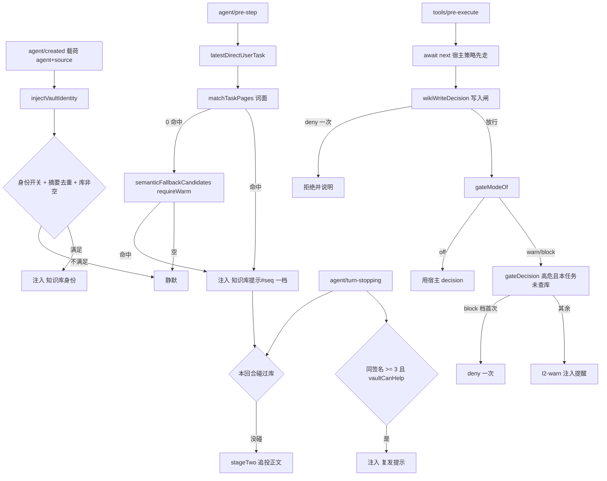
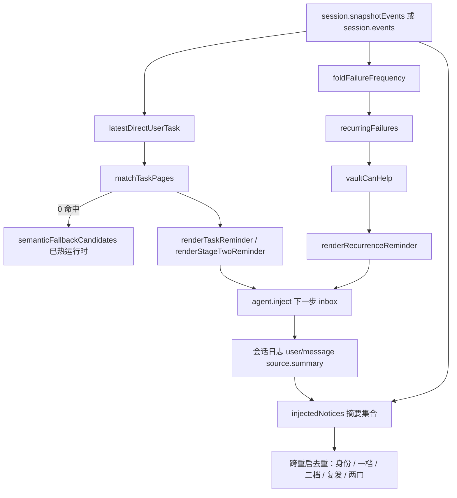

<details><summary>Relevant source files</summary>

- [src/trigger.ts](src/trigger.ts)
- [src/semantic-hits.ts](src/semantic-hits.ts)
- [src/vault-manager.ts](src/vault-manager.ts)
- [src/tools.ts](src/tools.ts)
- [trigger.test.mjs](trigger.test.mjs)

</details>

> 挖掘批次：能力挖掘原地重扫（2026-10-24，DSH 0.2 迁移后）。相对 2026-10-21 批次的实质变化：①**L0 库身份改挂 `agent/created`**（commit `c1451fd`）——DSH 0.2 的 `agent/*` 事件表没有 `session-start`，只挂 legacy 事件会「注册成功但永不触发」；②触发层四个入口行号整体漂移；③新增 L2 可观测日志（`event-register-failed` / `l2-status` / `l2-error`）；④L5 沉淀提醒确认「导出保留、零调用点」。

## 1. 概念定义

### 1.1 核心概念

| 概念 | 定义 | 为什么重要 |
|---|---|---|
| **主动触发** | agent 没主动调工具时，插件通过宿主钩子把知识递到模型眼前的能力 | 基线实测改库 1719 次 vs 读库 151 次，光靠 agent 自觉不够 |
| **L0 库身份** | 会话建立时注入「本会话绑哪个库、几页、索引在哪」 | 绑定错库会让后续所有提示答偏；L2 的高危路径集也依赖本会话的库 |
| **L1 一档** | 新任务词面/语义命中 → 注入 top-3（路径 + 命中词 + 摘要） | 提示存在但不含正文，成本低、可忽略 |
| **L1 二档** | 一档被忽略（那一整个回合没碰库）→ 追投 top-1 的**正文**（≤4800 字符） | 「被忽略」是最不容争议的度量；二档直接给正文，不再要求模型自己去读 |
| **L3 复发信号** | 同一失败签名在会话内累计 ≥3 次 → 提示「上次的办法没生效」 | 只认结构化失败证据，不认正文里出现的「error」字样 |
| **写入闸** | 未授权的知识库写入 deny 一次，重试即放行 | 「写入必须由用户决定」的硬约束，与 L5 移除配套 |
| **L2 改动门** | 改高危路径 + 本任务没查过库 → warn 注入或 block 一次 | 兜底：漏查之后别造成损失；是唯一会**打断**的一层 |
| **触发层日志** | `event-registered` / `l2-status` / `l2-warn` 等可观测出口 | 否则「钩子没注册上」与「注册了但没命中」在日志上完全同形，后者永远无法被证伪 |

### 1.2 领域概念

| 概念 | 说明 |
|---|---|
| **命中门槛** | `MIN_TERMS=2` 条 + `MIN_SCORE=1` 分，双双不满足则该页不入候选，一个字都不注入 |
| **泛词三折** | `GENERIC_TERMS={dsh,web,npm}` 在 df 权重之上再 ×0.3——小库里 `web` 的 df=1 会拿满权重，曾把宽相关页推进二档 4.8KB 正文 |
| **标题六折** | 只出现在小节标题里的词 ×`HEADING_ONLY_DISCOUNT`=0.6（「更新」「问题」这类结构性词是假阳性主要来源） |
| **语义兜底门** | `SEMANTIC_MIN_SCORE=0.35` + `requireWarm: true`：只接受**已热**运行时，冷启动不挂 pre-step |
| **库解析** | 按 `session.header.cwd` 只读解析本会话的库；给了 cwd 却解析不出就静默，不回退全局库 |
| **子代理门** | `KNJ_OBSIDIAN_TRIGGER_SUBAGENT=off` 时 `delegationDepth > 0` 的会话整层不触发 |
| **只读契约** | 触发层绝不写盘：不在没有 `.wiki` 的会话里凭空建库 |
| **失败签名** | `工具名::命令指纹::错误指纹`，数字被归一化成 `#` 以便跨运行匹配 |
| **注入去重键** | 落盘 `user/message.source.summary`：`知识库身份` / `知识库提示#<任务seq>` / `知识库提示全文#<任务seq>` / `复发提示#<短哈希>` |

## 2. 系统事实

### 2.1 系统事实

| 事实 | 值 | 来源 |
|---|---|---|
| 命中门槛常量 | `MIN_SCORE = 1`、`MIN_TERMS = 2`、`DEFAULT_MAX = 3`、`MAX_HITS_SHOWN = 4` | `src/trigger.ts:49-53` |
| 门槛判定点 | `matched.length < MIN_TERMS \|\| score < MIN_SCORE` → 该页直接丢弃 | `src/trigger.ts:137` |
| 词面打分三级 | Σ 命中词权重（`weightOf` 按 df 四档衰减）→ 泛词再 ×0.3 → 仅小节标题词再 ×0.6 | `src/trigger.ts:105-126`、`src/trigger.ts:181-184` |
| 生态泛词与折扣 | `GENERIC_TERMS = {dsh, web, npm}`、`GENERIC_TERM_DISCOUNT = 0.3` | `src/trigger.ts:119-120` |
| 语义兜底门槛 | `SEMANTIC_FALLBACK_LIMIT = 5`、`SEMANTIC_MIN_SCORE = 0.35`、`requireWarm: true` | `src/trigger.ts:204-206`、`src/trigger.ts:231` |
| 语义通道失败口径 | 开关关 / 未热 / 无模型 / 无索引 / 抛错 → 一律空数组，不抛错、不联网、不建索引 | `src/semantic-hits.ts:146-157` |
| 二档正文上限 | `STAGE_TWO_BODY_LIMIT = 4800` 字符 | `src/trigger.ts:300` |
| L3 复发门槛 | `RECURRENCE_THRESHOLD = 3`；只折叠最近 `RECURRENCE_SCAN_LIMIT = 400` 条 `tool/result`，指纹上限 `FAILURE_TOKEN_LIMIT = 140` | `src/trigger.ts:554-558` |
| L3 每回合注入上限 | `RECURRENCE_INJECT_LIMIT = 2` | `src/trigger.ts:819` |
| L3 说话前置 | `vaultCanHelp` 用失败指纹当查询串检索一次库，无命中即沉默 | `src/trigger.ts:745-753` |
| **L0 注册事件** | `agent/created`（0.2 真实事件，载荷 `{ agent, source }`）**与** `agent/session-start`（0.1.x legacy）双挂 | `src/trigger.ts:1468-1469` |
| L0 注入体 | `injectVaultIdentity`：总开关/子代理门 → 身份开关 → 摘要去重 → 会话库解析 → 页数 0 静默 → `await createNotice` | `src/trigger.ts:1449-1462` |
| L0 身份摘要 | `VAULT_IDENTITY_SUMMARY = '知识库身份'`（跨重启去重键） | `src/trigger.ts:1671` |
| 触发层总开关 | `KNJ_OBSIDIAN_TRIGGER=off` → `triggerEnabled` 返回 false，L0/L1/L3 全关 | `src/trigger.ts:328-330` |
| 分层开关 | `KNJ_OBSIDIAN_TRIGGER_RECURRENCE=off`、`KNJ_OBSIDIAN_TRIGGER_FULLTEXT=off`、`KNJ_OBSIDIAN_TRIGGER_SUBAGENT=off`、`KNJ_OBSIDIAN_VAULT_IDENTITY=off` | `src/trigger.ts:333-343`、`src/trigger.ts:1162-1164`、`src/trigger.ts:1191-1193` |
| `shutdownCheck` 三条短路 | 总开关关 / `agent.inject` 不存在 / 子代理且 `delegationDepth > 0` | `src/trigger.ts:1424-1429` |
| 写入闸档位与默认 | `KNJ_OBSIDIAN_WRITE_GATE=ask\|block` 才启用，默认 off；只拦 `VAULT_WRITE_TOOL_NAMES = {wiki_capture, wiki_ingest}` | `src/trigger.ts:1017-1022`、`src/trigger.ts:1028` |
| L2 改动门档位与默认 | `KNJ_OBSIDIAN_GATE=warn\|block` 才启用，默认 off | `src/trigger.ts:894-898` |
| L2 高危硬编码集 | 6 条：`migrations` / `.github/workflows` / `Dockerfile\|docker-compose` / `deploy\|release\|publish` / `AGENTS\|CLAUDE\|SKILL.md` / `auth*` | `src/trigger.ts:908-915` |
| L2 库内高危集 | 同一路径被 ≥`VAULT_PATH_MIN_PAGES = 2` 个页面提到才入集，最多 `VAULT_PATH_LIMIT = 64` 条 | `src/trigger.ts:925-927` |
| 两门的判定顺序 | 先写入闸 `wikiWriteDecision`，再 `gateModeOf` / `gateDecision`——前者不受 `KNJ_OBSIDIAN_GATE` 影响 | `src/trigger.ts:1597-1601` |
| L2 可观测 | 注册成功/失败记 `event-registered`/`event-register-failed`；每次 apply 记一行 `l2-status`；命中记 `l2-warn`/`l2-block`；异常记 `l2-error` | `src/trigger.ts:1432-1442`、`src/trigger.ts:1607-1612`、`src/trigger.ts:1658-1661` |
| 跨重启去重 | 按落盘摘要判定，摘要带任务 seq（`taskSummaryOf` / `fullTextSummaryOf`） | `src/trigger.ts:1119-1121`、`src/trigger.ts:1135-1147` |
| 注入消息的 source.kind | 必须是 producer-owned 的 `PLUGIN_ID`；旧写法 `kind: 'plugin'` 在会话 V4 的物理行准入会被拒、整回合失败 | `src/trigger.ts:1387-1392` |
| `consultedThisTask` 的更新时机 | 只在 `agent/turn-stopping` 折叠时置位，`tools/pre-execute` 只读它——同一回合内先改后查不会立刻开闸 | `src/trigger.ts:1510-1511`、`src/trigger.ts:1651` |
| L5 沉淀提醒现状 | 整体移除：`renderCaptureReminder` / `shouldRemindCapture` / `foldTurnFacts` / `CAPTURE_SUMMARY` 保留导出但**零调用点** | `src/trigger.ts:1541-1548` |
| 会话级库解析 | 有 cwd → `readonlyVaultForRoot` 只读解析，解析不出返回 undefined；仅无 cwd 才回退 provider 当前库 | `src/trigger.ts:1233-1277` |
| 只读解析实现 | 三级：已注册库根 → 向上找最近 `.wiki` → 磁盘存在的未注册根；零 `ensure()`/`mkdir`/写注册表 | `src/vault-manager.ts:219-232` |
| 写入型工具注册处 | `wiki_ingest`、`wiki_capture`——与 `VAULT_WRITE_TOOL_NAMES` 一一对应 | `src/tools.ts:318-319`、`src/tools.ts:473-474` |

### 2.2 数据事实

| 数据 | 位置 / 形态 |
|---|---|
| 会话事件源 | `session.snapshotEvents()`，未实现时回退 `session.events`（`src/trigger.ts:1365-1370`） |
| 会话级状态 | 进程内 `WeakMap<session, TriggerState>`：`lastTaskSeq` / `stageOne` / `hintedFailures` / `consultedThisTask` / `gateWarnedFor` / `gateDeniedFor` / `writeAuthorized` / `writeGateWarned`（`src/trigger.ts:1345-1362`） |
| 提示注入通道 | `agent.inject(createUserMessage(...))` → 落到**下一步** inbox；`agent.inject?` 可能不存在（退化即整层关闭） |
| 去重数据源 | 会话日志里的 `user/message.data.source.summary`（三种历史 kind 形态都认，`src/trigger.ts:1095-1116`） |
| 库根 | `VaultStore.wikiRoot` 只读属性（`src/trigger.ts:270-273`） |
| 语义检索范围 | 由 `collectionIdOf(vaultRoot)` 限定到本库 collection，避免全局索引串库（`src/semantic-hits.ts:146-157`） |
| L2 高危路径集 | 每次判定现算、不落盘：`highRiskPathsFromVault`（`src/trigger.ts:945-971`） |

## 3. 功能树与入口映射

### 3.1 功能模块结构

```
主动触发层（src/trigger.ts）
├─ L0 库身份        agent/created + agent/session-start
│  └─ injectVaultIdentity → resolveSessionVault → renderVaultIdentity
├─ L1 一档提示      agent/pre-step（新任务 seq 命中）
│  ├─ matchTaskPages               词面：MIN_TERMS=2 + MIN_SCORE=1
│  └─ semanticFallbackCandidates   0 命中兜底：requireWarm
├─ L1 二档正文      agent/turn-stopping → stageTwo（≤4800 字符）
├─ L3 复发信号      agent/turn-stopping（签名 ≥3 且库里有对症页）
│  └─ foldFailureFrequency → recurringFailures → vaultCanHelp
├─ 写入闸 + L2 改动门  tools/pre-execute（两个独立口径，默认都 off）
│  ├─ wikiWriteDecision   管「写库必须由用户决定」
│  └─ gateDecision        管「改高危文件前先查库」
└─ 共用
   ├─ shutdownCheck     总开关 + inject 能力 + 子代理策略
   ├─ injectedNotices   跨重启去重（读落盘摘要）
   └─ log / TriggerLog  可观测出口
```

### 3.2 入口映射表

| 入口 | 类型 | 必填 / 载荷 | 内核 | 文件:行 |
|---|---|---|---|---|
| `agent/created` | hook | `{ agent, source }`（宿主 `ctx.serial` 等待型） | `injectVaultIdentity` | `src/trigger.ts:1468` |
| `agent/session-start` | hook | legacy 0.1.x | `injectVaultIdentity` | `src/trigger.ts:1469` |
| `agent/pre-step` | hook | `next()` waterfall | L1 一档 | `src/trigger.ts:1472` |
| `agent/turn-stopping` | hook | — | `stageTwo` + L3 复发 | `src/trigger.ts:1502` |
| `tools/pre-execute` | hook | `exec, next()` waterfall | 写入闸 → L2 改动门 | `src/trigger.ts:1593` |

### 3.3 使用场景

| 场景 | 触发层动作 |
|---|---|
| 新会话 / resume / clear / compaction 进入某工作区 | L0 注入库身份（库名 + 页数 + 根 + 索引路径），摘要去重保证每会话一条 |
| 用户发了新任务且命中库内页 | L1 一档注入 top-3（路径 + 命中词 + 摘要） |
| 新任务字面 0 命中但语义相关、运行时已热 | L1 一档改走语义候选（标注［语义］） |
| 上一条提示被无视、那一回合完全没碰库 | L1 二档追投 top-1 正文（≤4800 字符） |
| 同一错误第 3 次出现且库里有对症页 | L3 提示「上次的办法没生效」+ 两个出口 |
| 模型在未授权时调 `wiki_ingest`/`wiki_capture` | 写入闸 deny 一次（同时记 `writeAuthorized`，重试即放行） |
| 模型要改 migrations/ 或库内多页提到的路径、本任务没查过库 | L2：warn 档注入提醒；block 档拦一次，重试放行 |

## 4. 调用链路总结

### 4.1 主链路图



### 4.2 分通道详细流程

**L0 库身份**（注册于 `src/trigger.ts:1468-1469`，注入体 `src/trigger.ts:1449-1462`）：

```
agent/created（0.2 真实事件）或 agent/session-start（0.1.x legacy）
→ shutdownCheck：总开关 / agent.inject / 子代理深度
→ vaultIdentityEnabled（KNJ_OBSIDIAN_VAULT_IDENTITY）
→ injectedNotices(events).has(VAULT_IDENTITY_SUMMARY) → 已注入则 return
→ resolveSessionVault(provider, sessionCwdOf(session)) → 解析不出或 pageCount === 0 → 静默
→ agent.inject(await createNotice(renderVaultIdentity(identity), '知识库身份'))
```

> 为什么两个事件都注册（`src/trigger.ts:1464-1469`）：DSH 0.2.1-rc.2 的 `agent/*` 事件表是 created / disposed / status / pre-step / turn-stopping 等，**没有 session-start**；而 `ctx.on` 不校验事件名，只挂 legacy 事件会「注册成功但永不触发」。实测证据：同一工作区两个会话的「知识库身份」注入计数都是 0，而 L1 提示正常。已对照宿主 0.2 的类型声明核实：`agent/created` 载荷 `{ agent, source: SessionStartSource, signal? }`，`agent/pre-step` / `agent/turn-stopping` 均在，`agent/session-start` 不在。
>
> `agent/created` 在 fresh creation / resume / clear / compaction 都会发（`source` 区分来源），所以「每会话一次」不能靠事件本身保证，靠的是摘要去重。测试 `trigger.test.mjs` 的 L0 用例（第 650–686 行）断言三件事：`agent/created` 存在且能注入、legacy 事件仍注册、resume 时日志已有身份块则不再注入。

**如何验证真的触发了**（不是「注册成功」）：①启动日志里应有一行 `event-registered` 带 `event: 'agent/created'`（`src/trigger.ts:1435`）；②会话日志里应有 `user/message` 且 `source.kind === 'dsh-knj-obsidian'`、`source.summary === '知识库身份'`（`src/trigger.ts:1102-1116`），条数就是注入计数，正常每会话 1 条；③若 V4 会话里 `source.kind` 写错，物理行准入直接拒写、整回合失败（`src/trigger.ts:1387-1392`）。

**L1 一档**（`src/trigger.ts:1472-1500`）：

```
await next()（waterfall：先走宿主自己的 pre-step）
→ shutdownCheck
→ latestDirectUserTask：只认 user/message 且 source.kind === 'user'（防自激）
→ state.lastTaskSeq 去重（同一任务只匹配一次，不论是否命中）
→ 重置 L2 的 consultedThisTask / gateWarnedFor / gateDeniedFor
→ injectedNotices 有 taskSummaryOf(task.seq) → return（跨重启去重）
→ currentVault：解析不出则静默
→ matchTaskPages（词面）→ 0 命中则 semanticFallbackCandidates（requireWarm）
→ 仍空则 return；记 state.stageOne（top-1 备二档用）
→ agent.inject(renderTaskReminder(hits), 知识库提示#seq)
```

**L1 二档**（`stageTwo`，`src/trigger.ts:1558-1584`）：

```
fullTextStageEnabled()（KNJ_OBSIDIAN_TRIGGER_FULLTEXT 默认开）
→ state.stageOne 存在 → turn 非空
→ latestNoticeByPrefix(知识库提示#)：取一档那条注入记录
→ turn > injectedTurn（同回合追投等于没给模型机会）
→ fullTextSummaryOf 已注入则 return
→ foldHintOutcome(turnToolCalls(events, turn))：本回合碰过库就 return
→ readPage(stageOne.top) → renderStageTwoReminder（正文截断到 4800）
→ 注入后清空 state.stageOne
```

**L3 复发**（`src/trigger.ts:1502-1552`，阈值与判据在 `src/trigger.ts:554-558`）：

```
recurrenceEnabled() 且本会话有库
→ recurringFailures(events, state.hintedFailures)：count >= 3 且本会话未提示过
→ foldFailureFrequency：全会话（不按回合切）签名计数
→ 逐个签名 vaultCanHelp：无对症页也记入 hintedFailures（否则每回合重扫全库）
→ 最多注入 RECURRENCE_INJECT_LIMIT = 2 条 renderRecurrenceReminder
```

**写入闸 / L2 改动门**（`src/trigger.ts:1593-1610`）：

```
await next()（必须先调宿主：waterfall 直接返回会跳过宿主权限/沙箱策略）
→ shutdownCheck
→ wikiWriteDecision（写入闸）：mode off / 非 wiki_* 写入工具 / 无库 / 已 writeAuthorized → 放行；
   否则置 writeAuthorized=true，ask 档先注入一次提醒，返回 { kind: 'deny' }
→ gateModeOf() 为 off → 用宿主 decision
→ gateDecision（L2）：非 mutation 工具 / 无路径 / 无库 / consultedThisTask / 非高危 / 同路径已提醒 → 放行；
   block 档且该路径未被 deny 过 → deny 一次；其余 → l2-warn + 注入提醒
→ 任何异常：记 l2-error 后返回宿主 decision（触发层是增益，不是依赖）
```

### 4.3 数据与存储关系



## 5. 附录

### 5.1 术语表

| 术语 | 含义 |
|---|---|
| 一档 / 二档 | L1 的两级（提示文本 / 追投正文） |
| 跟进率 | 一档注入后 ≤2 步内是否读/查了提示页（≥50% 为目标） |
| 失败签名 | `工具名::命令指纹::错误指纹`，数字归一化为 `#` |
| requireWarm | 只接受已加载的语义运行时，冷启动不挂 pre-step |
| writeAuthorized | 本会话已被判为授权写库（首次受限调用即置位，重试放行） |
| consultedThisTask | 本任务之后是否碰过库；新任务在 pre-step 重置，在 turn-stopping 置位 |
| producer-owned kind | 会话 V4 要求 `user/message.source.kind` 是插件自有标识而非 `'plugin'` |

### 5.2 参考资料

- [[知识库读取触发层设计]] — 五层结构与默认开关、验收指标
- [[会话级知识库绑定]] — 答偏的两条路径与只读解析修法
- [[知识库写入侧零推动]] — 写入闸存在的理由与 L5 移除决策
- [[失败复发检测信号]] — L3 签名判据与假阳性修复
- [[dsh-插件宿主接口契约]] — 钩子与事件结构；注意其 `agent/session-start` 条目是 0.1.x 口径
- [[插件验证纪律与实测陷阱]] — 「注册成功但永不触发」这类静默失败的验证方法
- [[capability-知识检索]] — 触发层最终把流量引向的检索面

## 任务问法

（这页应该回答的问题——问答式与任务式都要收）

```queries
主动触发层为什么把库身份挂在 agent/created 上
触发层的命中门槛是多少
L1 一档和二档有什么区别
库身份注入了却看不到是什么原因
改触发层的命中门槛要动哪里
新增一层触发要接哪个钩子
```

## Sources

- `src/trigger.ts:49-53`（`MIN_SCORE` / `MIN_TERMS` / `DEFAULT_MAX` / `MAX_HITS_SHOWN` 四个门槛常量）
- `src/trigger.ts:105-110`（`weightOf` 的文档频率四档衰减）
- `src/trigger.ts:119-126`（`GENERIC_TERMS` 三折与 `HEADING_ONLY_DISCOUNT` 六折）
- `src/trigger.ts:129-142`（`lexicalHitsOf` 的打分与 `MIN_TERMS` 判定）
- `src/trigger.ts:150-201`（`matchTaskPages` 两遍扫描与同分按 id 排序）
- `src/trigger.ts:204-206`（`SEMANTIC_FALLBACK_LIMIT = 5` / `SEMANTIC_MIN_SCORE = 0.35`）
- `src/trigger.ts:219-255`（`semanticFallbackCandidates` 的 `requireWarm` 兜底）
- `src/trigger.ts:276-300`（`renderTaskReminder` / `renderStageTwoReminder` / `STAGE_TWO_BODY_LIMIT = 4800`）
- `src/trigger.ts:328-343`（`triggerEnabled` / `recurrenceEnabled` / `fullTextStageEnabled` 三个开关）
- `src/trigger.ts:401-413`（`latestDirectUserTask` 只认 `source.kind === 'user'`）
- `src/trigger.ts:513-523`（`foldHintOutcome` 的二档判据）
- `src/trigger.ts:554-558`（`RECURRENCE_THRESHOLD = 3` / `RECURRENCE_SCAN_LIMIT` / `FAILURE_TOKEN_LIMIT`）
- `src/trigger.ts:623`（`failureSignatureOf` 失败签名）
- `src/trigger.ts:721-733`（`foldFailureFrequency` 全会话计数）
- `src/trigger.ts:745-753`（`vaultCanHelp` 库里没有对症页则沉默）
- `src/trigger.ts:764-795`（`recurrenceHintOf` / `mergeCjkTokens` 查询串构造）
- `src/trigger.ts:804-819`（`recurringFailures` / `RECURRENCE_INJECT_LIMIT = 2`）
- `src/trigger.ts:894-898`（`gateModeOf` 默认 off）
- `src/trigger.ts:907-922`（`HIGH_RISK_PATTERNS` 六条与 `isHardcodedHighRisk`）
- `src/trigger.ts:925-927`（`VAULT_PATH_MIN_PAGES = 2` / `VAULT_PATH_LIMIT = 64`）
- `src/trigger.ts:945-971`（`highRiskPathsFromVault` 只读取路径）
- `src/trigger.ts:983-999`（`isHighRiskTarget` / `isMutationCall`）
- `src/trigger.ts:1017-1028`（`writeGateModeOf` / `VAULT_WRITE_TOOL_NAMES`）
- `src/trigger.ts:1119-1121`（`injectedNotices` 跨重启去重）
- `src/trigger.ts:1135-1147`（`TASK_SUMMARY_PREFIX` / `FULLTEXT_SUMMARY_PREFIX` 与摘要构造函数）
- `src/trigger.ts:1162-1178`（`subagentTriggerEnabled` / `delegationDepthOf` / `sessionCwdOf`）
- `src/trigger.ts:1191-1206`（`vaultIdentityEnabled` / `renderVaultIdentity`）
- `src/trigger.ts:1233-1277`（`resolveSessionVault` 会话 cwd 优先）
- `src/trigger.ts:1372-1393`（`installTrigger` 与 `createNotice` 的 producer-owned `PLUGIN_ID`）
- `src/trigger.ts:1424-1442`（`shutdownCheck` / `register` 的失败留痕）
- `src/trigger.ts:1449-1462`（`injectVaultIdentity` 注入体）
- `src/trigger.ts:1468-1469`（`agent/created` 与 legacy `agent/session-start` 双注册）
- `src/trigger.ts:1472-1500`（`agent/pre-step` 的 L1 一档）
- `src/trigger.ts:1502-1552`（`agent/turn-stopping` 的二档与 L3、L5 已移除注释）
- `src/trigger.ts:1558-1584`（`stageTwo` 二档追投）
- `src/trigger.ts:1593-1612`（`tools/pre-execute` 两门与 `l2-status`）
- `src/trigger.ts:1622-1637`（`wikiWriteDecision` 写入闸）
- `src/trigger.ts:1644-1664`（`gateDecision` 与 `l2-warn`）
- `src/trigger.ts:1671`（`VAULT_IDENTITY_SUMMARY = '知识库身份'`）
- `src/semantic-hits.ts:146-157`（`semanticRawHits` 的 `requireWarm` 分支）
- `src/semantic-hits.ts:84`（`semanticRuntimeFor` 按库缓存运行时）
- `src/vault-manager.ts:219-232`（`readonlyVaultForRoot` 三级解析零写盘）
- `src/tools.ts:473-474`（`wiki_capture` 工具注册，写入闸的拦截对象）

```sources
[
  {"path":"src/trigger.ts","hash":"sha256:c1390e53930ce977","symbols":["installTrigger","injectVaultIdentity","shutdownCheck","resolveSessionVault","matchTaskPages","MIN_SCORE","MIN_TERMS","RECURRENCE_THRESHOLD","RECURRENCE_INJECT_LIMIT","gateModeOf","writeGateModeOf","VAULT_WRITE_TOOL_NAMES","injectedNotices","stageTwo"]},
  {"path":"src/semantic-hits.ts","hash":"sha256:c567bbcc9252c5ab","symbols":["semanticRawHits","semanticRuntimeFor","requireWarm"]},
  {"path":"src/vault-manager.ts","hash":"sha256:893434304cf07940","symbols":["readonlyVaultForRoot"]},
  {"path":"src/tools.ts","hash":"sha256:750e59e1f739ed94","symbols":["wiki_capture","wiki_ingest"]}
]
```

