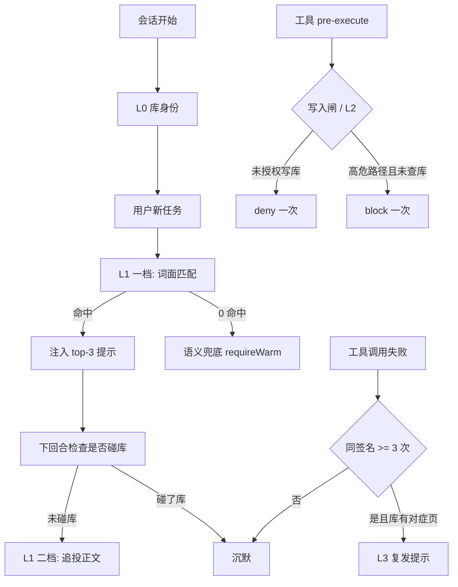
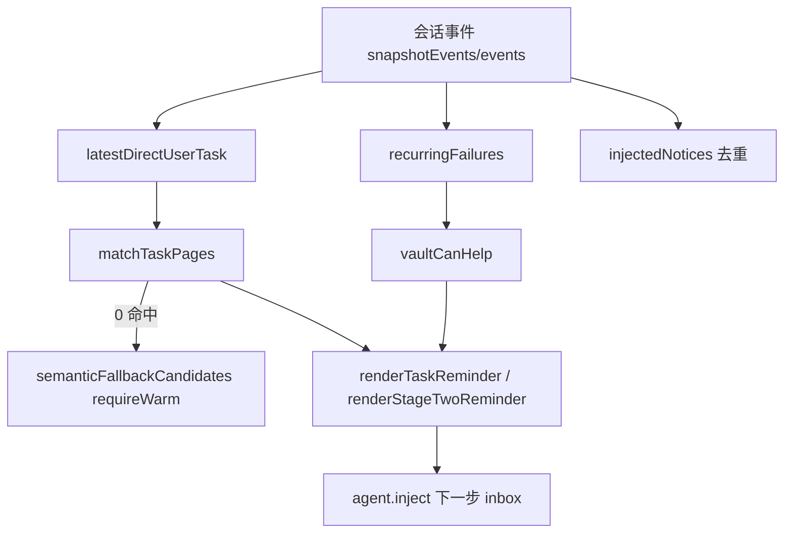

<details><summary>Relevant source files</summary>

- [src/trigger.ts](src/trigger.ts)
- [src/semantic-hits.ts](src/semantic-hits.ts)
- [src/vault-manager.ts](src/vault-manager.ts)
- [src/tools.ts](src/tools.ts)
- [src/types.ts](src/types.ts)

</details>

> 挖掘批次：能力挖掘重扫（2026-10-20）。本轮纠正两处：①L3 复发门槛是**≥ 3 次**（`RECURRENCE_THRESHOLD = 3`），旧版写的「≥2 次」是错的；②`tools/pre-execute` 上挂着**两个不同口径的门**（写入闸 / L2 合取门），旧版把它们合并成了一个「L2 写入闸」。

## 1. 概念定义

### 1.1 核心概念

| 概念 | 定义 | 为什么重要 |
|---|---|---|
| **主动触发** | agent 没主动调工具时，插件通过宿主钩子注入提示的能力 | 基线实测：改库 1719 次 vs 读库 151 次，光靠 agent 自觉不够 |
| **L0 库身份** | 会话开始注入「这个会话绑哪个库」 | 绑定错库会让后续所有提示都答偏 |
| **L1 一档** | 新任务词面命中时注入 top-3（标题 + 命中词 + 摘要） | 提示存在但不含正文，成本低 |
| **L1 二档** | 一档被忽略（那回合完全没碰库）→ 追投正文（≤4800 字符） | 「被忽略」= 塔的免费度量 |
| **L3 复发信号** | 同一失败签名累计 ≥3 次出现 → 提示「上次的办法没生效」 | 只认结构化证据，不认退出码猜测 |
| **写入闸** | 知识库写入工具未授权时 deny 一次 | 「写入必须由用户决定」的硬约束 |
| **L2 合取门** | 改高危路径 + 本任务未查过库 → block 一次 | 兜底：漏了之后别造成损失 |

### 1.2 领域概念

| 概念 | 说明 |
|---|---|
| **命中门槛** | `MIN_TERMS=2` + `MIN_SCORE=1`，不足则一个字都不注入 |
| **语义兜底门** | `SEMANTIC_MIN_SCORE=0.35` + `requireWarm: true` |
| **库解析** | 按会话 `header.cwd` 只读解析（`resolveSessionVault`），解析不出则静默 |
| **子代理开关** | `KNJ_OBSIDIAN_TRIGGER_SUBAGENT=off` 收敛子代理触发 |
| **只读契约** | 触发层绝不写盘（不在会话开始时凭空建 `.wiki`） |
| **失败签名** | `工具名::命令指纹::错误指纹` |

## 2. 系统事实

### 2.1 系统事实

| 事实 | 值 | 来源 |
|---|---|---|
| 命中门槛 | `MIN_SCORE = 1`、`MIN_TERMS = 2`、`DEFAULT_MAX = 3` | `src/trigger.ts:49-51` |
| 门槛判定点 | `matched.length < MIN_TERMS \|\| score < MIN_SCORE` → 不入候选 | `src/trigger.ts:137` |
| 词面打分三级修正 | ① Σ 命中词权重（按文档频率 df 衰减）→ ② **生态泛词再打三折** → ③ 与 `MIN_SCORE` 比较 | `src/trigger.ts:150-190` |
| 生态泛词集 | `GENERIC_TERMS = {dsh, web, npm}`、`GENERIC_TERM_DISCOUNT = 0.3` | `src/trigger.ts:119-120` |
| 泛词折扣应用点 | `weightOf(df) ×（GENERIC_TERMS.has(t) ? 0.3 : 1）` | `src/trigger.ts:182` |
| 语义兜底阈值 | `SEMANTIC_MIN_SCORE = 0.35` | `src/trigger.ts:206` |
| 语义兜底是否接受冷启动 | **否**（`requireWarm: true`，冷启动几十秒绝不挂 pre-step） | `src/trigger.ts:231` |
| 二档正文上限 | `STAGE_TWO_BODY_LIMIT = 4800` 字符 | `src/trigger.ts:300` |
| L3 复发门槛 | `RECURRENCE_THRESHOLD = 3`（同一签名第 3 次才提示） | `src/trigger.ts:554` |
| L3 每回合注入上限 | `RECURRENCE_INJECT_LIMIT = 2` | `src/trigger.ts:819` |
| 写入闸默认 | **off**（`KNJ_OBSIDIAN_WRITE_GATE=ask\|block` 才启用） | `src/trigger.ts:1018` |
| 写入闸覆盖的工具 | 仅 `wiki_capture` / `wiki_ingest` | `src/trigger.ts:1028` |
| L2 合取门默认 | **off**（`KNJ_OBSIDIAN_GATE=warn\|block` 才启用） | `src/trigger.ts:894` |
| L2 高危路径硬编码集 | migrations / .github/workflows / Dockerfile|compose / deploy|release|publish / AGENTS|CLAUDE|SKILL.md | `src/trigger.ts:908-913` |
| 存储依赖 | 只读（不 ensure、不建目录） | `src/vault-manager.ts:204` |
| 跨重启去重 | 按注入摘要（带任务 seq）判定，已在日志里就不再注入 | `src/trigger.ts:1402`、`src/trigger.ts:1427` |
| 注入的静默失败 | `createNotice` 是 async，漏 await 会把 Promise 当消息注入（宿主签名同步，不报错） | `src/trigger.ts:1393-1395` |
| L5 沉淀提醒 | **已移除**（2026-10-13 用户决策）；相关导出保留但无调用点 | `src/trigger.ts:1481-1488` |

### 2.2 数据事实

| 数据 | 位置 / 形态 |
|---|---|
| 会话事件 | 宿主 `session.snapshotEvents()` 或 `session.events`（双探测） |
| 提示注入 | `agent.inject(createUserMessage(...))` → `agent.inject?` 可能不存在 |
| 未命中上下文 | 单任务只匹配一次（`state.lastTaskSeq`） |
| 会话级开关状态 | `WeakMap<session, TriggerState>`（`gateWarnedFor` / `writeAuthorized` 等） |

## 3. 功能树与入口映射

### 3.1 功能模块结构

```
主动触发层
├─ L0 库身份        agent/session-start
├─ L1 一档提示      agent/pre-step（新任务命中）
├─ L1 二档正文      agent/turn-stopping → stageTwo
├─ L3 复发信号      agent/turn-stopping（签名 ≥3）
├─ 写入闸 + L2 合取门  tools/pre-execute（两个开关，默认都 off）
└─ 共用
    ├─ resolveSessionVault          按会话 cwd 只读解析库
    ├─ matchTaskPages               词面匹配（MIN_TERMS=2；打分含 df 衰减 × 泛词三折）
    ├─ semanticFallbackCandidates   字面 0 命中时的语义兜底（requireWarm）
    └─ shutdownCheck                开关 + 子代理策略的统一门
```

### 3.2 入口映射表

| 钩子 | 层 | 何时触发 | 实现位置 |
|---|---|---|---|
| `agent/session-start` | L0 库身份 | 会话开始，库非空 | `src/trigger.ts:1396` |
| `agent/pre-step` | L1 一档 | 新任务 seq，每任务一次 | `src/trigger.ts:1412` |
| `agent/turn-stopping` | L1 二档 + L3 | 一档被忽略 / 签名计数 ≥3 | `src/trigger.ts:1442` |
| `tools/pre-execute` | 写入闸 + L2 | 默认都 off，显式 opt-in | `src/trigger.ts:1533` |

### 3.3 使用场景

| 场景 | 触发层动作 |
|---|---|
| 新会话进入某工作区 | L0 注入库身份（库名+页数+根+索引路径） |
| 用户发了新任务且命中库内页 | L1 一档注入 top-3 提示 |
| 上一条提示被无视、那回合没碰库 | L1 二档追投正文（≤4800 字符） |
| 同一错误第 3 次出现且库里有对症页 | L3 提示「上次的办法没生效」 |
| 模型在未授权时调 `wiki_ingest` | 写入闸 deny 一次（重试即放行） |
| 模型要改 migrations/ 且本任务没查过库 | L2（`block` 档）拦一次，再试即放行 |

## 4. 调用链路总结

### 4.1 主链路图



### 4.2 分通道详细流程

**L1 一档**（`src/trigger.ts:1412`）：

```
await next() → shutdownCheck（开关/子代理/注入能力）
→ latestDirectUserTask（取最近一条直接用户任务，src/trigger.ts:401）
→ state.lastTaskSeq 去重（同任务只匹配一次，src/trigger.ts:1420）
→ 重置 L2 的 consultedThisTask / gateWarnedFor（src/trigger.ts:1423-1425）
→ injectedNotices 去重（跨重启，src/trigger.ts:1427）
→ currentVault(session)（解析不出则静默）
→ matchTaskPages（词面，MIN_TERMS=2 + MIN_SCORE=1，src/trigger.ts:150）
   打分三级：Σ 命中词权重（df 衰减）→ 泛词（dsh/web/npm）再 ×0.3 → 比 MIN_SCORE（src/trigger.ts:182）
→ 0 命中则 semanticFallbackCandidates（requireWarm，src/trigger.ts:219）
→ 记 state.stageOne → 注入 renderTaskReminder(hits)
```

**L1 二档**（`src/trigger.ts:1498`）：

```
stageOne 存在 → turn 非空 → 找到一档 notice
→ turn > injectedTurn（同回合追投等于噪音）
→ 未追投过（按摘要去重）→ 本回合未碰库（foldHintOutcome）
→ readPage(stageOne.top) → renderStageTwoReminder（≤4800 字符）
```

**L3 复发**（`src/trigger.ts:1456-1479`）：

```
recurringFailures(events, hintedFailures)（count >= RECURRENCE_THRESHOLD=3，src/trigger.ts:804）
→ foldFailureFrequency 计数
→ vaultCanHelp(store, signature)（库里有对症页才提示，src/trigger.ts:745）
→ 每个签名先记入 hintedFailures（库帮不上也记，否则每回合重扫全库）
→ 注入 renderRecurrenceReminder，最多 RECURRENCE_INJECT_LIMIT=2 条
```

**写入闸 / L2**（`src/trigger.ts:1533`）：

```
先 await next()（waterfall：跳过会绕开宿主权限/沙箱策略）
→ wikiWriteDecision（mode=off 直接放行；只拦 wiki_capture/wiki_ingest；writeAuthorized 后不再拦）
→ mode = gateModeOf()；off 直接放行
→ gateDecision（仅 mutation 调用 + 高危路径 + 本任务未查库；同路径本任务不反复说；block 档拦一次）
→ 任何异常都返回宿主 decision（触发层是增益，不是依赖）
```

### 4.3 数据与存储关系



## 5. 附录

### 5.1 术语表

| 术语 | 含义 |
|---|---|
| 一档 / 二档 | L1 的两级（提示文本 / 追投正文） |
| 跟进率 | 一档注入后 ≤2 步内是否读/查了提示页（≥50% 为目标） |
| 失败签名 | `工具名::命令指纹::错误指纹` |
| requireWarm | 只接受已加载的语义运行时，冷启动不挂 pre-step |
| writeAuthorized | 本会话已授权写库（放行一次即视为授权） |

### 5.2 参考资料

- [[知识库读取触发层设计]] — 五层结构与默认开关、验收指标
- [[会话级知识库绑定]] — 答偏的两条路径与只读解析修法
- [[知识库写入侧零推动]] — 写入闸存在的理由（L5 已移除）
- [[失败复发检测信号]] — L3 签名判据与假阳性修复
- [[capability-知识检索]] — 触发层最终把流量引向的检索面

## 任务问法

（这页应该回答的问题——问答式与任务式都要收）

```queries
agent 不主动查库怎么办
L1 一档和二档是什么
触发层的命中门槛是多少
库身份注入是什么
改触发层的命中门槛
关掉某一层触发
```

## Sources

- `src/trigger.ts:49-51`（MIN_SCORE / MIN_TERMS / DEFAULT_MAX 门槛常量）
- `src/trigger.ts:137`（`MIN_TERMS` / `MIN_SCORE` 门槛判定点）
- `src/trigger.ts:150`（matchTaskPages）
- `src/trigger.ts:119-120`（GENERIC_TERMS / GENERIC_TERM_DISCOUNT：生态泛词三折）
- `src/trigger.ts:182`（泛词折扣应用点：weightOf × GENERIC_TERM_DISCOUNT）
- `src/trigger.ts:206`（SEMANTIC_MIN_SCORE = 0.35）
- `src/trigger.ts:219-255`（semanticFallbackCandidates：requireWarm 语义兜底）
- `src/trigger.ts:300`（STAGE_TWO_BODY_LIMIT = 4800）
- `src/trigger.ts:401`（latestDirectUserTask）
- `src/trigger.ts:554`（RECURRENCE_THRESHOLD = 3）
- `src/trigger.ts:745`（vaultCanHelp）
- `src/trigger.ts:804-816`（recurringFailures）
- `src/trigger.ts:819`（RECURRENCE_INJECT_LIMIT = 2）
- `src/trigger.ts:894-898`（gateModeOf：默认 off）
- `src/trigger.ts:908-913`（`HIGH_RISK_PATTERNS` 高危路径硬编码集）
- `src/trigger.ts:1017-1028`（writeGateModeOf 默认 off / VAULT_WRITE_TOOL_NAMES）
- `src/trigger.ts:1328-1390`（installTrigger 装配与 register 包装）
- `src/trigger.ts:1375-1380`（shutdownCheck：开关 + 子代理门）
- `src/trigger.ts:1396-1409`（`register('agent/session-start')` L0 库身份注入）
- `src/trigger.ts:1412-1440`（`register('agent/pre-step')` L1 一档：任务去重 + 词面/语义匹配 + 注入）
- `src/trigger.ts:1442-1492`（`register('agent/turn-stopping')` 二档入口 + L3 复发）
- `src/trigger.ts:1481-1488`（L5 已移除的决策记录：纯注释区间，无可核对符号）
- `src/trigger.ts:1498-1524`（stageTwo 二档追投）
- `src/trigger.ts:1533-1597`（`register('tools/pre-execute')` 写入闸 + L2 合取门）
- `src/trigger.ts:1213-1256`（resolveSessionVault：按会话 cwd 只读解析）
- `src/semantic-hits.ts:146`（semanticRawHits：触发层语义入口）
- `src/semantic-hits.ts:84`（semanticRuntimeFor：按库缓存 + 失败冷却窗）
- `src/vault-manager.ts:204`（readonlyVaultForRoot：零写盘实现）

```sources
[
  {"path":"src/trigger.ts","hash":"sha256:0a4e578f19985416","symbols":["installTrigger","resolveSessionVault","semanticFallbackCandidates","MIN_TERMS","GENERIC_TERMS","GENERIC_TERM_DISCOUNT","shutdownCheck","writeGateModeOf","gateModeOf"]},
  {"path":"src/semantic-hits.ts","hash":"sha256:c567bbcc9252c5ab","symbols":["semanticRawHits","semanticRuntimeFor"]},
  {"path":"src/vault-manager.ts","hash":"sha256:00e17048c6583e30","symbols":["readonlyVaultForRoot"]}
]
```

