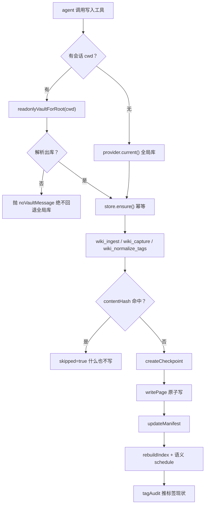
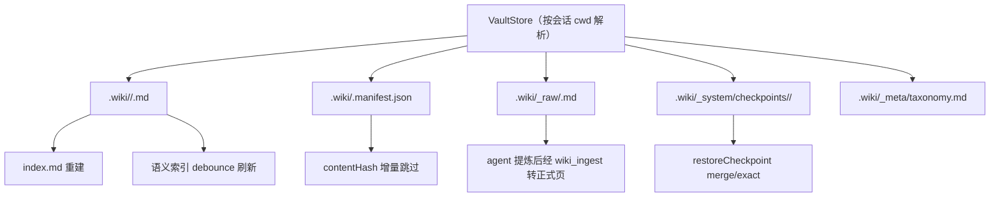

<details><summary>Relevant source files</summary>

- [src/tools.ts](src/tools.ts)
- [src/routes.ts](src/routes.ts)
- [src/vault-store.ts](src/vault-store.ts)
- [src/vault-manager.ts](src/vault-manager.ts)
- [src/importer.ts](src/importer.ts)
- [src/taxonomy.ts](src/taxonomy.ts)
- [src/trigger.ts](src/trigger.ts)
- [src/checkpoint.ts](src/checkpoint.ts)

</details>

> 挖掘批次：能力挖掘重扫（2026-10-24）。本轮纠正四类旧事实：① 旧页把 `POST /import` 说成「目录扫描 → 页面数组」，实际 `importPath` 只做**保真搬运到 `_raw/`**，正式页仍须 `wiki_ingest` 提炼；② 旧页称 `writePage` 写「固定 11 键」，实际是 9 个固定键 + 可选 `summary`；③ `src/routes.ts` 行号整体后移约 61 行（`WRITE_PATHS` 112→149、`/page` 180→241、`/import` 233→294）；④ 新增「会话级选库」整块事实（commit `7d8fcb6`）：写工具按 `session.header.cwd` 解析库，解析不出**抛错**而不是写进全局库；配套「不再隐式建库」（commit `a471cf6`）。

## 1. 概念定义

### 1.1 核心概念

| 概念 | 定义 | 为什么重要 |
|---|---|---|
| **知识写入** | 把外部材料（文档/会话/代码结构）变成 `.wiki` 正式页面的全部通道 | 库的价值取决于喂进来的东西；写入错一次，检索层拿到的就是错的 |
| **会话级选库（`sessionWriteStore`）** | 写工具先按 `session.header.cwd` 解析出该会话工作区的库；有 cwd 却解析不出 → 抛带指引的错误，**绝不回退全局当前库** | 宿主进程的「当前库」是单值，多工作区会话并存时会串台；写错库比读错库更糟——污染是持久的 |
| **批量入库（`wiki_ingest`）** | agent 提取好的页面数组 → 逐页 `writePage`，带 contentHash 去重、写前自动还原点 | 增量跳过与批次回滚都靠它；同源重导覆盖、异源加 `-2` 后缀 |
| **快速沉淀（`wiki_capture`）** | 当前讨论 → 单页（默认 `references/`），source 固定 `agent:capture` | 会话里「记一下」的最短路径，也是本库主力写路径 |
| **跨源避让 + `-N` 复用** | 同 id 但不同 source 时不覆盖；先找**本源已建的 `-N` 页**更新，找不到才取首个空后缀 | 只避让不复用会让每次重导都再避让一次 → `-3/-4/-5…` 无限膨胀且旧页陈旧 |
| **写入前还原点** | 真正写盘前自动 `createCheckpoint`，返回 `checkpointId` | 批次级回滚的**结构性**凭据，不靠提示词自觉 |
| **保真暂存（`_raw/`）** | `POST /import` 把 `.md` 原样搬进 `<wiki>/_raw/`，**不进** 7 个正式分类 | 导入是搬运不是提炼；直接进知识层会稀释检索质量 |
| **两条写路径的分工** | 工具写 = `writePage`（整份重建 frontmatter）；`POST /page` = `saveRawPage`（保存用户原文，只校验不重建） | 混淆会导致人工编辑的 frontmatter 被机器覆盖，或机器写入被原文带偏 |

### 1.2 领域概念

| 概念 | 说明 |
|---|---|
| **contentHash** | 源内容 SHA-256；与 manifest 记录一致时整批 skip（什么也不写、不建还原点） |
| **manifest** | `<vault>/.wiki/.manifest.json`，`{ version: 1, sources: { <source>: { content_hash, last_ingested, pages_produced } } }` |
| **flatField** | 把 frontmatter 值里的 `\r \n U+2028 U+2029` 全部拍平成空格——不拍平就能注入伪造的 `category:` 行 |
| **round-trip 校验** | 写出的 frontmatter 必须能解析回同一个 id/category，否则抛错、磁盘不动 |
| **原子写** | 先写 `*.tmp-<pid>-<ts>` 再 `renameWithRetry`；Windows 瞬时 `EPERM/EACCES/EBUSY` 退避重试 5 次 |
| **写入闸** | `KNJ_OBSIDIAN_WRITE_GATE=ask|block` 显式 opt-in，**默认 off**（L5 沉淀提醒已整体移除） |
| **dryRun** | `wiki_normalize_tags` 的默认模式；写操作必须显式传 `false` |

## 2. 系统事实

### 2.1 系统事实

| 事实 | 值 | 来源 |
|---|---|---|
| 写工具按什么选库 | **会话 cwd**：`sessionWriteStore` → `readonlyVaultForRoot(cwd)`，命中后幂等 `ensure()` | `src/tools.ts:207-215` |
| 有 cwd 但工作区没库 | **抛 `noVaultMessage` 错误**（提示先 `wiki_init`），不回退全局库 | `src/tools.ts:391-393`、`src/tools.ts:180-182` |
| 无会话上下文（测试替身/非 agent） | 回退旧的全局行为 `provider.current()` | `src/tools.ts:213-214` |
| 会话库从哪来 | `readonlyVaultForRoot`：注册根 → 向上找最近 `.wiki`（不越过已知根）→ 磁盘真实 `.wiki`；**零写盘** | `src/vault-manager.ts:219-232` |
| 空壳库时 `currentRecord()` | 当前库未初始化则**优先返回另一个已初始化库**；全都未初始化才返回当前库 | `src/vault-manager.ts:162-172` |
| `current()` 是否隐式建库 | **否**：只有已初始化的库才 `ensure()`，空壳库等显式 `wiki_init` | `src/vault-manager.ts:186-195` |
| 写路由如何选库 | 带 `?root=` 时按该根**只读**解析；解析不出返回 **409 `vault-not-initialized`**，绝不回退全局库 | `src/routes.ts:149-151`、`src/routes.ts:169-176` |
| 哪些端点走可写 `current()` | 仅 `POST` + `WRITE_PATHS`（`/page`、`/rebuild-index`、`/import`、`/checkpoint/restore`） | `src/routes.ts:149`、`src/routes.ts:177-179` |
| 写入是否必须由用户决定 | **是**（零推动：不提醒、不拦截） | [[知识库写入侧零推动]]、`src/trigger.ts:1017-1022` |
| 写入闸默认值 | **off**（`ask` / `block` 才是 opt-in）；理由：UI 蒸馏与模型自写共用 `wiki_ingest` 一个工具名 | `src/trigger.ts:1017-1022`、`src/trigger.ts:1028` |
| contentHash 命中 | 整批 `skipped: true`，**在还原点之前**返回（不写页、不建快照） | `src/tools.ts:394-399` |
| `wiki_ingest` 是否自动建还原点 | 是，写入前 `createCheckpoint`；失败只让 `checkpointId=undefined`，**不阻塞写入** | `src/tools.ts:405-408` |
| 跨源同 id 如何避让 | 先找本 source 已有的 `-N` 页复用更新，找不到才在**第一个空后缀**新建 | `src/tools.ts:417-429` |
| 同 source 重写时 `created` | 保留旧 `created`（`reused.source === args.source` 才保留，否则取 `now`） | `src/tools.ts:437` |
| summary/tier 缺省时 | **不传**（不塞 `undefined`），交给 `writePage` 沿用磁盘已有值；tier 缺省再退化为 `supporting` | `src/tools.ts:439-443`、`src/vault-store.ts:263-265` |
| `writePage` 是否重建 frontmatter | 是，整份重建：`id/title/category/tags/[summary]/tier/source/confidence/created/updated`（9 固定 + 可选 summary） | `src/vault-store.ts:266-280` |
| 正文注入防御 | `flatField` 覆盖全部 Unicode 行终止符；round-trip 解析必须回读同一 id/category | `src/vault-store.ts:240-242`、`src/vault-store.ts:282-286` |
| 是否原子写 | 是（tmp + `renameWithRetry`，失败清理 tmp 再抛） | `src/vault-store.ts:287-295` |
| rename 重试策略 | 可重试码 `EPERM/EACCES/EBUSY`，最多 5 次、退避 `attempt*5ms`；不可重试码立即抛 | `src/vault-store.ts:110-111`、`src/vault-store.ts:132-150` |
| manifest 何时写 | 逐页写完 `writePage` 之后一次性 `updateManifest`（`content_hash`/`last_ingested`/`pages_produced` 逐页记录） | `src/tools.ts:451-456`、`src/vault-store.ts:481-485` |
| 写后是否重建 index | 是（`wiki_ingest` / `wiki_capture` / `wiki_normalize_tags` / `POST /page` 全都立即重建，失败不影响写入结果） | `src/tools.ts:462-463`、`src/tools.ts:551-553`、`src/tools.ts:713`、`src/routes.ts:264-267` |
| 写后是否排语义刷新 | 是（`refresherFor(root).schedule('wiki_ingest'|'wiki_capture')`，debounce + 单飞，失败不影响结果） | `src/tools.ts:464-468`、`src/tools.ts:556-559` |
| 写后是否回报标签现状 | 是（`tagAudit`：未知/别名/零标签 + 升表建议） | `src/tools.ts:469`、`src/tools.ts:122-145` |
| `wiki_capture` 的 source | 固定 `agent:capture`（跨源避让也按这个字面量判定） | `src/tools.ts:544` |
| `wiki_capture` 的标签 | 调用方给了就透传；不给为空数组（保持旧行为，不回归） | `src/tools.ts:538-542` |
| `wiki_normalize_tags` 默认 dryRun | **是**（`args.dryRun !== false`）；真实改写前建还原点，**0 改动不建**（幂等重跑不误报失败） | `src/tools.ts:634`、`src/tools.ts:678-693` |
| 标签硬限制 | 每页最多 5 个标签（`SYSTEM_TAG_PREFIX` 的 `visibility/*` 不计入） | `src/taxonomy.ts:18`、`src/taxonomy.ts:28-30` |
| 词表来源 | 基础层 ∪ 库级层合并；两层都没有有效规范词时 `loadTaxonomy` 返回 `null`（跳过规范检查，不把整库标签报成未知） | `src/taxonomy.ts:184-200` |
| `POST /import` 的落点 | **只**落 `<wiki>/_raw/<sanitizeId>.md`；`importPath` 不产生正式页 | `src/importer.ts:88-137`、`src/vault-store.ts:416-431` |
| `POST /import` 的路径边界 | 只允许导入**已注册库根目录内**的 `.md`（防同源脚本拖任意目录进库） | `src/routes.ts:303-313` |
| `saveRawPage` 的约束 | 目标页必须已存在（否则 404）、frontmatter 可解析且 id/category 一致；**不做新建/改名** | `src/vault-store.ts:381-398` |
| 还原点落点 | `<wiki>/_system/checkpoints/<ISO 时间戳>/`，拷贝 7 个分类目录 + 派生工件 | `src/checkpoint.ts:18-45` |
| 行为证据（测试） | 「有 cwd 但解析不出库」用例断言 `wiki_ingest` 直接 reject 且错误含「没有知识库」，即**不落库到全局库** | `session-binding.test.mjs:105-122` |

### 2.2 数据事实

| 数据 | 位置 / 形态 |
|---|---|
| 正式页面 | `<vault>/.wiki/<category>/<id>.md`（7 分类：concepts/entities/references/synthesis/projects/dictionaries/tables） |
| 清单 | `<vault>/.wiki/.manifest.json`（JSON，`version:1` + `sources` 映射） |
| 还原点 | `<vault>/.wiki/_system/checkpoints/<ISO>/`（整库拷贝） |
| 保真暂存区 | `<vault>/.wiki/_raw/<id>.md`（不参与检索） |
| 词表 | 基础层包内文件 ∪ `<vault>/.wiki/_meta/taxonomy.md` |
| 派生索引 | `<vault>/.wiki/index.md`（写后重建，L1/index-only 检索的唯一来源） |
| 写路由白名单 | `${BASE}/page`、`${BASE}/rebuild-index`、`${BASE}/import`、`${BASE}/checkpoint/restore` |

## 3. 功能树与入口映射

### 3.1 功能模块结构

```
知识写入
├─ 选库层（先于一切写入）
│   ├─ sessionWriteStore       ← 会话 cwd → 会话库；无 cwd → 全局（tools.ts:207）
│   └─ currentRecord/current   ← 空壳库优先已初始化库；不对未初始化库 ensure（vault-manager.ts:162/186）
├─ agent 工具面
│   ├─ wiki_ingest             ← 批量入库：contentHash 跳重 / 还原点 / 跨源避让 / manifest
│   ├─ wiki_capture            ← quick 单页：references + agent:capture
│   └─ wiki_normalize_tags     ← 标签收敛：词表别名 + 显式 mapping，默认 dryRun
├─ HTTP 写路由（?root= 可改库作用域）
│   ├─ POST /page              ← 全文编辑保存（saveRawPage，仅已存在页）
│   ├─ POST /import            ← 保真搬 _raw/（不产正式页）
│   ├─ POST /rebuild-index     ← 重建派生索引
│   └─ POST /checkpoint/restore← 回滚（merge 默认 / exact）
└─ 底层
    ├─ vault-store.writePage   ← frontmatter 重建 + flatField + round-trip + 原子写
    ├─ vault-store.saveRawPage ← 原文保存 + 三层校验 + 原子写
    ├─ importer.importPath     ← 目录/文件收集 + 限额 + sanitizeId
    ├─ checkpoint.createCheckpoint ← 整库快照
    └─ taxonomy.loadTaxonomy   ← 基础层 ∪ 库级层
```

### 3.2 入口映射表

| 入口 | 类型 | 必填 | 内核 | 文件:行 |
|---|---|---|---|---|
| `wiki_ingest` | tool | `source`、`pages` | `writePage` + `updateManifest` + `relatedHits` | `src/tools.ts:318`（注册）、`src/tools.ts:391`（execute） |
| `wiki_capture` | tool | `title`、`body` | `writePage`（`agent:capture` 单页） | `src/tools.ts:473`（注册）、`src/tools.ts:511`（execute） |
| `wiki_normalize_tags` | tool | — | `loadTaxonomy` + 逐页 `writePage` | `src/tools.ts:564`（注册）、`src/tools.ts:633`（execute） |
| `POST /page` | route | `id`、`category`、body.`raw` | `saveRawPage` + `rebuildIndex` | `src/routes.ts:241` |
| `POST /import` | route | body.`path` | `importPath` → `stageRawFile` | `src/routes.ts:294` |
| `POST /rebuild-index` | route | —（body 仅触发） | `rebuildIndex` | `src/routes.ts:285` |
| `POST /checkpoint/restore` | route | body.`id` | `restoreCheckpoint` + `rebuildIndex` | `src/routes.ts:322` |
| `KNJ_OBSIDIAN_WRITE_GATE` | 环境闸 | `ask` / `block` | `writeGateModeOf` | `src/trigger.ts:1017` |

### 3.3 使用场景

| 场景 | 入口 | 理由 |
|---|---|---|
| 把一篇文章/文档拆成多页入库 | `wiki_ingest` | 批量 + contentHash 去重 + 写前还原点 |
| 会话里记一条结论 | `wiki_capture` | 最短路径，单页、免分类决策 |
| 用户在边栏编辑某页并保存 | `POST /page` | 整页原文保存，不重建 frontmatter（保住人工手写字段） |
| 从本地目录搬一批 `.md` 进库 | `POST /import` | 只搬进 `_raw/`，等 agent 提炼；不污染正式分类 |
| 写完发现标签不一致 | `wiki_normalize_tags` | 写后治理，先 dryRun 看清单 |
| 写错了要整批撤销 | `POST /checkpoint/restore` | `wiki_ingest` 返回的 `checkpointId` 就是凭据 |
| 在某个工作区里写库 | 任一写工具 | 选库由 `session.header.cwd` 决定，无需切全局当前库 |

## 4. 调用链路总结

### 4.1 主链路图



### 4.2 分通道详细流程

```
wiki_ingest（src/tools.ts:391-470）
  1. sessionWriteStore(provider, exec) 选库；解析不出 → throw noVaultMessage   (:392-393)
  2. args.contentHash 与 manifest 记录一致 → 直接返回 skipped                    (:394-399)
  3. createCheckpoint(store) → checkpointId（失败仅置 undefined，不阻塞）        (:405-408)
  4. 逐页：
     a. readPage 同 id；existing.source !== args.source → 先找本源 -N 页复用，
        找不到才取第一个空后缀（-2/-3…）                                          (:417-429)
     b. 组装 WikiPage：created 保留条件 = reused.source === args.source；
        summary/tier 只在显式给出时透传                                            (:430-445)
     c. writePage(page) → created/updated 分流，produced 记录 id                   (:446-449)
  5. updateManifest(source, { content_hash, last_ingested, pages_produced })       (:451-456)
  6. relatedCheck：对本批新建页做库内相关页对账（排除同批产出）                    (:457-461)
  7. rebuildIndex(store)（失败不影响入库）                                        (:462-463)
  8. refresherFor(root).schedule('wiki_ingest')                                   (:464-468)
  9. 返回 { created, updated, skipped:false, relatedCheck, checkpointId, tagAudit } (:469)
```

```
wiki_capture（src/tools.ts:511-561）
  1. sessionWriteStore 选库（同上，解析不出即抛错）                                (:512-513)
  2. title → kebab id（保留 CJK），category 缺省 references                        (:516-517)
  3. 跨源防覆盖 + 防 -N 膨胀：base.source==='agent:capture' 则复用 created；
     否则找本源 -N 页，再否则取首个空后缀                                          (:521-537)
  4. tags 过滤空串后透传（缺省 []）；summary/tier 显式才透传                        (:540-549)
  5. writePage(...) 后 relatedHits 对账                                            (:543-550)
  6. rebuildIndex → schedule('wiki_capture')                                       (:551-559)
```

```
wiki_normalize_tags（src/tools.ts:633-722）
  1. dryRun = args.dryRun !== false（默认只报告）                                  (:634)
  2. sessionWriteStore 选库；loadTaxonomy(store)                                   (:635-637)
  3. 显式 mapping（from→to；to 省略 = 删除）承载人工判断，本工具不发明映射          (:639-646)
  4. 无词表且无 mapping → 直接返回 note                                            (:648-650)
  5. 逐页：先词表别名映射，再显式替换，同页去重保序；无变化则跳过                   (:652-676)
  6. dryRun 或 0 改动 → 只返回 changed 计划（不建还原点）                          (:678-684)
  7. 真实改写：createCheckpoint（失败置 checkpointFailed）→ 逐页 writePage
     （tags 换新、created 保留、summary/tier 显式透传）                             (:686-712)
  8. rebuildIndex(store)                                                           (:713)
```

```
POST /page（src/routes.ts:241-269）
  1. `?root=` 有值时 resolveFollowedVault 只读解析；解析不出 → 409 vault-not-initialized (:150-176)
  2. 方法/白名单判定：POST + `${BASE}/page` ∈ WRITE_PATHS → provider.current()      (:149、:179)
  3. GET 分支：`raw=1` 返回磁盘原文，否则返回解析后的 page                          (:243-255)
  4. POST 分支：同源校验(403) → content-type(415) → JSON(400) → raw 必须是字符串(400) (:257-263)
  5. saveRawPage(id, category, raw)：存在性/frontmatter/路径校验后原子写            (:264)
  6. rebuildIndex(store)（保存成功即重建，失败不影响返回）                          (:267)
```

```
POST /import（src/routes.ts:294-316）
  1. 同源 + content-type + body.path 必填校验                                      (:295-301)
  2. category 只作为「蒸馏建议归类」写进提示，不再决定落点                          (:302)
  3. 路径边界：resolve(path) 必须落在某个已注册库根内，否则 400                     (:303-313)
  4. importPath(store, target, category)：收集（排除 node_modules/.git/.wiki 等，
     限 500 文件 / 1MB / 深度 12）→ 每个文件 stageRawFile(sanitizeId(name), text)   (:314)
  5. 返回 ImportReport{imported,updated,skipped,files,stagedDir:'_raw',hint}        （importer.ts:119-136）
```

### 4.3 数据与存储关系



## 5. 附录

### 5.1 术语表

| 术语 | 含义 |
|---|---|
| 会话级选库 | 写工具按 `session.header.cwd` 解析库，解析不出即抛错（不回退全局） |
| contentHash | 源内容哈希，增量跳过的主信号；命中即整批 skip |
| `-N` 复用 | 异源避让时优先更新本 source 已建的 `concept-x-2` 而不是继续 `-3/-4` |
| 还原点 | `_system/checkpoints/<ISO>/` 的整库快照；`checkpointId` 即回滚凭据 |
| quick 模式 | `wiki_capture` 的单页快速路径（source 固定 `agent:capture`） |
| 保真搬运 | `importPath` 把 `.md` 原样写进 `_raw/`，不解析、不改写、不分类 |
| 升表建议 | `tagAudit` 里出现 ≥2 页的标签，提示粘进 `_meta/taxonomy.md` |

### 5.2 参考资料

- [[知识库写入侧零推动]] — 写入为何必须由用户决定、L5 沉淀提醒为何整体移除、写入闸为何默认 off
- [[会话级知识库绑定]] — 选库契约的来龙去脉（工具侧与触发层共用 `session.header.cwd` 解析）
- [[capability-知识检索]] — 写入的对偶面：检索层如何消费这些页
- [[capability-知识治理]] — 还原点 / 标签 / 索引的治理面
- [[插件验证纪律与实测陷阱]] — 写入侧的静默失败与夹具陷阱

## 任务问法

（这页应该回答的问题——问答式与任务式都要收）

```queries
知识写入是怎么实现的
wiki_ingest 怎么保证不重复入库
跨源同 id 的页面为什么不覆盖
写页时到底写进了哪个库
导入一个目录会直接变成正式页吗
改写入的查重逻辑
新增一个写入工具
```

## Sources

- `src/tools.ts:207-215`（`sessionWriteStore` 写语义：会话库 ensure、无 cwd 才回退全局）
- `src/tools.ts:391-469`（`wiki_ingest` execute：`sessionWriteStore`、`createCheckpoint`、`writePage`、`updateManifest`、`rebuildIndex`、`tagHintOf`）
- `src/tools.ts:511-560`（`wiki_capture`：`agent:capture` 跨源避让、`rebuildIndex`、`schedule`）
- `src/tools.ts:633-721`（`wiki_normalize_tags`：`dryRun`、`loadTaxonomy`、`createCheckpoint`、`writePage`）
- `src/routes.ts:149-179`（`WRITE_PATHS` 白名单、`current()` 与 `vault-not-initialized` 409）
- `src/routes.ts:241-269`（`POST /page`：`saveRawPage` + `rebuildIndex`）
- `src/routes.ts:294-316`（`POST /import`：路径边界 `listVaults`/`relative` + `importPath`）
- `src/vault-store.ts:244-298`（`writePage`：`flatField`、`parsePageText` round-trip、`renameWithRetry`）
- `src/vault-store.ts:381-398`（`saveRawPage`：`SaveError`、`assertSaveablePage`、原子写）
- `src/vault-store.ts:481-485`（`updateManifest` 写 manifest）
- `src/vault-manager.ts:162-195`（`currentRecord` 优先已初始化库、`isInitialized`、`current()` 不隐式 ensure）
- `src/importer.ts:94-137`（`importPath` 保真搬 `_raw/`：`stageRawFile`、`sanitizeId`）
- `src/taxonomy.ts:184-200`（`loadTaxonomy`：基础层 ∪ 库级层、`mergeTaxonomies`）
- `src/taxonomy.ts:18`（`TAG_LIMIT` = 5）
- `src/trigger.ts:1017-1022`（`writeGateModeOf` 默认 off、`KNJ_OBSIDIAN_WRITE_GATE`）
- `src/checkpoint.ts:28-45`（`createCheckpoint` 整库快照、`CATEGORIES`）

```sources
[
  {"path":"src/tools.ts","hash":"sha256:750e59e1f739ed94","symbols":["wiki_ingest","wiki_capture","wiki_normalize_tags","sessionWriteStore"]},
  {"path":"src/routes.ts","hash":"sha256:6912078691258cac","symbols":["WRITE_PATHS"]},
  {"path":"src/vault-store.ts","hash":"sha256:7ab646573d70cb40","symbols":["writePage","saveRawPage","updateManifest","renameWithRetry"]},
  {"path":"src/vault-manager.ts","hash":"sha256:893434304cf07940","symbols":["currentRecord","current","isInitialized"]},
  {"path":"src/importer.ts","hash":"sha256:8d1e3ae53185b9e7","symbols":["importPath","sanitizeId"]},
  {"path":"src/taxonomy.ts","hash":"sha256:49eaed875486d4e4","symbols":["TAG_LIMIT","loadTaxonomy"]},
  {"path":"src/trigger.ts","hash":"sha256:c1390e53930ce977","symbols":["writeGateModeOf"]},
  {"path":"src/checkpoint.ts","hash":"sha256:11a8c3119b2fd0b1","symbols":["createCheckpoint"]}
]
```
