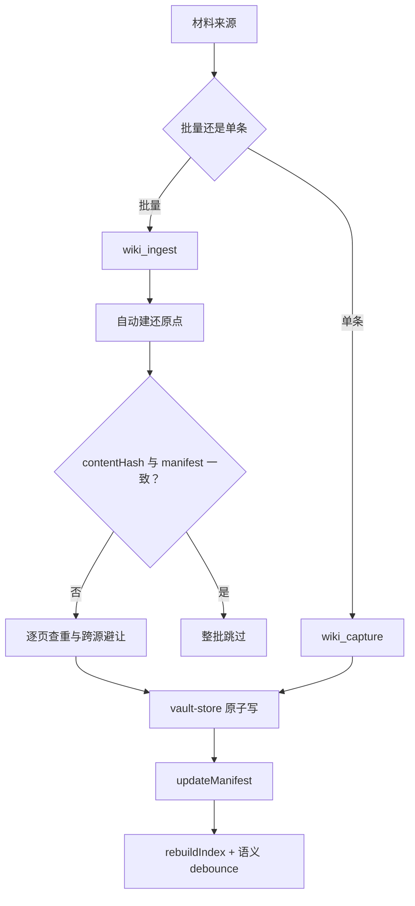
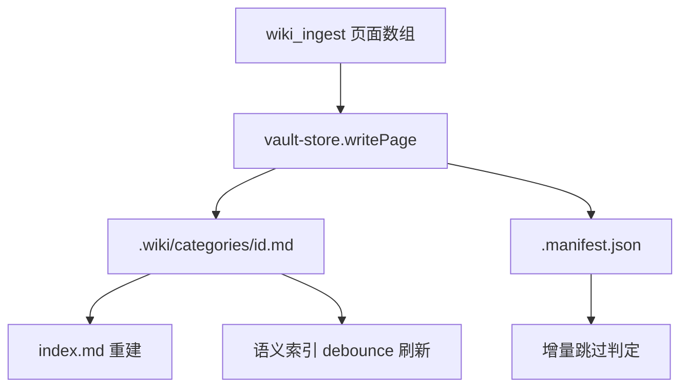

<details><summary>Relevant source files</summary>

- [src/tools.ts](src/tools.ts)
- [src/importer.ts](src/importer.ts)
- [src/vault-store.ts](src/vault-store.ts)
- [src/routes.ts](src/routes.ts)
- [src/taxonomy.ts](src/taxonomy.ts)
- [src/trigger.ts](src/trigger.ts)

</details>

> 挖掘批次：能力挖掘重扫（2026-10-20）。行号由脚本回读核对；`sources` 为真实 sha256 前缀。

## 1. 概念定义

### 1.1 核心概念

| 概念 | 定义 | 为什么重要 |
|---|---|---|
| **知识写入** | 把外部材料（文档/会话/代码结构）转成 `.wiki` 页面的全部通道 | 库的价值取决于喂进来的东西，写入质量决定检索质量 |
| **批量入库（wiki_ingest）** | agent 提取好的页面数组 → 逐页写入，带 contentHash 去重 | 增量跳过靠它；同源重导覆盖、异源加 `-2` 后缀 |
| **快速沉淀（wiki_capture）** | 当前讨论 → 单页 references（quick 模式，source 固定 `agent:capture`） | 会话里「记一下」的最短路径 |
| **跨源避让** | 同 id 但不同 source 时不覆盖，自动加后缀 | 防跨源静默丢失旧内容 |
| **写入前还原点** | 批量入库前自动 `wiki_checkpoint`，返回 `checkpointId` | 批次级回滚的凭据（结构性保证，不靠提示词） |

### 1.2 领域概念

| 概念 | 说明 |
|---|---|
| **contentHash** | 源内容 SHA-256；与 manifest 记录一致时整体跳过本次 ingest |
| **manifest** | `<vault>/.wiki/.manifest.json`：`source → { content_hash, last_ingested, pages_produced }` |
| **原子写入** | 先写临时文件再 `renameWithRetry`，避免半个文件 |
| **frontmatter 重建** | `writePage()` 整份重建 frontmatter，只写固定 11 键——自定义字段活不过一次更新 |
| **写入闸** | `KNJ_OBSIDIAN_WRITE_GATE=ask\|block` 显式 opt-in，默认不拦 |

## 2. 系统事实

### 2.1 系统事实

| 事实 | 值 | 来源 |
|---|---|---|
| 写入是否必须由用户决定 | **是**（零推动：不提醒、不拦截） | [[知识库写入侧零推动]] |
| 写入闸默认值 | **off**（仅 `ask` / `block` 为 opt-in） | `src/trigger.ts:1017` |
| 写入是否原子 | 是（临时文件 + `renameWithRetry` 重试） | `src/vault-store.ts:291` |
| 是否自动建还原点 | `wiki_ingest` / `wiki_normalize_tags` / `wiki_checkpoint` 均建 | `src/tools.ts:319` |
| 同名页是否覆盖 | 同 source 覆盖（保留 created）；异 source 加 `-2` 后缀 | `src/tools.ts:328-340` |
| contentHash 跳过 | 与 manifest 一致时整批 skip（什么也不写） | `src/tools.ts:305-310` |
| 写后是否重建 index | 是（立即，失败不影响入库结果） | `src/tools.ts:374` |
| 写后是否排语义刷新 | 是（debounce + 单飞，失败不影响结果） | `src/tools.ts:376-379` |
| capture 路径需标签显式传入 | 是；不给则为空数组（保持旧行为） | `src/tools.ts:450-452` |
| 索引滞后的实测代价 | 曾有一个 capture 页**滞后 12 天不可检索** | `src/tools.ts:461-462` |
| capture 是本库主力写路径 | 实测 21 页里 8 页来自 `agent:capture` | `src/tools.ts:464-465` |
| normalize_tags 默认 dryRun | **是**（`args.dryRun !== false`）；真实改写先建还原点 | `src/tools.ts:544`、`src/tools.ts:599` |
| 标签硬限制 | 每页最多 5 个标签 | `src/taxonomy.ts:18` |

### 2.2 数据事实

| 数据 | 位置 / 形态 |
|---|---|
| 页面 | `<vault>/.wiki/<category>/<id>.md` |
| 清单 | `<vault>/.wiki/.manifest.json`（source → pages_produced + content_hash） |
| 还原点 | `<vault>/.wiki/_system/checkpoints/<ISO>/` |
| 词表 | `<vault>/.wiki/_meta/taxonomy.md` + 包内 `taxonomy.base.md` |
| 写路由白名单 | `/page`、`/rebuild-index`、`/import`、`/checkpoint/restore`（仅 POST 才拿可写 store） |

## 3. 功能树与入口映射

### 3.1 功能模块结构

```
知识写入
├─ agent 工具面
│   ├─ wiki_ingest        批量入库（页面数组 + contentHash 去重）
│   ├─ wiki_capture       快速沉淀（当前讨论 → 单页 references）
│   └─ wiki_normalize_tags 标签收敛（写后治理）
├─ HTTP 写路由
│   ├─ POST /page         整页编辑保存
│   └─ POST /import       目录/文件导入
└─ 底层
    ├─ vault-store.writePage / saveRawPage（原子写 + frontmatter 重建）
    ├─ importer.importPath（目录扫描 → 页面数组）
    └─ taxonomy（别名收敛 / 未知词上报）
```

### 3.2 入口映射表

| 入口 | 类型 | 必填参数 | 底层内核 | 实现位置 |
|---|---|---|---|---|
| `wiki_ingest` | 工具 | source, pages | 批量写 + manifest 对账 | `src/tools.ts:231` |
| `wiki_capture` | 工具 | title, body | quick 模式写 references | `src/tools.ts:385` |
| `wiki_normalize_tags` | 工具 | — | taxonomy 收敛 | `src/tools.ts:475` |
| `POST /page` | 路由 | id, category | vault-store.saveRawPage | `src/routes.ts:180` |
| `POST /import` | 路由 | path | importer.importPath | `src/routes.ts:233` |

### 3.3 使用场景

| 场景 | 入口 | 理由 |
|---|---|---|
| 把一篇文章/文档拆成多页入库 | `wiki_ingest` | 批量 + contentHash 去重 |
| 会话里记一条结论 | `wiki_capture` | 最短路径，单页 |
| 用户在边栏编辑某页 | `POST /page` | 整页保存 |
| 导入整个目录 | `POST /import` | 目录扫描（sanitizeId 清洗文件名） |
| 写完发现标签不一致 | `wiki_normalize_tags` | 写后治理，先 dryRun |

## 4. 调用链路总结

### 4.1 主链路图



### 4.2 分通道详细流程

**wiki_ingest**（`src/tools.ts:231`）：

```
contentHash 比对 manifest（一致则 skipped=true，什么也不写，src/tools.ts:305-310）
→ createCheckpoint（src/tools.ts:319）
→ 逐页：同源覆盖（保留 created，src/tools.ts:348）/ 异源加 -2 后缀（src/tools.ts:328-340）
→ writePage（frontmatter 重建 + 原子写，src/tools.ts:357）
→ updateManifest(content_hash, last_ingested, pages_produced)（src/tools.ts:363-367）
→ relatedCheck 相关页对账（src/tools.ts:370-372）
→ rebuildIndex + 语义 debounce（src/tools.ts:374-379）
```

**POST /page**（`src/routes.ts:180`）：

```
写路由白名单判定（POST + /page → 可写 store，src/routes.ts:112）
→ 同源校验 + JSON content-type 校验
→ saveRawPage(id, category, rawText)（src/vault-store.ts:381）
→ 解析 frontmatter 校验 id/category 与目标一致
```

### 4.3 数据与存储关系



## 5. 附录

### 5.1 术语表

| 术语 | 含义 |
|---|---|
| contentHash | 源内容哈希，增量跳过的主信号 |
| 跨源避让 | 同 id 异 source 时不覆盖，加 `-2/-3` 后缀 |
| 还原点 | `_system/checkpoints/<ISO>/` 的整库快照 |
| quick 模式 | wiki_capture 的单页快速路径 |
| 升表建议 | 写后回报的 tagAudit（≥2 页的词建议进词表） |

### 5.2 参考资料

- [[知识库写入侧零推动]] — 写入必须由用户决定的决策与因果链实证
- [[capability-知识检索]] — 写入的对偶面：检索面如何消费这些页
- [[capability-知识治理]] — 还原点/标签/索引的治理面
- [[插件验证纪律与实测陷阱]] — 写入侧的静默失败与夹具陷阱

## 任务问法

（这页应该回答的问题——问答式与任务式都要收）

```queries
知识写入是怎么做的
wiki_ingest 怎么保证不重复入库
跨源避让是什么
还原点和 checkpoint 怎么用
改写入的查重逻辑
新增一个写入工具
```

## Sources

- `src/tools.ts:231-382`（wiki_ingest 批量入库：还原点/查重/避让/manifest）
- `src/tools.ts:305-310`（contentHash 跳过）
- `src/tools.ts:328-340`（跨源避让与 -N 复用）
- `src/tools.ts:385-472`（wiki_capture quick 模式）
- `src/tools.ts:475-630`（wiki_normalize_tags 标签收敛）
- `src/importer.ts:94`（importPath 目录导入）
- `src/importer.ts:50`（sanitizeId）
- `src/vault-store.ts:244`（writePage：frontmatter 重建 + 原子写）
- `src/vault-store.ts:381`（saveRawPage：整页保存与校验）
- `src/vault-store.ts:132`（renameWithRetry 原子落盘）
- `src/vault-store.ts:481`（updateManifest）
- `src/routes.ts:112`（写路径白名单）
- `src/routes.ts:180`（`/page` 路由入口；`GET` 方法判定在 `:182`，`POST` 走后续分支）
- `src/routes.ts:233`（POST /import）
- `src/taxonomy.ts:18`（TAG_LIMIT = 5）
- `src/trigger.ts:1017`（writeGateModeOf 默认 off）

```sources
[
  {"path":"src/tools.ts","hash":"sha256:49ce63670351691b","symbols":["wiki_ingest","wiki_capture","wiki_normalize_tags"]},
  {"path":"src/importer.ts","hash":"sha256:8d1e3ae53185b9e7","symbols":["importPath","sanitizeId"]},
  {"path":"src/vault-store.ts","hash":"sha256:7ab646573d70cb40","symbols":["writePage","saveRawPage","renameWithRetry","updateManifest"]},
  {"path":"src/routes.ts","hash":"sha256:6cc47ff45e56c5bb","symbols":["WRITE_PATHS"]},
  {"path":"src/taxonomy.ts","hash":"sha256:49eaed875486d4e4","symbols":["TAG_LIMIT","loadTaxonomy"]},
  {"path":"src/trigger.ts","hash":"sha256:0a4e578f19985416","symbols":["writeGateModeOf"]}
]
```

