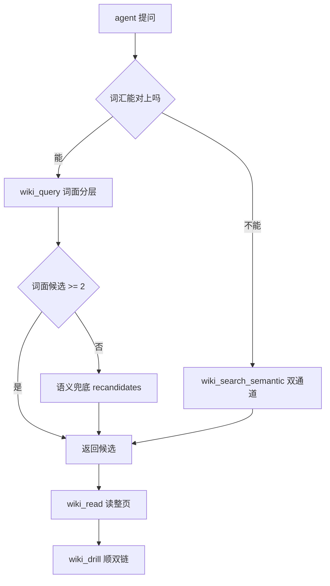
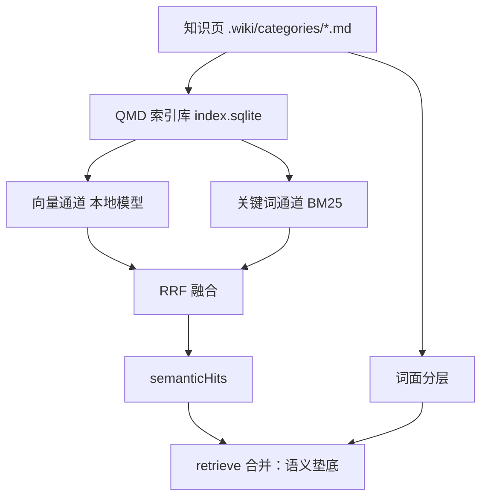

<details><summary>Relevant source files</summary>

- [src/tools.ts](src/tools.ts)
- [src/retriever.ts](src/retriever.ts)
- [src/semantic-index.ts](src/semantic-index.ts)
- [src/semantic-hits.ts](src/semantic-hits.ts)
- [src/drill.ts](src/drill.ts)
- [src/routes.ts](src/routes.ts)

</details>

> 挖掘批次：能力挖掘重扫（2026-10-20）。本页所有 `路径:行` 均由脚本逐一回读核对，`sources` 块为真实 sha256 前缀（非 `pending`）。

## 1. 概念定义

### 1.1 核心概念

| 概念 | 定义 | 为什么重要 |
|---|---|---|
| **知识检索** | agent 与人在知识库中查找页面的全部通道 | 知识页已编译好，但没有检索面 agent 不会主动翻 |
| **词面分层检索** | 按匹配字段分层（标题→问法→标签→摘要→正文→图谱），前置层全词命中即停 | 最便宜，5ms 级，覆盖多数查询 |
| **问法层** | 候选页正文 queries 围栏块声明的「这页回答什么问题」，分值介于标题与标签之间 | 让能力页显式声明自己的问法，长问句也能进前置层 |
| **语义双通道** | 本地嵌入向量 + BM25 关键词，本地 RRF 融合 | 词面空手时唯一的路；不联网 |
| **双链下钻** | 从命中页沿 `[[wikilink]]` 走一跳，拿邻居 | 解决「找到一页后怎么继续」 |
| **兜底门** | 词面候选 < 2 时才启用语义层的阈值 | 省算力；放过宽会掉精度 |
| **语义垫底** | 语义候选按通道内名次递减（0.3/n），整层低于词面最低层 | 语义只补召回，不许顶掉正确的词面 Top1 |

### 1.2 领域概念

| 概念 | 说明 |
|---|---|
| **RRF（Reciprocal Rank Fusion）** | 按名次而非分数融合多通道：`1/(60+rank)`，避免不可比分数相加 |
| **tier 权重** | core 1.3 / supporting 1.0 / peripheral 0.7，影响打分 |
| **度加权** | `min(度×0.1, 2)`，度 = 出链 + 入链；语义候选刻意不加 |
| **collection** | QMD 索引库里的库分区（`<库路径>-wiki`），必须限定否则串库 |
| **guards（护栏位）** | 前置层匹配是否「全部词命中」；只有全词命中才允许短路 |

## 2. 系统事实

### 2.1 系统事实

| 事实 | 值 | 来源 |
|---|---|---|
| 词面打分层 | exactTitle 10 / title 6 / queries 5 / tag 4 / summary 2 / index 2 / body 1 / graph 0.5 | `src/retriever.ts:21-31` |
| 语义分基准 | `SEMANTIC_RANK_BASE = 0.3`，第 n 名 = 0.3/n，严格递减且恒 < 0.35 | `src/retriever.ts:49-54` |
| tier 权重 | core 1.3 / supporting 1.0 / peripheral 0.7 | `src/retriever.ts:57` |
| 度加权 | 每度 +0.1，上限 +2；语义候选传空度表 | `src/retriever.ts:60-63` |
| 最终打分式 | `(base + min(度×0.1, 2)) × tier 权重` | `src/retriever.ts:360-362` |
| 兜底门 | 词面候选少于 2 才启用语义层（唯一条件） | `src/tools.ts:165`、`src/tools.ts:771` |
| 成本护栏触发 | `!hasSemantic && guardTriggered` 才短路正文层与图谱层 | `src/retriever.ts:237` |
| 合并顺序 | 前置→正文→摘要→图谱→语义，首次出现优先（语义天然垫底） | `src/retriever.ts:277` |
| 排序平局裁决 | score 降序 → 度降序 → 页面路径升序 | `src/retriever.ts:386` |
| 检索零写入 | `listPagesReadonly()`，不触发 `ensure()`，全新 vault 也能检索 | `src/retriever.ts:179` |
| 语义融合常数 | RRF_K = 60，每通道按名次贡献 `1/(60+rank)` 后求和降序 | `src/semantic-index.ts:281-290` |
| 通道降级 | 向量/关键词任一通道失败只记 `degraded` 文案，绝不抛异常 | `src/semantic-index.ts:330-351` |
| 云端模型禁用 | query-expansion / rerank 指向本地不存在的 `DISABLED-*.gguf` | `src/semantic-index.ts:264-268` |
| 句柄复用 | 语义运行时按库缓存：首次 7–10s，之后 28–83ms（差 100 倍以上） | `src/tools.ts:1163-1165` |
| 下钻参数上限 | seed 默认 5 / 上限 10；neighbors 默认 8 / 上限 20 | `src/drill.ts:103-106` |
| 问法层解析位置 | 正文 queries 围栏块（不可用 frontmatter：`writePage()` 只写固定 11 键） | `src/retriever.ts:308-323` |

### 2.2 数据事实

| 数据 | 位置 / 形态 |
|---|---|
| 知识页 | `<vault>/.wiki/<category>/*.md`（7 个正式分类，见 `src/retriever.ts:10`） |
| 索引库 | `~/.dsh/qmd/index.sqlite`（**全局共享**，多库共存） |
| 嵌入模型 | `~/.dsh/qmd/models/embeddinggemma-300M-Q8_0.gguf`（313 MB，手动放置，缺则报 `model-missing`） |
| 未命中日志 | `<DSH_HOME>/knj-obsidian/query-misses.jsonl` |
| 语义检索出参 | `status` ∈ ready / index-empty / index-stale / model-missing / library-missing |

## 3. 功能树与入口映射

### 3.1 功能模块结构

```
知识检索
├─ 词面分层（wiki_query / GET /search）
│   ├─ 前置层：标题 + 问法(queries) + 标签（全词命中即停）
│   ├─ 摘要层：正文不含时才产生
│   ├─ 正文层：占比加权 + 命中位置摘取
│   └─ 图谱层：正文命中页的出链邻居
├─ 语义双通道（wiki_search_semantic / wiki_query 兜底）
│   ├─ 向量通道（本地 300M 嵌入模型）
│   ├─ 关键词通道（BM25，无需模型）
│   └─ 本地 RRF 融合（RK=60）
└─ 双链下钻（wiki_drill）
    ├─ query 模式：语义种子 + 词面 RRF + 一跳邻居
    └─ page 模式：纯图、零嵌入、毫秒级
```

### 3.2 入口映射表

| 入口 | 类型 | 必填参数 | 底层内核 | 实现文件:行 |
|---|---|---|---|---|
| `wiki_query` | 工具 | query | 词面分层 + 语义兜底 | `src/tools.ts:724` |
| `wiki_search_semantic` | 工具 | query | QMD 双通道（离线） | `src/tools.ts:1121` |
| `wiki_drill`（query） | 工具 | query | 语义种子 + RRF + 邻居 | `src/drill.ts:295` |
| `wiki_drill`（page） | 工具 | page | 纯图下钻 | `src/drill.ts:413` |
| `wiki_read` | 工具 | id | 纯读取（整页 + 出入链） | `src/tools.ts:1370` |
| `GET …/search` | 路由 | q | 纯词面（不掺语义） | `src/routes.ts:210` |

### 3.3 使用场景

| 场景 | 入口 | 理由 |
|---|---|---|
| 有明确词汇（术语、标题） | `wiki_query` | 5ms，前置层直接命中 |
| 改写式提问、自然语言长句 | `wiki_search_semantic` | 词面必然空手 |
| 想顺着引用继续找 | `wiki_drill` | 双链下钻 |
| 已知页面 id | `wiki_drill({page})` | 毫秒级，不跑嵌入 |
| 引用前取原文 | `wiki_read` | 强制读整页，防伪知识 |
| 人在侧边栏搜 | 侧边栏搜索框 | 纯词面，不掺语义 |

## 4. 调用链路总结

### 4.1 主链路图



### 4.2 分通道详细流程

**词面分层**（`src/retriever.ts:168-289`）：

```
拆词(tokenizeQuery) → 前置层(frontMatch：标题→问法→标签，取最高一档)
  → 摘要层(仅当正文不含) → 护栏(!hasSemantic && guardTriggered) 命中即停
  → 正文层(占比加权) → 图谱层(正文命中页的出链邻居)
  → 融合去重(前置>正文>摘要>图谱>语义) → rank(分降序→度降序→路径升序)
```

护栏只在「全部词命中且本库没有语义命中」时触发（`src/retriever.ts:237`）：单 token 查询命中即占比 1，弱前置命中不会截断正文层与 L4。

**语义双通道**（`src/semantic-index.ts:319-352`）：

```
searchVector(query, {limit, collection})  ┐
searchLex(query, {limit, collection})     ┤→ 两通道都非空则 fuseRanked(RRF) → shapeSearchResults
                                          └→ 任一失败：记 degraded，用剩下的通道
```

`collection` 必须传当前库 id（`collectionIdOf`，`src/semantic-index.ts:42-47`）：索引库全局共享，不限定就串库。详见 [[qmd-全局索引库的跨库噪声与两道防线]]。

**双链下钻**（`src/drill.ts:295`）：

```
retrieve() 词面候选 ┐
语义 backend 命中   ┤→ fuseSeedRanks(RRF，src/drill.ts:259) → 种子排序(纯名次)
                    └→ neighborsFor(一跳，出+入链，带方向/断链，src/drill.ts:209)
```

### 4.3 数据与存储关系



## 5. 附录

### 5.1 术语表

| 术语 | 含义 |
|---|---|
| 前置层 | 标题 + 问法 + 标签（frontmatter 与 queries 块，不读正文） |
| 成本护栏 | 前置层全词命中且无语义命中时短路下探的路径 |
| collection | QMD 索引库中的库分区 |
| RRF_K | 融合常数 60 |
| 兜底门 | `SEMANTIC_FALLBACK_MIN_CANDIDATES = 2` |
| 语义垫底 | 语义层分值恒低于 graph×peripheral（0.5×0.7=0.35） |

### 5.2 参考资料

- [[qmd-全局索引库的跨库噪声与两道防线]] — 索引库全局共享的跨库污染
- [[语义融合会顶掉正确的词面-top1]] — 语义打分策略的实测教训（Top1 精度 6/10→4/10）
- [[知识库读取触发层设计]] — 检索面之外的主动读取触发
- [[capability-知识写入]] — 知识页怎么来；检索的输入侧
- `retriever.test.mjs` / `wiki-drill.test.mjs` — 分层与种子排序的行为断言

## 任务问法

（这页应该回答的问题——问答式与任务式都要收）

```queries
知识检索是怎么实现的
词面分层和语义双通道怎么分工
语义层为什么会串库
为什么兜底门是 2 不是 3
wiki_query 和 wiki_search_semantic 什么区别
语义分为什么整层垫底
改检索排序 / 调打分权重
加一个新的 wiki 工具
```

## Sources

- `src/tools.ts:724-785`（wiki_query 注册、exec 与兜底门）
- `src/tools.ts:165`（SEMANTIC_FALLBACK_MIN_CANDIDATES = 2）
- `src/tools.ts:1121`（wiki_search_semantic 注册）
- `src/tools.ts:1370`（wiki_read 注册）
- `src/retriever.ts:168-289`（retrieve 分层检索主链）
- `src/retriever.ts:237`（成本护栏短路）
- `src/retriever.ts:329-357`（frontMatch 前置层与 guards）
- `src/retriever.ts:386-393`（rank 平局裁决）
- `src/semantic-index.ts:277-300`（fuseRanked RRF）
- `src/semantic-index.ts:319-352`（runOfflineSearch 双通道降级）
- `src/semantic-index.ts:42-47`（collectionIdOf）
- `src/semantic-hits.ts:84`（semanticRuntimeFor 按库缓存）
- `src/drill.ts:295`（drillQuery）
- `src/drill.ts:413`（drillPage 纯图模式）
- `src/routes.ts:210-213`（GET /search）

```sources
[
  {"path":"src/tools.ts","hash":"sha256:49ce63670351691b","symbols":["wiki_query","wiki_read","SEMANTIC_FALLBACK_MIN_CANDIDATES"]},
  {"path":"src/retriever.ts","hash":"sha256:508f063e6846fd7b","symbols":["retrieve","MATCH_SCORE","SEMANTIC_RANK_BASE","frontMatch","rank"]},
  {"path":"src/semantic-index.ts","hash":"sha256:2b2c4c8f63a86b80","symbols":["collectionIdOf","fuseRanked","runOfflineSearch"]},
  {"path":"src/semantic-hits.ts","hash":"sha256:c567bbcc9252c5ab","symbols":["semanticRuntimeFor"]},
  {"path":"src/drill.ts","hash":"sha256:0cc07fa01c92b27d","symbols":["drillQuery","drillPage","fuseSeedRanks"]},
  {"path":"src/routes.ts","hash":"sha256:6cc47ff45e56c5bb","symbols":[]}
]
```

