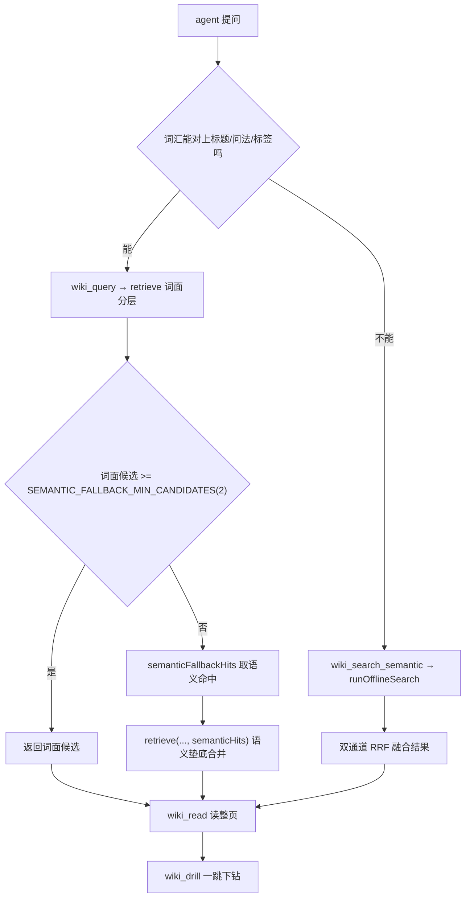
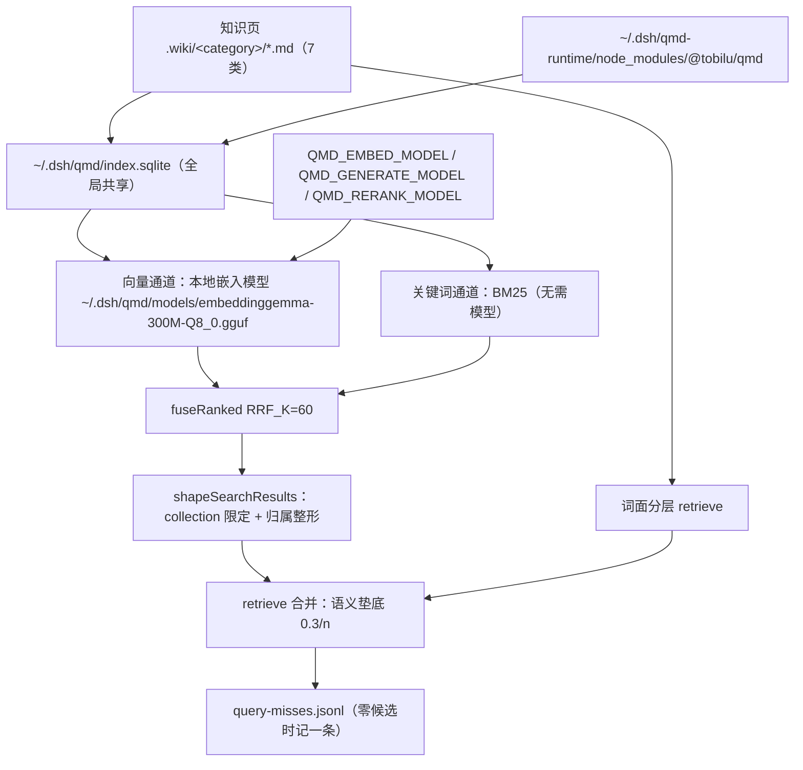

<details><summary>Relevant source files</summary>

- [src/tools.ts](src/tools.ts)
- [src/retriever.ts](src/retriever.ts)
- [src/semantic-index.ts](src/semantic-index.ts)
- [src/semantic-hits.ts](src/semantic-hits.ts)
- [src/drill.ts](src/drill.ts)
- [src/routes.ts](src/routes.ts)
- [src/miss-log.ts](src/miss-log.ts)

</details>

> 挖掘批次：能力挖掘重扫（2026-10-24，qmd 独立运行时改造之后）。本轮纠正：旧页的行号是 2026-10-21 批次产物，7 次提交后 `src/tools.ts` 整体后移约 96 行、`src/routes.ts` 后移约 61 行，全部旧锚点已按现码重定；同时补上 `qmdRuntimeDir` / `qmdRuntimeEntry` / `resolveQmdModule` 这条新链路与 `QMD_*` 环境变量注入。所有 `路径:行` 与 `sources` 均为脚本回读结果，无 `pending`。

## 1. 概念定义

### 1.1 核心概念

| 概念 | 定义 | 为什么重要 |
|---|---|---|
| **知识检索** | agent 与人在知识库中查找页面的全部通道：4 个工具（`wiki_query` / `wiki_search_semantic` / `wiki_drill` / `wiki_read`）+ 1 条 HTTP 路由（`GET /search`） | 知识页已编译好，但没有检索面 agent 不会主动翻；四个入口按「代价 vs 召回」递进分工，用错入口要么贵 100 倍要么召回空 |
| **词面分层检索** | `retrieve()` 按匹配字段分层：前置层（标题→问法→标签）→ 正文层 → 摘要层 → 图谱层 → 语义层，前置层全词命中即停 | 最便宜（5ms 量级），覆盖多数查询；分层顺序就是召回质量的优先级 |
| **问法层** | 正文 ` ```queries ` 围栏块声明的「这页回答什么问题」，基础分 5，介于标题(6)与标签(4)之间 | 能力页标题与真实提问常无共同 bigram（「知识检索」vs「词面检索和语义检索什么区别」），没有这一层，改写式提问只能掉到语义层 |
| **语义双通道** | 本地嵌入向量 + BM25 关键词，本地 RRF 融合，云端查询扩展/精排被显式禁用 | 词面空手时唯一的路；不联网、不需要单独启动 CLI |
| **双链下钻** | `wiki_drill` 从命中页沿 `[[wikilink]]` 走**一跳**，邻居带方向（out/in）与断链标记 | 解决「找到一页后怎么继续」；两跳即覆盖全库 40%–60%，故刻意只给一跳 |
| **兜底门** | `wiki_query` 只在词面候选 < `SEMANTIC_FALLBACK_MIN_CANDIDATES`(2) 时才调语义层 | 放过宽会让语义候选顶掉正确的词面 Top1（实测 Top1 精度 6/10→4/10） |
| **语义垫底** | 语义候选分值 = `SEMANTIC_RANK_BASE / 名次`（0.3/n），恒 < 0.35，且不乘 tier、不加度加权 | 语义只补召回、不参与词面之上的排序；否则 hub/core 页会稳定压过语义更相关的页 |
| **独立运行时目录** | qmd 装在 `~/.dsh/qmd-runtime`，不进 profile 依赖图；状态目录仍是 `~/.dsh/qmd` | qmd 一旦进 profile 清单，`qmd → node-llama-cpp → 14 个平台二进制包`（一次约 318MB）会在**每次 `dsh plugin add`** 时被重新解析 |

### 1.2 领域概念

| 概念 | 说明 |
|---|---|
| **RRF（Reciprocal Rank Fusion）** | 按名次而非分数融合多通道：`1/(60+rank)`，同页累加；两条 RRF 的常数都取 60（`fuseRanked` 与 `fuseSeedRanks`） |
| **tier 权重** | core 1.3 / supporting 1.0 / peripheral 0.7（`TIER_WEIGHT`），只作用于词面候选 |
| **度加权** | `min(度×0.1, 2)`，度 = 出链 + 入链（只统计指向库内真实页的链接，同目标重复只计一次）；语义候选传空度表刻意不加 |
| **collection** | QMD 索引库里的库分区（`collectionIdOf`：库路径规整成 `<slug>-wiki`），建索引与检索必须同源同名 |
| **guards（护栏位）** | 前置层是否「全部词命中」（`ratio === 1`）；只有全词命中且本库无语义命中才允许短路正文层 |
| **requireWarm** | 触发层专用的语义取用模式：只接受已热的运行时，绝不因冷启动挂住 pre-step |
| **失败冷却窗** | `SEMANTIC_FAILURE_RETRY_MS = 30_000`：失败的运行时只复用 30 秒结论，窗外允许重试（成功则永久复用） |

## 2. 系统事实

### 2.1 系统事实

| 事实 | 值 | 来源 |
|---|---|---|
| 词面打分层 | exactTitle 10 / title 6 / queries 5 / tag 4 / summary 2 / index 2 / body 1 / graph 0.5；语义层**不在这张表里** | `src/retriever.ts:21-31` |
| 语义分基准 | `SEMANTIC_RANK_BASE = 0.3`，第 n 名 = `0.3 / max(1, n)`，恒 < 0.35（graph 层零度 peripheral = 0.5×0.7） | `src/retriever.ts:49-54` |
| tier 权重 | `TIER_WEIGHT` = core 1.3 / supporting 1.0 / peripheral 0.7 | `src/retriever.ts:57` |
| 度加权 | `DEGREE_STEP = 0.1`、`MAX_DEGREE_BONUS = 2`；语义候选传 `NO_DEGREE` 空表 | `src/retriever.ts:60-63` |
| 最终打分式 | `(base + min(度×0.1, 2)) × tier 权重`（`scoreOf`） | `src/retriever.ts:377-379` |
| 兜底门 | `SEMANTIC_FALLBACK_MIN_CANDIDATES = 2`；唯一条件是「词面候选 < 2」，且 `index-only` 模式一律不掺语义 | `src/tools.ts:252`、`src/tools.ts:877` |
| 成本护栏 | `!hasSemantic && guardTriggered` 才短路（只返前置层 + 摘要层） | `src/retriever.ts:254-260` |
| 合并顺序 | 前置 → 正文 → 摘要 → 图谱 → 语义，按首次出现去重（语义天然垫底） | `src/retriever.ts:294` |
| 排序平局裁决 | score 降序 → 度降序 → 页面路径升序（结果可复现，不依赖遍历顺序） | `src/retriever.ts:403-409` |
| 检索零写入 | `listPagesReadonly()`，不触发 `ensure()`，全新 vault 也能检索 | `src/retriever.ts:186` |
| 问法层解析 | 正则读正文 ` ```queries ` 块（`queriesOf`）；不可用 frontmatter——`writePage()` 只写固定键 | `src/retriever.ts:336-340` |
| 前置层分层 | 标题（id 精确相等给 exactTitle）→ 问法 → 标签，一页只取最高一档；id 精确命中**不**触发护栏 | `src/retriever.ts:346-374` |
| strategy 披露 | 前置层含问法命中时 `title+queries+tag`，否则 `title+tag`；后续按层追加 summary/body/graph/semantic | `src/retriever.ts:226`、`src/retriever.ts:300-305` |
| 语义 RRF | `RRF_K = 60`，每通道按名次贡献 `1/(60+rank)` 后求和降序取前 limit | `src/semantic-index.ts:344-367` |
| 通道降级 | 向量/关键词任一失败只记 `degraded` 文案并如实回报，绝不抛异常 | `src/semantic-index.ts:386-419` |
| 双通道限定 | `collection` 同时传给 `searchVector` 与 `searchLex`；整形再用 `allowedCollection` 兜一层归属 | `src/semantic-index.ts:395`、`src/semantic-index.ts:409-413` |
| 云端模型禁用 | `offlineModelPins` 把 generate/rerank 指向本地不存在的 `DISABLED-*.gguf` | `src/semantic-index.ts:331-336` |
| 模型注入方式 | `QMD_EMBED_MODEL` / `QMD_GENERATE_MODEL` / `QMD_RERANK_MODEL` 按**绝对路径**写进进程环境（分块路径走模块级单例，只认 env） | `src/semantic-index.ts:428-438` |
| qmd 独立运行时 | 目录 `~/.dsh/qmd-runtime`，入口 `node_modules/@tobilu/qmd/dist/index.js`；解析顺序 = 独立目录优先 → profile 内安装兜底 → 抛可执行错误（含安装命令 `pnpm add --dir ... @tobilu/qmd@2.8.3`） | `src/semantic-index.ts:271-278`、`src/semantic-index.ts:296-323` |
| 运行时按库缓存 | 首次 7–10s，之后 28–83ms（差 100 倍以上）；可用（`store != null`）永久复用，失败只复用冷却窗 | `src/semantic-hits.ts:84-114`、`src/tools.ts:1317-1321` |
| 触发层只吃热运行时 | `requireWarm` 走 `warmSemanticRuntime` 同步查询，没热过就放弃语义兜底 | `src/semantic-hits.ts:139`、`src/semantic-hits.ts:151-154` |
| 句柄释放 | 插件卸载时 `disposeSemanticRuntimes()` 统一 close，避免 sqlite 句柄与模型常驻 | `src/tools.ts:1563` |
| 下钻参数上限 | seed 默认 5 / 上限 10；neighbors 默认 8 / 上限 20 | `src/drill.ts:103-106` |
| 下钻种子分 | 纯 RRF 融合分（不乘度/tier），度只做完全平局裁决 | `src/drill.ts:344-360` |
| 下钻邻居 | `neighborsFor` 一跳，出+入链，带 `direction` / `broken` / `via` | `src/drill.ts:209` |
| HTTP 检索面 | `GET /api/obsidian-wiki/search?q=&mode=`，直接 `retrieve(store, q, {mode})`，不掺语义 | `src/routes.ts:271-275` |
| 未命中埋点 | 零候选时记一条；只读、失败静默、`KNJ_OBSIDIAN_MISS_LOG=off` 可关 | `src/miss-log.ts:49-51` |

### 2.2 数据事实

| 数据 | 位置 / 形态 |
|---|---|
| 知识页 | `<vault>/.wiki/<category>/*.md`，7 个正式分类（`RETRIEVAL_CATEGORIES` / `FORMAL_CATEGORIES`）；`_system/`、`wiki-export/` 永不可被语义层命中 |
| 索引库 | `~/.dsh/qmd/index.sqlite`（**全局共享**，多库 collection 共存；本机实测 5.04 MB） |
| 嵌入模型 | `~/.dsh/qmd/models/embeddinggemma-300M-Q8_0.gguf`（本机实测 313.4 MB，手动放置；缺则报 `model-missing`，绝不下载） |
| qmd 运行时 | `~/.dsh/qmd-runtime/`（`package.json` + `node_modules/@tobilu/qmd/dist/index.js`、`pnpm-lock.yaml`；本机已就位，实测入口存在） |
| 状态目录声明 | `resolveStateHome()` 声明 `index.sqlite` / `models/` / `config.yml` 三件；本机实测只有前三者中的 index.sqlite 与 models/，`config.yml` 未被检索路径写出 |
| 未命中日志 | `<DSH_HOME 或 ~/.dsh>/knj-obsidian/query-misses.jsonl`，JSONL，封顶 2000 条（保留最近 N 条） |
| 语义检索出参 | `status` ∈ ready / index-empty / index-stale / model-missing / library-missing |

## 3. 功能树与入口映射

### 3.1 功能模块结构

```
知识检索
├─ 词面分层（wiki_query / GET /search）
│   ├─ 前置层：标题 + 问法(queries) + 标签（全词命中即停）
│   ├─ 正文层：占比加权 + 命中位置居中 snippet
│   ├─ 摘要层：正文不含时才产生（天然最后回退）
│   └─ 图谱层：正文命中页的出链邻居
├─ 语义双通道（wiki_search_semantic / wiki_query 兜底 / wiki_drill 种子）
│   ├─ 向量通道（本地 300M 嵌入模型）
│   ├─ 关键词通道（BM25，无需模型）
│   └─ 本地 RRF 融合（RRF_K = 60）
├─ 双链下钻（wiki_drill）
│   ├─ query 模式：语义种子 + 词面 RRF + 一跳邻居
│   └─ page 模式：纯图、零嵌入、毫秒级
└─ 整页读取（wiki_read）
    └─ 正文 + frontmatter 摘要/tier/confidence + 出入链（含断链）
```

### 3.2 入口映射表

| 入口 | 类型 | 必填参数 | 底层内核 | 实现文件:行 |
|---|---|---|---|---|
| `wiki_query` | 工具 | query | `retrieve()` 词面分层 + 兜底语义 | `src/tools.ts:816-891` |
| `wiki_search_semantic` | 工具 | query | `semanticRuntimeFor` + `runOfflineSearch` 双通道 | `src/tools.ts:1262-1372` |
| `wiki_drill`（query） | 工具 | query | `drillSemanticProbe` + `drillQuery`（RRF 融合种子） | `src/tools.ts:1446-1519` |
| `wiki_drill`（page） | 工具 | page | `drillPage` 纯图下钻 | `src/drill.ts:413-470` |
| `wiki_read` | 工具 | id | `readPageDetail`（整页 + 出入链） | `src/tools.ts:1521-1561` |
| `GET /api/obsidian-wiki/search` | 路由 | q | 纯词面 `retrieve()`（不掺语义） | `src/routes.ts:271-275` |

### 3.3 使用场景

| 场景 | 入口 | 理由 |
|---|---|---|
| 有明确词汇（术语、标题、页面 id） | `wiki_query` | 5ms 级，前置层直接命中；候选自带 summary 便于决定是否展开 |
| 改写式提问、自然语言长句 | `wiki_search_semantic` | 词面必然空手；双通道 + RRF 是唯一的路 |
| 词面几乎无果但要一次拿全 | `wiki_query`（自动兜底） | 候选 < 2 时自动补语义，语义命中整层垫底，不会抢排序 |
| 想顺着引用继续找 | `wiki_drill({query})` | 语义种子 + 一跳邻居，一次拿到「下一步读哪」 |
| 已知页面 id | `wiki_drill({page})` | 毫秒级，不跑嵌入 |
| 引用前取原文 | `wiki_read` | 强制读整页，防「有引用格式、没读原文」的伪知识 |
| 人在侧边栏搜 | 侧边栏搜索框 → `GET /search` | 纯词面、同步返回，不拖语义运行时 |

## 4. 调用链路总结

### 4.1 主链路图



### 4.2 分通道详细流程

**词面分层**（`src/retriever.ts:175-306`）：

```
拆词(tokenizeQuery：空白/标点切分 + ≥3 字 CJK 按 2 字滑窗拆 bigram)
  → 前置层(frontMatch：标题 → 问法 → 标签，一页只取最高一档)
  → 摘要层(仅在正文不命中时产生) → 护栏(!hasSemantic && guardTriggered) 命中即停
  → 正文层(占比加权 + 命中位置居中 snippet) → 图谱层(正文命中页的出链邻居)
  → 融合去重(前置>正文>摘要>图谱>语义) → rank(分降序→度降序→路径升序)
```

护栏只在「全部词命中且本库没有语义命中」时触发（`src/retriever.ts:254-260`）：多词查询只命中一个词时守卫为 false，弱前置命中不会截断正文层与图谱层。`id` 精确相等只加分、绝不放行护栏（改动前实测：`dsh-agent-orchestration` 放行后召回从 4 页掉到 1 页）。

**语义双通道**（`src/semantic-index.ts:386-419`）：

```
searchVector(query, {limit, collection})  ┐
searchLex(query, {limit, collection})     ┤→ 两通道都非空则 fuseRanked(RRF_K=60) → shapeSearchResults
                                          └→ 任一失败：记 degraded，用剩下的通道
```

`collection` 必须传当前库 id（`collectionIdOf`，`src/semantic-index.ts:44-46`）：索引库全局共享，不限定就串库。详见 [[qmd-全局索引库的跨库噪声与两道防线]]。

qmd 模块本身经 `resolveQmdModule` 解析：`~/.dsh/qmd-runtime` 优先（走 `pathToFileURL`，目录名可能含空格或非 ASCII），profile 内安装兜底，两条都失败时抛一条含两条候选路径、安装命令与底层报错的错误（`src/semantic-index.ts:296-323`）。因此 qmd 不再出现在 profile 依赖图里，装/卸任何插件都不再重新解析那 318MB 平台包。

**双链下钻**（`src/drill.ts:295-361`）：

```
retrieve() 词面候选 ┐
语义 backend 命中   ┤→ fuseSeedRanks(RRF，src/drill.ts:259-291) → 种子排序(纯 RRF 名次；度只裁决完全平局)
                    └→ neighborsFor(一跳，出+入链，带方向/断链，src/drill.ts:209)
```

**整页读取**：`wiki_read` → `readPageDetail`（`src/drill.ts:488`），出链/断链/入链三张清单与正文一次返回；未知 id 返回 `found:false` 而非抛错。

### 4.3 数据与存储关系



## 5. 附录

### 5.1 术语表

| 术语 | 含义 |
|---|---|
| 前置层 | 标题 + 问法 + 标签（frontmatter 与正文 queries 块，不读正文内容即完成匹配） |
| 成本护栏 | 前置层全词命中且无语义命中时短路下探的路径 |
| collection | QMD 索引库中的库分区，`collectionIdOf(vaultRoot)` |
| RRF_K | 融合常数 60（语义双通道与下钻种子各有一份，取值一致） |
| 兜底门 | `SEMANTIC_FALLBACK_MIN_CANDIDATES = 2` |
| 语义垫底 | 语义层分值恒低于 graph×peripheral（0.5×0.7=0.35） |
| 独立运行时 | qmd 的安装位 `~/.dsh/qmd-runtime`，与 profile 依赖图解耦 |
| 失败冷却窗 | 失败结论只复用 `SEMANTIC_FAILURE_RETRY_MS`(30s)，窗外重试 |

### 5.2 参考资料

- [[qmd-全局索引库的跨库噪声与两道防线]] — 索引库全局共享，检索限定与归属整形两道防线的实测依据
- [[语义融合会顶掉正确的词面-top1]] — 语义打分策略的实测教训（Top1 精度 6/10→4/10），兜底门不许放宽的原因
- [[语义层未就绪的诊断口径-require-假阴性-被吞掉的真实错误-永久失败缓存]] — `loadError` / `requireWarm` / 失败冷却窗的设计来由
- [[知识库读取触发层设计]] — 检索面之外的主动读取触发（L0–L4）
- [[capability-知识写入]] — 知识页怎么来；检索的输入侧

## 任务问法

（这页应该回答的问题——问答式与任务式都要收）

```queries
知识检索是怎么实现的
词面分层和语义双通道怎么分工
语义层为什么会串库
为什么兜底门是 2 不是 3
wiki_query 和 wiki_search_semantic 什么区别
语义分为什么整层垫底
改检索排序 / 调打分权重
加一个新的 wiki 工具
```

## Sources

- `src/tools.ts:816-891`（`wiki_query` 注册、`SEMANTIC_FALLBACK_MIN_CANDIDATES` 兜底门、`semanticFallbackHits`）
- `src/tools.ts:252`（`SEMANTIC_FALLBACK_MIN_CANDIDATES = 2` 与「不要再放宽」的实测证据）
- `src/tools.ts:1262-1372`（`wiki_search_semantic` 注册、`semanticRuntimeFor` 复用、`runOfflineSearch` 调用）
- `src/tools.ts:1446-1519`（`wiki_drill` 注册、`drillSemanticProbe`、`drillQuery` 调用）
- `src/tools.ts:1521-1561`（`wiki_read` 注册与 `readPageDetail`）
- `src/tools.ts:1563`（`disposeSemanticRuntimes` 卸载释放）
- `src/retriever.ts:21-31`（`MATCH_SCORE`：exactTitle/title/queries/tag/summary/body/graph）
- `src/retriever.ts:49-63`（`SEMANTIC_RANK_BASE = 0.3`、`TIER_WEIGHT`、`MAX_DEGREE_BONUS`、`NO_DEGREE`）
- `src/retriever.ts:175-306`（`retrieve` 分层主链、`frontMatch`、`frontLabel`）
- `src/retriever.ts:254-260`（成本护栏 `guardTriggered` 短路）
- `src/retriever.ts:336-374`（`queriesOf` 问法块解析、`frontMatch` 与 `guards`）
- `src/retriever.ts:403-409`（`rank` 平局裁决）
- `src/semantic-index.ts:271-323`（`qmdRuntimeDir`、`qmdRuntimeEntry`、`resolveQmdModule` 解析顺序）
- `src/semantic-index.ts:331-336`（`offlineModelPins` 云端模型禁用位）
- `src/semantic-index.ts:344-367`（`fuseRanked`、`RRF_K = 60`）
- `src/semantic-index.ts:386-419`（`runOfflineSearch` 双通道与降级、`shapeSearchResults`）
- `src/semantic-index.ts:428-438`（`offlineModelEnv`、`QMD_EMBED_MODEL`、`applyOfflineModelEnv`）
- `src/semantic-index.ts:44-46`（`collectionIdOf`）
- `src/semantic-hits.ts:84-114`（`semanticRuntimeFor` 按库缓存与可用/失败判定）
- `src/semantic-hits.ts:146-157`（`semanticRawHits`、`requireWarm` 热运行时门）
- `src/semantic-hits.ts:48`（`SEMANTIC_FAILURE_RETRY_MS = 30_000`）
- `src/drill.ts:259-291`（`fuseSeedRanks` 名次级 RRF）
- `src/drill.ts:295-301`（`drillQuery` 与 `DEFAULT_SEED_LIMIT`）
- `src/drill.ts:413-470`（`drillPage` 纯图模式与 `neighborsFor`）
- `src/routes.ts:271-275`（`GET` `/search` 路由直通 `retrieve`）

```sources
[
  {"path":"src/tools.ts","hash":"sha256:750e59e1f739ed94","symbols":["wiki_query","wiki_search_semantic","wiki_drill","wiki_read","SEMANTIC_FALLBACK_MIN_CANDIDATES","semanticFallbackHits","semanticRuntimeFor","runOfflineSearch","readPageDetail","disposeSemanticRuntimes"]},
  {"path":"src/retriever.ts","hash":"sha256:eee7239c132622b6","symbols":["retrieve","MATCH_SCORE","SEMANTIC_RANK_BASE","TIER_WEIGHT","MAX_DEGREE_BONUS","frontMatch","frontLabel","queriesOf","guards","rank"]},
  {"path":"src/semantic-index.ts","hash":"sha256:201aee37cc534f09","symbols":["collectionIdOf","qmdRuntimeDir","qmdRuntimeEntry","resolveQmdModule","offlineModelPins","fuseRanked","runOfflineSearch","shapeSearchResults","QMD_EMBED_MODEL","applyOfflineModelEnv"]},
  {"path":"src/semantic-hits.ts","hash":"sha256:c567bbcc9252c5ab","symbols":["semanticRuntimeFor","semanticRawHits","requireWarm","SEMANTIC_FAILURE_RETRY_MS","warmSemanticRuntime"]},
  {"path":"src/drill.ts","hash":"sha256:0cc07fa01c92b27d","symbols":["drillQuery","drillPage","fuseSeedRanks","neighborsFor","DEFAULT_SEED_LIMIT"]},
  {"path":"src/routes.ts","hash":"sha256:6912078691258cac","symbols":["search"]}
]
```
