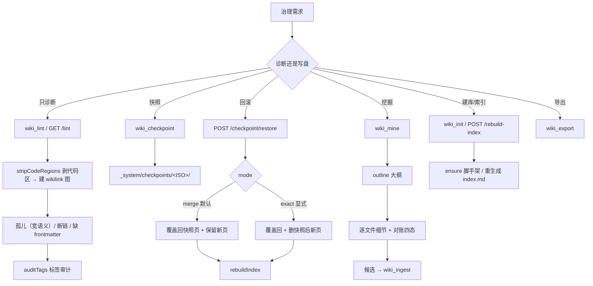
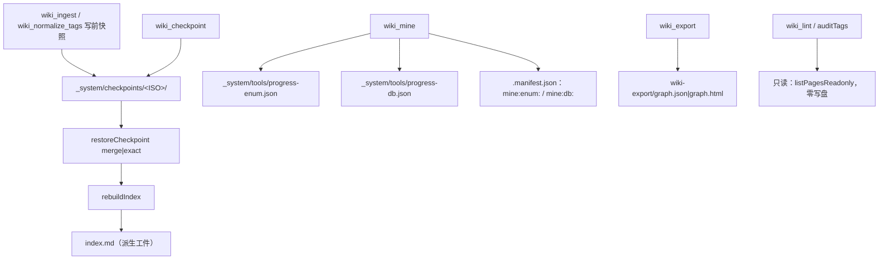

<details><summary>Relevant source files</summary>

- [src/tools.ts](src/tools.ts)
- [src/lint.ts](src/lint.ts)
- [src/checkpoint.ts](src/checkpoint.ts)
- [src/code-miner.ts](src/code-miner.ts)
- [src/index-builder.ts](src/index-builder.ts)
- [src/taxonomy.ts](src/taxonomy.ts)
- [src/mining-progress.ts](src/mining-progress.ts)
- [src/routes.ts](src/routes.ts)
- [src/vault-manager.ts](src/vault-manager.ts)
- [src/vault-store.ts](src/vault-store.ts)

</details>

> 挖掘批次：能力挖掘重扫（2026-10-24）。本轮相对 2026-10-21 版有四处实质变化：①**lint 说真话**（commit `a471cf6`）——提取 wikilink 前先 `stripCodeRegions` 剥代码区，`INDEX_PAGE_ID` 让索引页不再算孤儿；②**不再隐式建库**——lint 走 `listPagesReadonly`，`VaultManager.currentRecord()`/`current()` 也不对未初始化库 `ensure`；③行号整体漂移（`src/tools.ts` 约 +96 行、`src/routes.ts` 约 +61 行），旧页入口表里的注册行/路由行锚点已逐条重核；④补上「写前快照的调用点」（`wiki_ingest`、`wiki_normalize_tags` 各自在写盘前建还原点），旧页只在场景表里含糊提过一句。

## 1. 概念定义

### 1.1 核心概念

| 概念 | 定义 | 为什么重要 |
|---|---|---|
| **知识治理** | 不新增知识、只维护库健康的全部操作：lint / checkpoint / restore / mine / init / rebuild-index / export | 库会腐烂：孤儿页、断链、标签漂移、索引过期；没有治理通道就只能重建整库 |
| **lint（说真话）** | 体检：孤儿 / 断链 / 缺 frontmatter / 标签审计；提取链接前先剥代码区 | 诊断工具撒谎比不报更贵——它会让人去修一个不存在的问题（本库曾报 3 条全是同一个假目标） |
| **checkpoint** | 整库快照：7 个分类目录全部 `.md` + `index.md` + `.manifest.json` | 批次级回滚凭据；快照在**写盘前**建，不是写完再补 |
| **restore** | 按快照回写；`merge` 默认非破坏，`exact` 显式才删新页 | 默认破坏会把别人的正当产物一起抹掉；默认保守把「回滚」降级成「什么都不发生」 |
| **mine** | 从代码静态挖枚举/常量类与表结构候选（Java / SQL / MyBatis / JPA） | 代码结构知识的确定性来源；靠模型读源码会漏、会编 |
| **init** | 建 `.wiki` 脚手架（7 分类 + index + manifest），幂等 | 未初始化 ≠ 已注册；初始化是**显式动作**，不能被「看一眼」触发 |
| **写后治理 vs 写前快照** | 治理工具本身不改页面内容；真正写盘的是 restore / rebuild-index / init / export | 把「只读诊断」和「写操作」混在一起，就会出现「查一次就建库」的副作用 |

### 1.2 领域概念

| 概念 | 说明 |
|---|---|
| **孤儿页（宽语义）** | lint 的定义是「双向链接未织好」：`!hasOut \|\| !hasIn` 都算孤儿（有出无入、有入无出、完全无链接都算）；只有既有出链又有入链才算真正织入。**有意与 `graph-engine.ts` 的严格语义（`!hasOut && !hasIn`）不同，双语义并存，勿"统一"** |
| **断链** | `[[wikilink]]` 指向不存在的页 id。`WIKILINK_RE` 支持 `#锚点` 与 `\|别名` 语法：`[[目标#小节\|显示文字]]` 只取 `目标` 段 |
| **代码区剥离** | `stripCodeRegions`：剥围栏代码块（```` ``` ````/`~~~`）与行内代码（`` `…` ``），**不**剥四空格缩进块——宁少剥不多剥，剥过头会把真断链藏起来；未闭合围栏视为「其后全是代码」 |
| **INDEX_PAGE_ID** | 值为 `'index'`；库根索引页天然没有入链，它是库入口而不是图谱节点，报成孤儿只是噪声 |
| **标签审计六类** | `unknown`（不在词表）/ `aliasUsed`（用了别名）/ `overTagged`（超 `TAG_LIMIT`）/ `untagged`（零标签）/ `promote`（≥2 页的未知词，升表候选）/ `localTypeTags`（库级新增的 Type 词）；另有 `shadowedBaseTags`（库级重复登记基础层词，会遮蔽基础层更新） |
| **无词表降级** | `loadTaxonomy` 两层都没有有效规范词时返回 `null`：此时**不报**未知/别名/升表（没有「规范」可言），`overTagged`/`untagged` 照报 |
| **merge 回滚** | 默认模式：只把快照里的页**覆盖回**（撤销批次对既有页的修改），**保留**快照之后新增的页，并回报 `keptNewer` 计数 |
| **exact 回滚** | 显式模式：整库回到快照状态，`rmSync` 删除快照之后新增的页 |
| **对账四态** | new / changed / unchanged / deleted；判据是 manifest 里 `mine:enum:<file>` / `mine:db:<file>` 的 `content_hash` 与本次文件 sha256 比较 |
| **两阶段（大纲→细节）** | `mineEnums`/`mineTables` 先产出 `outline`（module / fileCount / enumEstimate / tableEstimate），再给逐条明细；`wiki_mine` 的 `remaining` 用 outline 模块数算 |
| **断点续传** | 进度落 `_system/tools/progress-<kind>.json`，模块级 `pending`/`done`/`partial`；中断最多丢一个模块 |

## 2. 系统事实

### 2.1 系统事实

| 事实 | 值 | 来源 |
|---|---|---|
| 治理操作是否改页面内容 | **否**（lint / checkpoints / mine 走只读 store；只有 restore、rebuild-index、init、export 写盘） | `src/tools.ts:810`（`sessionReadonlyStore`）、`src/tools.ts:1256` |
| lint 是否隐式建库 | **否**——`auditTags` 与 `lintVault` 都用 `listPagesReadonly`（不 `ensure`、不建目录） | `src/lint.ts:98`、`src/lint.ts:154`、`src/vault-store.ts:497` |
| `listPages` 与 `listPagesReadonly` 的差别 | 前者先 `this.ensure()` 再调后者；后者分类目录缺失时 `catch` 跳过 | `src/vault-store.ts:487` |
| 断链判定前是否剥代码区 | **是**：`const body = stripCodeRegions(page.body)` 后才 `matchAll(WIKILINK_RE)` | `src/lint.ts:171` |
| 剥代码区只处理哪些 | 围栏代码块 + 行内代码；**不**处理四空格缩进块；未闭合围栏 => 其后全算代码 | `src/lint.ts:58`（`stripCodeRegions`） |
| 索引页是否计孤儿 | **否**：`p.id === INDEX_PAGE_ID` 直接 `return false` | `src/lint.ts:78`、`src/lint.ts:194` |
| 孤儿判据 | `!hasOut \|\| !hasIn`（宽语义；与 graph-engine 严格语义并存） | `src/lint.ts:197` |
| 缺 frontmatter 判据 | `readPage` 返回 null，或 `created`/`source`/`confidence` 任一缺失 | `src/lint.ts:168` |
| 标签上限 | `TAG_LIMIT = 5`（系统标签 `visibility/*` 不计入） | `src/taxonomy.ts:18`、`src/lint.ts:109` |
| 升表候选门槛 | 未知词出现 **≥2 页**才进 `promote`（1 页的应换成更宽的规范词） | `src/lint.ts:136` |
| 还原点快照范围 | 7 个分类目录全部 `.md` + `index.md` + `.manifest.json` | `src/checkpoint.ts:11`、`src/checkpoint.ts:12` |
| 还原点 id 形态 | ISO 时间戳把 `:` 与 `.` 换成 `-`（如 `2026-10-24T13-39-14-678Z`）；严格正则校验防路径穿越（不匹配抛 `SaveError(400)`） | `src/checkpoint.ts:14`、`src/checkpoint.ts:29` |
| `listCheckpoints` 的 `createdAt` | 由 id 反推（`id.replace(/-(\d{2})-(\d{2})$/, ':$1:$2')`）——但 id 以 `Z` 结尾，该正则**实际不命中**，返回的是 dashed id 原样；真 ISO 时间戳只有 `createCheckpoint` 的返回值里有 | `src/checkpoint.ts:60`、`src/checkpoint.ts:44` |
| 恢复默认模式 | `mode: 'merge' | 'exact' = 'merge'`；非法值抛 400，快照不存在抛 404 | `src/checkpoint.ts:76`、`src/checkpoint.ts:79` |
| 两种模式都要做的 | 把快照里的页 `cpSync` 覆盖回（撤销批次对旧页的修改） | `src/checkpoint.ts:100` |
| merge 与 exact 的唯一分歧 | `exact` 先用 `rmSync` 删掉快照外的新页；`merge` 只累加 `keptNewer` | `src/checkpoint.ts:92` |
| 恢复返回值 | `{ ok, pageCount, restored, keptNewer, mode }`，且回写 `index.md` / `.manifest.json` | `src/checkpoint.ts:113` |
| `wiki_ingest` 的写前快照 | 真正写页前 `createCheckpoint(store).id`；失败被 `catch` 吞掉（不阻塞写入，返回值里 `checkpointId` 变 `undefined`） | `src/tools.ts:407` |
| `wiki_normalize_tags` 的写前快照 | `dryRun=false` 的真实写入路径先建还原点；失败置 `checkpointFailed=true` 如实告知 | `src/tools.ts:690` |
| `POST /checkpoint/restore` 恢复后做什么 | 立刻 `rebuildIndex(store)`（索引是派生工件，回滚后必须重生成） | `src/routes.ts:329` |
| 写白名单 | `WRITE_PATHS` = `/page`、`/rebuild-index`、`/import`、`/checkpoint/restore`；只有这些 POST 走 `provider.current()`（会 ensure），其余走 `currentReadonly()` | `src/routes.ts:149`、`src/routes.ts:179` |
| `currentRecord()` 空壳行为 | 当前库未初始化时**优先返回另一个已初始化的库**；全都未初始化才返回当前库 | `src/vault-manager.ts:162`、`src/vault-manager.ts:170` |
| `current()` 是否隐式 ensure | **否**：`this.storeFor(rec.root, this.isInitialized(rec.root))`——只有已初始化库才 ensure；仅当连库记录都没有时才兜底 `storeFor(cwdRoot, true)` | `src/vault-manager.ts:186`、`src/vault-manager.ts:194`、`src/vault-manager.ts:190` |
| mine 的排除目录 | `node_modules`、`.git`、`.svn`、`target`、`dist`、`__pycache__`、`.wiki`（**没有 `build`**） | `src/code-miner.ts:8` |
| mine 支持的结构 | Java `enum` + `public static final`（String/Integer/Long/int/long/short/byte）常量类、SQL DDL、MyBatis XML、JPA Entity；**不支持 TS/Python/任意 ORM** | `src/code-miner.ts:63`、`src/code-miner.ts:105`、`src/code-miner.ts:206`、`src/code-miner.ts:286`、`src/code-miner.ts:331` |
| 表结构多来源合并优先级 | `SOURCE_PRIORITY = { ddl: 3, jpa: 2, mapper: 1 }`；同表高优先级来源的列/索引/关系替换低优先级，`sources` 取并集 | `src/code-miner.ts:367`、`src/code-miner.ts:370` |
| resume 的陷阱 | 无 pending/partial 记录时**不做过滤**（返回 null），否则 resume 会把结果全滤空 | `src/tools.ts:1060` |
| deleted 对账的条件 | 仅全扫（`isFullScan = !args.module && !args.resume`）才判删；带过滤时扫不到的文件不能据以判删 | `src/tools.ts:1069`、`src/tools.ts:1087` |
| 挖掘进度何时落盘 | 只有 `.wiki` 已存在才写（`canPersistProgress = existsSync(store.wikiRoot)`），否则跳过——避免"挖掘即建库" | `src/tools.ts:1053`、`src/tools.ts:1128` |
| `wiki_init` 是否幂等 | 是：`created = !existedBefore`，`store.ensure()` 只补缺失结构；`existedBefore` 必须在 `ensureVaultAt` **之前**取 | `src/tools.ts:1188`、`src/tools.ts:1192` |
| `wiki_export` 产物 | `<vault>/.wiki/wiki-export/graph.json` 或 `graph.html`；`nodeCount < 2` 时附加"图谱过小"提示 | `src/tools.ts:920`、`src/tools.ts:911` |
| `rebuildIndex` 是否幂等 | 是；排序键是 id 码位升序（不用 `localeCompare`，避免 locale 让派生工件不可复现），摘要优先取 frontmatter `summary:` | `src/index-builder.ts:39`、`src/index-builder.ts:34` |
| 索引行格式 | `- [[id]] 标题 — 摘要`，与 retriever L1 的 `[[wikilink]]` 行匹配兼容 | `src/index-builder.ts:57` |

### 2.2 数据事实

| 数据 | 位置 / 形态 |
|---|---|
| 还原点 | `<vault>/.wiki/_system/checkpoints/<ISO>/`（内部运行数据，不参与知识检索） |
| 挖掘进度 | `<vault>/.wiki/_system/tools/progress-enum.json`、`progress-db.json`（JSON，`{version:1, kind, modules:{<module>:{state,updatedAt}}}`） |
| 标签词表 | `taxonomy.base.md`（随插件，Type 轴 + 通用别名）+ `<vault>/_meta/taxonomy.md`（库级，Domain/Project）；生效词表 = 两层并集，同词以库级为准 |
| 对账指纹 | `<vault>/.wiki/.manifest.json` 的 `sources` 映射，键为 `mine:enum:<file>` / `mine:db:<file>`，值含 `content_hash`（源文件 sha256） |
| 导出产物 | `<vault>/.wiki/wiki-export/graph.json` / `graph.html` |
| 索引 | `<vault>/.wiki/index.md`——**派生工件**，由 `rebuildIndex` 覆盖，自定义注释会丢 |

## 3. 功能树与入口映射

### 3.1 功能模块结构

```
知识治理
├─ 健康检查（只读）
│   └─ wiki_lint / GET /lint      ← lintVault + auditTags；先剥代码区，index 不计孤儿
├─ 快照与回滚
│   ├─ wiki_checkpoint            ← createCheckpoint（写盘前快照）
│   ├─ wiki_checkpoints           ← listCheckpoints（新→旧）
│   └─ POST /checkpoint/restore   ← restoreCheckpoint（merge 默认 / exact 删新）+ rebuildIndex
├─ 结构挖掘（只读扫描 + 进度写 _system）
│   ├─ wiki_mine                  ← mineEnums / mineTables；两阶段 + 对账 + resume
│   └─ src/mining-progress.ts     ← readProgress / pendingModules / progressFileFor
├─ 建库与索引
│   ├─ wiki_init                  ← ensureVaultAt + VaultStore.ensure（幂等）
│   └─ POST /rebuild-index        ← rebuildIndex（index.md 是派生工件）
└─ 导出
    └─ wiki_export                ← buildGraph → graph.json / graph.html
```

### 3.2 入口映射表

| 入口 | 类型 | 必填 | 内核 | 文件:行 |
|---|---|---|---|---|
| `wiki_lint` | tool | — | `lintVault`（内含 `auditTags`） | `src/tools.ts:726` |
| `wiki_checkpoint` | tool | — | `createCheckpoint` | `src/tools.ts:1209` |
| `wiki_checkpoints` | tool | — | `listCheckpoints` | `src/tools.ts:1233` |
| `wiki_mine` | tool | kind（默认 `both`）、module、resume 均可选 | `mineEnums` / `mineTables` | `src/tools.ts:930` |
| `wiki_init` | tool | — | `ensureVaultAt` + `VaultStore.ensure` | `src/tools.ts:1151` |
| `wiki_export` | tool | format（默认 `html`；`json` 可选） | `buildGraph` → `writeFileSync` | `src/tools.ts:894` |
| `GET …/lint` | route | — | `lintVault` | `src/routes.ts:281` |
| `POST …/rebuild-index` | route | body 不携带参数（仅作触发；须同源 + JSON） | `rebuildIndex` | `src/routes.ts:285` |
| `GET …/checkpoints` | route | — | `listCheckpoints` | `src/routes.ts:318` |
| `POST …/checkpoint/restore` | route | id（string）、mode（`exact` 需显式，默认 `merge`） | `restoreCheckpoint` + `rebuildIndex` | `src/routes.ts:322` |

### 3.3 使用场景

| 场景 | 入口 | 理由 |
|---|---|---|
| 批次入库前确保能回滚 | `wiki_checkpoint` | 显式拿 id；`wiki_ingest` 自己也会在写盘前建一份 |
| 怀疑库有孤儿/断链 | `wiki_lint` | 唯一体检；正文示例里的 `[[wikilink]]` 不会被误报 |
| 核对标签漂移 | `wiki_lint` 的 `tags` 段 | 未知/别名/超上限/零标签 + 升表候选一站出齐 |
| 把 Java 枚举/表结构收进库 | `wiki_mine` | 确定性挖掘 + 对账四态，可 resume |
| 新项目第一次建库 | `wiki_init` | 幂等脚手架，且只在**本会话工作区**建 |
| 想看知识图谱 | `wiki_export` | 出 `graph.html` 单文件，浏览器直接开 |
| 回滚刚跑坏的批次 | `POST /checkpoint/restore` | 默认 merge 保留别人的新页；`exact` 才整库回退 |
| 索引与页面不一致 | `POST /rebuild-index` | index.md 是派生工件，重生成即幂等修复 |

## 4. 调用链路总结

### 4.1 主链路图



### 4.2 分通道详细流程

```
lint（src/lint.ts:153 lintVault）
  1. listPagesReadonly()（不 ensure）→ 逐页 readPage
  2. readPage 为 null 或 created/source/confidence 缺失 → missingFrontmatter
  3. body = stripCodeRegions(page.body)（剥围栏 + 行内代码，不剥四空格块）
  4. matchAll(WIKILINK_RE)：目标不在 ids 里 → brokenLinks；在 → 记入链；出链计数 +1
  5. 孤儿 = 非 index 页且 (无出链 或 无入链)
  6. tags = auditTags(store, loadTaxonomy(store, opts))
     —— 词表为空(null) 时只报 overTagged/untagged，unknown/alias/promote 全空
```

```
checkpoint（src/checkpoint.ts:28 createCheckpoint）
  1. id = new Date().toISOString() 把 : 与 . 换成 -  → mkdir _system/checkpoints/<id>
  2. 对 7 个分类目录逐个 cpSync(recursive)（不存在则跳过）
  3. 拷 index.md + .manifest.json（同样存在才拷）
  4. pageCount = 7 个目录下 .md 文件数之和
  5. 返回 { id, createdAt: 真 ISO, pageCount }
```

```
restore（src/checkpoint.ts:73 restoreCheckpoint）
  1. assertCheckpointId（CHECKPOINT_ID_RE 防路径穿越）→ mode ∈ {merge, exact} 否则 400
  2. 快照目录不存在 → SaveError 404
  3. 逐分类目录：
     - exact：rmSync 快照外的 live 文件
     - merge：keptNewer += 快照外的 live 文件数（不动它们）
  4. 两模式都 cpSync 快照页覆盖回 live（restored++）
  5. 回写 index.md / .manifest.json（快照里存在才写）
  6. 返回 { ok, pageCount, restored, keptNewer, mode }
  注：路由层拿到结果后再 rebuildIndex(store)（src/routes.ts:329）
```

```
mine（src/tools.ts:1049 execute）
  1. sessionReadonlyStore（只读解析库，不建库）；canPersistProgress = .wiki 是否已存在
  2. readProgress(progressFileFor(wikiRoot,'enum')) / ('db')
  3. resume：pendingModules 并集 → 非空则按 module 过滤；空则不过滤
  4. isFullScan = !module && !resume（决定能不能判 deleted）
  5. mineEnums / mineTables 产出 outline + 明细（含每文件 sha256）
  6. 对账：manifestEntry('mine:enum:<file>') 有无 / hash 相等 → new / changed / unchanged
  7. 全扫时再用 manifestSources 里 mine:* 的键减去本次扫到的文件 → deleted
  8. 把本次覆盖到的模块 markModule(...,'done') 写回 progress-<kind>.json（失败只吞掉）
  9. JSON.parse(JSON.stringify(...)) 保证 lossless（optional 字段 undefined 会被拒）
```

```
rebuild-index / init
  POST /rebuild-index：同源 + JSON 校验 → readBody（仅触发）→ rebuildIndex(store)
  rebuildIndex：listPages → 按 7 个 SECTION_TITLES 分组 → 每组按 id 码位排序 → 写 index.md
  wiki_init：cwd 有值 → readonlyVaultForRoot 命中则 ensure + created=!existed；
             未命中 → workspaceRootFor 求工作区根 → existedBefore 先取 → ensureVaultAt
```

### 4.3 数据与存储关系



## 5. 附录

### 5.1 术语表

| 术语 | 含义 |
|---|---|
| 孤儿页 | lint 宽语义：`!hasOut \|\| !hasIn`（双向未织好）；graph-engine 严格语义：`!hasOut && !hasIn` |
| 断链 | `[[wikilink]]` 指向不存在的页 id |
| 代码区 | 围栏代码块 + 行内代码；`stripCodeRegions` 剥掉它们再提链接 |
| `INDEX_PAGE_ID` | `'index'`，库根索引页，不计孤儿 |
| `localTypeTags` | 本库词表新增、基础层没有的 Type 词（先在库级用，确认跨项目才升基础层） |
| `shadowedBaseTags` | 库级词表重复登记了基础层已有的词 → 遮蔽基础层的后续更新 |
| `promote` | 出现 ≥2 页的未知标签：升表候选；1 页的应换成更宽的规范词 |
| `keptNewer` | merge 回滚时保留的快照后新页数量 |
| 对账四态 | new / changed / unchanged / deleted |
| `isFullScan` | `!module && !resume`；只有全扫才判 deleted |
| `canPersistProgress` | 库已存在（`.wiki`）才写进度，避免"挖掘即建库" |

### 5.2 参考资料

- [[知识库读取触发层设计]] — L0/L2 的库解析契约；本页的「只读解析、零写盘」与它同源
- [[插件验证纪律与实测陷阱]] — lint 曾经撒谎、假绿/假计数的教训都在这里
- [[capability-知识写入]] — 写侧的还原点调用点（`wiki_ingest` 写前快照）与治理侧的 restore 成对
- [[只改编译产物的修复会被下一次构建静默回滚]] — 治理工具的改法同样要看到 `src/`；只改产物会被下一次构建吞掉
- [[会话级知识库绑定]] — `sessionReadonlyStore` / `readonlyVaultForRoot` 的来由
- [[capability-知识检索]] — 治理产物 `index.md` 是 L1 检索的唯一来源

## 任务问法

（这页应该回答的问题——问答式与任务式都要收）

```queries
lint 怎么查孤儿页和断链
lint 的标签审计规则是什么
还原点的 merge 和 exact 有什么区别
wiki_mine 支持哪些语言和结构
为什么 lint 不报正文里示例的 wikilink 断链
代码结构挖掘的断点续传怎么工作
改 lint 的标签审计规则
新增一个治理工具
```

## Sources

- `src/lint.ts:58-75`（`stripCodeRegions`：剥围栏代码块与行内代码，宁少剥不多剥）
- `src/lint.ts:78`（`INDEX_PAGE_ID` = 'index'，索引页不计孤儿）
- `src/lint.ts:95-151`（`auditTags`：`TagAudit` 七类输出、`TAG_LIMIT`、`promote` ≥2 页门槛）
- `src/lint.ts:153-202`（`lintVault`：`listPagesReadonly`、`stripCodeRegions`、`missingFrontmatter`、孤儿宽语义）
- `src/checkpoint.ts:14-24`（`CHECKPOINT_ID_RE` 严格 id + `assertCheckpointId` 拒绝路径穿越）
- `src/checkpoint.ts:28-45`（`createCheckpoint`：`CATEGORIES` + `SNAPSHOT_FILES` 快照，返回 `pageCount`）
- `src/checkpoint.ts:48-63`（`listCheckpoints` 新→旧排序与 `createdAt` 反推）
- `src/checkpoint.ts:73-114`（`restoreCheckpoint`：`merge` 默认非破坏、`exact` 删新页、`keptNewer`）
- `src/tools.ts:407-408`（写前 `createCheckpoint`：`wiki_ingest` 的结构性保证）
- `src/tools.ts:809-813`（`wiki_lint` execute：`sessionReadonlyStore` → `lintVault`）
- `src/tools.ts:915-925`（`wiki_export` execute：`buildGraph` → `graph.json` / `graph.html`）
- `src/tools.ts:1049-1146`（`wiki_mine` execute：`resumeOnly`、`isFullScan`、`manifestEntry` 对账、`markModule`）
- `src/tools.ts:1169-1204`（`wiki_init` execute：`ensureVaultAt`、`workspaceRootFor`、`created` 幂等）
- `src/tools.ts:1209-1229`（`wiki_checkpoint`：`sessionWriteStore` + `createCheckpoint`，只建快照不恢复）
- `src/tools.ts:1233-1259`（`wiki_checkpoints`：只读 `sessionReadonlyStore` + `listCheckpoints`）
- `src/code-miner.ts:141-163`（`mineEnums`：`parseJavaFile` + 模块级 `outline` 大纲）
- `src/code-miner.ts:367-390`（`mergeTables`：`SOURCE_PRIORITY` ddl > jpa > mapper）
- `src/code-miner.ts:393-433`（`mineTables`：`parseDdlFile` / `parseMapperXml` / `parseJpaEntity` 三来源合并）
- `src/index-builder.ts:39-63`（`rebuildIndex`：`SECTION_TITLES` 分组、`byId` 码位排序、写 index.md）
- `src/mining-progress.ts:21-44`（`readProgress` / `pendingModules` / `progressFileFor` 断点续传）
- `src/routes.ts:149`（`WRITE_PATHS` 四项写白名单：/page、/rebuild-index、/import、/checkpoint/restore）
- `src/routes.ts:281-283`（`GET /lint` → `lintVault`）
- `src/routes.ts:285-293`（`POST /rebuild-index` → `rebuildIndex`，body 仅作触发）
- `src/routes.ts:318-320`（`GET /checkpoints` → `listCheckpoints`）
- `src/routes.ts:322-331`（`POST /checkpoint/restore` → `restoreCheckpoint` + `rebuildIndex`）
- `src/vault-manager.ts:162-172`（`currentRecord`：空壳时优先已初始化库、`isInitialized`）
- `src/vault-manager.ts:186-195`（`current` 不对未初始化库 ensure，`isInitialized` 决定是否 ensure）
- `src/vault-store.ts:487-497`（`listPages` 先 ensure；`listPagesReadonly` 不建目录）
- `src/taxonomy.ts:18`（`TAG_LIMIT` = 5）
- `src/taxonomy.ts:30`（`SYSTEM_TAG_PREFIX` = visibility/，不计上限不算未知）
- `src/taxonomy.ts:184-200`（`loadTaxonomy`：基础层 ∪ 库级层，无规范词返回 null）

```sources
[
  {"path":"src/tools.ts","hash":"sha256:750e59e1f739ed94","symbols":["wiki_lint","wiki_export","wiki_mine","wiki_init","wiki_checkpoint","wiki_checkpoints"]},
  {"path":"src/lint.ts","hash":"sha256:6fd257e83f4c26a7","symbols":["stripCodeRegions","INDEX_PAGE_ID","auditTags","lintVault"]},
  {"path":"src/checkpoint.ts","hash":"sha256:11a8c3119b2fd0b1","symbols":["createCheckpoint","listCheckpoints","restoreCheckpoint","CHECKPOINT_ID_RE"]},
  {"path":"src/code-miner.ts","hash":"sha256:62a7994c63ef8f24","symbols":["mineEnums","parseDdlFile","parseMapperXml","parseJpaEntity","mergeTables","mineTables"]},
  {"path":"src/index-builder.ts","hash":"sha256:051b7e5d6f51d95c","symbols":["rebuildIndex","byId","SECTION_TITLES"]},
  {"path":"src/mining-progress.ts","hash":"sha256:92e4d440e1502af1","symbols":["readProgress","pendingModules","progressFileFor"]},
  {"path":"src/routes.ts","hash":"sha256:6912078691258cac","symbols":["WRITE_PATHS","lintVault","listCheckpoints","restoreCheckpoint","rebuildIndex"]},
  {"path":"src/vault-manager.ts","hash":"sha256:893434304cf07940","symbols":["currentRecord","current","isInitialized"]},
  {"path":"src/vault-store.ts","hash":"sha256:7ab646573d70cb40","symbols":["listPages","listPagesReadonly"]},
  {"path":"src/taxonomy.ts","hash":"sha256:49eaed875486d4e4","symbols":["TAG_LIMIT","SYSTEM_TAG_PREFIX","loadTaxonomy"]}
]
```

