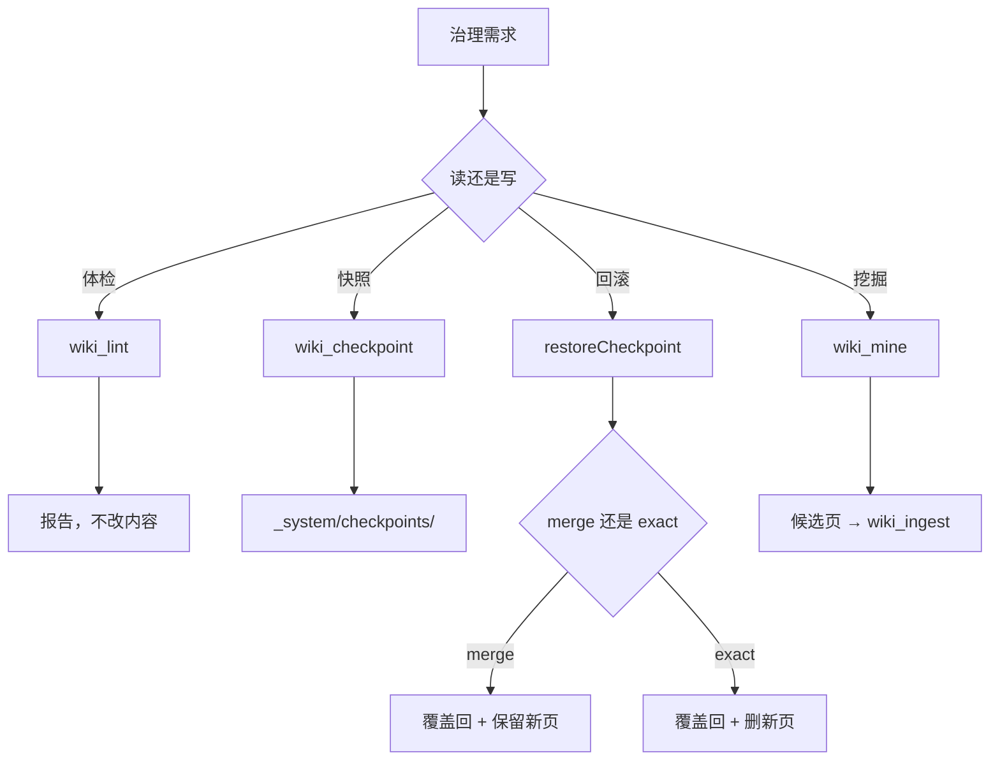
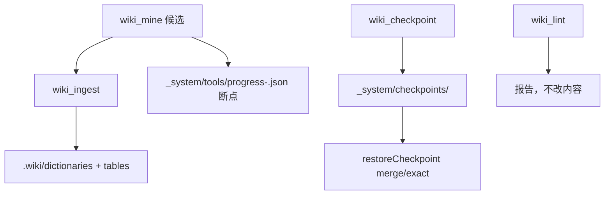

<details><summary>Relevant source files</summary>

- [src/tools.ts](src/tools.ts)
- [src/lint.ts](src/lint.ts)
- [src/checkpoint.ts](src/checkpoint.ts)
- [src/code-miner.ts](src/code-miner.ts)
- [src/index-builder.ts](src/index-builder.ts)
- [src/taxonomy.ts](src/taxonomy.ts)
- [src/mining-progress.ts](src/mining-progress.ts)
- [src/routes.ts](src/routes.ts)

</details>

> 挖掘批次：能力挖掘重扫（2026-10-20）。本轮**纠正了旧版两处错误**：①回滚默认是**非破坏**（`merge`）而不是一律破坏；②旧版把 DSH 配置工具 `config_restore` 的「卸载插件」写成了 wiki 还原点的行为，实际 wiki 还原点只动 `.wiki` 下的页面与派生工件。

## 1. 概念定义

### 1.1 核心概念

| 概念 | 定义 | 为什么重要 |
|---|---|---|
| **知识治理** | 不新增知识、只维护库健康的全部操作 | 库会腐烂：孤儿页、断链、标签漂移、索引过期 |
| **lint** | 查孤儿/断链/缺 frontmatter/标签审计 | 唯一的健康度体检 |
| **checkpoint** | 整库快照（7 分类页面 + index.md + .manifest.json） | 批次级回滚凭据 |
| **mine** | 从代码静态挖枚举/表结构候选 | 代码结构知识的确定性来源 |
| **init** | 建 `.wiki` 脚手架（7 分类 + index + manifest） | 幂等，可重复执行 |

### 1.2 领域概念

| 概念 | 说明 |
|---|---|
| **孤儿页** | 没有任何入链的页（`wiki_lint` 报告） |
| **断链** | `[[wikilink]]` 指向不存在的页 |
| **标签审计** | 对照 `taxonomy.base.md` + 库级 `_meta/taxonomy.md`，报未知/别名/超上限/零标签 |
| **merge 回滚** | 默认模式：只覆盖回快照里的页，**保留**快照后新增的页 |
| **exact 回滚** | 显式模式：整库回到快照状态，`rmSync` 删除快照后新增的页 |
| **对账四态** | new / changed / unchanged / deleted（mine 的每次报告） |

## 2. 系统事实

### 2.1 系统事实

| 事实 | 值 | 来源 |
|---|---|---|
| 治理操作是否改页面内容 | **否**（lint/list/export 只读；restore 才写） | `src/tools.ts:719` |
| 还原点快照内容 | 7 个分类目录的全部 `.md` + `index.md` + `.manifest.json` | `src/checkpoint.ts:11-12` |
| 还原点 id 形态 | ISO 时间戳把 `:` 与 `.` 换成 `-`，严格正则校验防路径穿越 | `src/checkpoint.ts:14`、`src/checkpoint.ts:23` |
| 恢复默认模式 | **merge（非破坏性）**，显式传 `exact` 才删快照后新增页 | `src/checkpoint.ts:76`、`src/checkpoint.ts:92-98` |
| 恢复返回值 | `{pageCount, restored, keptNewer, mode}`（`keptNewer` = 被保留的新页数） | `src/checkpoint.ts:113` |
| 两项模式都要做的 | 把快照里的页**覆盖回**（撑销批次对旧页的修改） | `src/checkpoint.ts:99-103` |
| 每页标签上限 | 5（`TAG_LIMIT`） | `src/taxonomy.ts:18` |
| mine 支持的语言/结构 | Java enum + `public static final`、SQL DDL、MyBatis XML、JPA Entity；**不支持 TS/Python/任意 ORM** | `src/code-miner.ts:63`、`src/code-miner.ts:206`、`src/code-miner.ts:286`、`src/code-miner.ts:331` |
| mine 断点续传 | 进度落 `_system/tools/progress-<kind>.json`，只处理 pending/partial 模块 | `src/mining-progress.ts:42-43` |
| resume 的陷阱 | 无 pending 记录时**不做过滤**，否则 resume 会把结果全滤空 | `src/tools.ts:955` |
| deleted 对账的条件 | 仅全扫（无 module/resume 过滤）时才判删，否则系统性误报 | `src/tools.ts:959-961` |
| init 是否幂等 | 是（已存在时只补缺失结构） | `src/tools.ts:1043` |

### 2.2 数据事实

| 数据 | 位置 |
|---|---|
| 还原点 | `<vault>/.wiki/_system/checkpoints/<ISO>/` |
| 挖矿进度 | `<vault>/.wiki/_system/tools/progress-<enum\|db>.json`（断点续传） |
| 标签词表 | `taxonomy.base.md`（随包）+ `<vault>/.wiki/_meta/taxonomy.md`（库级） |
| 导出产物 | `<项目根>/.wiki/wiki-export/graph.json` 或 `graph.html` |

## 3. 功能树与入口映射

### 3.1 功能模块结构

```
知识治理
├─ 健康检查
│   └─ wiki_lint          孤儿/断链/缺 frontmatter/标签审计
├─ 快照与回滚
│   ├─ wiki_checkpoint    建还原点
│   ├─ wiki_checkpoints   列还原点（新→旧）
│   └─ POST /checkpoint/restore  恢复（merge 默认 / exact 删新）
├─ 结构挖掘
│   └─ wiki_mine          Java enum / SQL DDL / MyBatis / JPA
├─ 建库与索引
│   ├─ wiki_init          建脚手架
│   └─ POST /rebuild-index 重建 index.md
└─ 导出
    └─ wiki_export        graph.json / graph.html
```

### 3.2 入口映射表

| 入口 | 类型 | 必填 | 底层内核 | 实现位置 |
|---|---|---|---|---|
| `wiki_lint` | 工具 | — | lintVault + auditTags | `src/tools.ts:635` |
| `wiki_checkpoint` | 工具 | — | createCheckpoint | `src/tools.ts:1071` |
| `wiki_checkpoints` | 工具 | — | listCheckpoints | `src/tools.ts:1093` |
| `wiki_mine` | 工具 | — | mineEnums / mineTables | `src/tools.ts:823` |
| `wiki_init` | 工具 | — | VaultStore.ensure | `src/tools.ts:1043` |
| `wiki_export` | 工具 | format | buildGraph → json/html | `src/tools.ts:788` |
| `GET …/lint` | 路由 | — | lintVault | `src/routes.ts:220` |
| `GET …/checkpoints` | 路由 | — | listCheckpoints | `src/routes.ts:257` |
| `POST …/checkpoint/restore` | 路由 | id, mode | restoreCheckpoint | `src/routes.ts:261` |
| `POST …/rebuild-index` | 路由 | — | rebuildIndex | `src/routes.ts:224` |

### 3.3 使用场景

| 场景 | 入口 | 理由 |
|---|---|---|
| 批次入库前确保能回滚 | `wiki_checkpoint` | 先建快照（`wiki_ingest` 自己也会建） |
| 怀疑库有孤儿/断链 | `wiki_lint` | 唯一体检 |
| 把 Java 枚举/表结构收进库 | `wiki_mine` | 确定性挖掘 + 对账 |
| 新项目第一次建库 | `wiki_init` | 幂等脚手架 |
| 想看知识图谱 | `wiki_export` | 出 graph.html |
| 回滚刚跑坏的批次 | `POST /checkpoint/restore` | 默认 merge 保留别人的新页 |

## 4. 调用链路总结

### 4.1 主链路图



### 4.2 分通道详细流程

**lint**（`src/lint.ts:118`）：

```
listPagesReadonly → 解析全部页 → 建 wikilink 图
→ 孤儿（无入链）+ 断链（指向不存在）
→ 缺 frontmatter 计数
→ auditTags（未知/别名/超上限 TAG_LIMIT=5/零标签，src/lint.ts:62）
→ LintReport
```

**checkpoint**（`src/checkpoint.ts:28`）：

```
new Date().toISOString() 换 : . 为 - → mkdir 还原点目录
→ 抖 7 个分类目录（recursive）
→ 抖 index.md + .manifest.json
→ 数页面得 pageCount → {id, createdAt, pageCount}
```

**restore**（`src/checkpoint.ts:73`）：

```
assertCheckpointId（正则防穿越）→ 校验 mode ∈ {merge, exact} → 快照不存在报 404
→ merge：覆盖回快照页，keptNewer 计数；exact：rmSync 快照外的新页后覆盖回
→ 两模式都回写 index.md / .manifest.json → {pageCount, restored, keptNewer, mode}
```

**mine**（`src/code-miner.ts:141`）：

```
walk 目录（排除 build/dist/node_modules）
→ parseJavaFile（enum + public static final，src/code-miner.ts:63）
→ parseDdlFile / parseMapperXml / parseJpaEntity
→ mergeTables 合并同名表（src/code-miner.ts:370）
→ 对账（new/changed/unchanged/deleted，仅全扫才判删）→ 候选页
```

### 4.3 数据与存储关系



## 5. 附录

### 5.1 术语表

| 术语 | 含义 |
|---|---|
| 孤儿页 | 无任何入链的页 |
| 断链 | wikilink 指向不存在的页 |
| localTypeTags | 本库自造、尚未升表的新 Type 词（lint 标记） |
| 对账四态 | new/changed/unchanged/deleted |
| keptNewer | merge 回滚时保留的快照后新页数量 |

### 5.2 参考资料

- [[知识库读取触发层设计]] — L2 合取门依赖库内高危路径集，与治理相关
- [[插件验证纪律与实测陷阱]] — 假绿/假计数在治理报告中的陷阱
- [[capability-知识写入]] — 写侧建还原点；治理侧负责回滚
- [[capability-知识检索]] — 治理产物（index.md）是 L1 检索的唯一来源

## 任务问法

（这页应该回答的问题——问答式与任务式都要收）

```queries
知识库的孤儿页和断链怎么查
lint 的标签审计规则是什么
还原点是怎么做的
怎么回滚一次挖掘
wiki_mine 支持哪些语言
改 lint 的标签审计规则
```

## Sources

- `src/tools.ts:635-721`（wiki_lint 注册与执行）
- `src/tools.ts:788`（wiki_export）
- `src/tools.ts:823-1041`（wiki_mine 与断点续传）
- `src/tools.ts:1043`（wiki_init）
- `src/tools.ts:1071`（wiki_checkpoint）
- `src/tools.ts:1093`（wiki_checkpoints）
- `src/lint.ts:62-117`（auditTags 标签审计）
- `src/lint.ts:118-153`（lintVault 主检查）
- `src/checkpoint.ts:11-12`（快照范围常量）
- `src/checkpoint.ts:28-45`（createCheckpoint）
- `src/checkpoint.ts:48-63`（listCheckpoints）
- `src/checkpoint.ts:73-114`（restoreCheckpoint merge/exact）
- `src/code-miner.ts:63`（parseJavaFile）
- `src/code-miner.ts:141`（mineEnums）
- `src/code-miner.ts:206`（parseDdlFile）
- `src/code-miner.ts:286`（parseMapperXml）
- `src/code-miner.ts:331`（parseJpaEntity）
- `src/code-miner.ts:370`（mergeTables）
- `src/code-miner.ts:393`（mineTables）
- `src/index-builder.ts:39-63`（rebuildIndex）
- `src/mining-progress.ts:42-43`（progressFileFor）
- `src/taxonomy.ts:18`（TAG_LIMIT）
- `src/routes.ts:220`（GET /lint）
- `src/routes.ts:224`（POST /rebuild-index）
- `src/routes.ts:257`（GET /checkpoints）
- `src/routes.ts:261-267`（POST /checkpoint/restore）

```sources
[
  {"path":"src/tools.ts","hash":"sha256:49ce63670351691b","symbols":["wiki_lint","wiki_export","wiki_mine","wiki_init","wiki_checkpoint","wiki_checkpoints"]},
  {"path":"src/lint.ts","hash":"sha256:8278513c7be0a4a9","symbols":["lintVault","auditTags"]},
  {"path":"src/checkpoint.ts","hash":"sha256:11a8c3119b2fd0b1","symbols":["createCheckpoint","listCheckpoints","restoreCheckpoint"]},
  {"path":"src/code-miner.ts","hash":"sha256:62a7994c63ef8f24","symbols":["mineEnums","parseDdlFile","parseMapperXml","parseJpaEntity","mergeTables"]},
  {"path":"src/index-builder.ts","hash":"sha256:051b7e5d6f51d95c","symbols":["rebuildIndex"]},
  {"path":"src/mining-progress.ts","hash":"pending","symbols":["progressFileFor","readProgress"]},
  {"path":"src/taxonomy.ts","hash":"sha256:49eaed875486d4e4","symbols":["TAG_LIMIT"]},
  {"path":"src/routes.ts","hash":"sha256:6cc47ff45e56c5bb","symbols":["lintVault","listCheckpoints","restoreCheckpoint"]}
]
```

