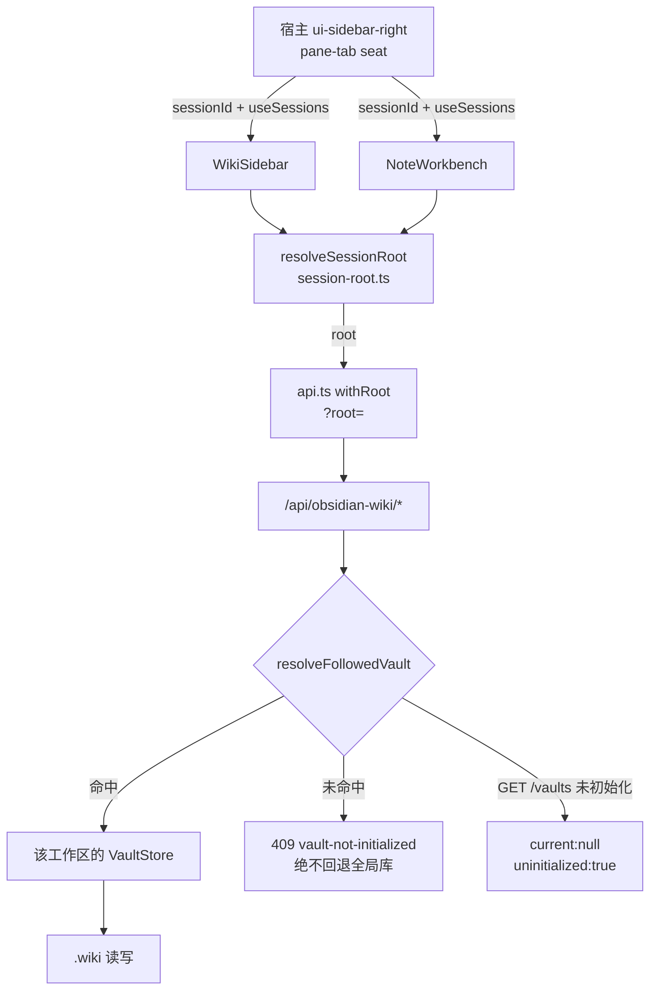
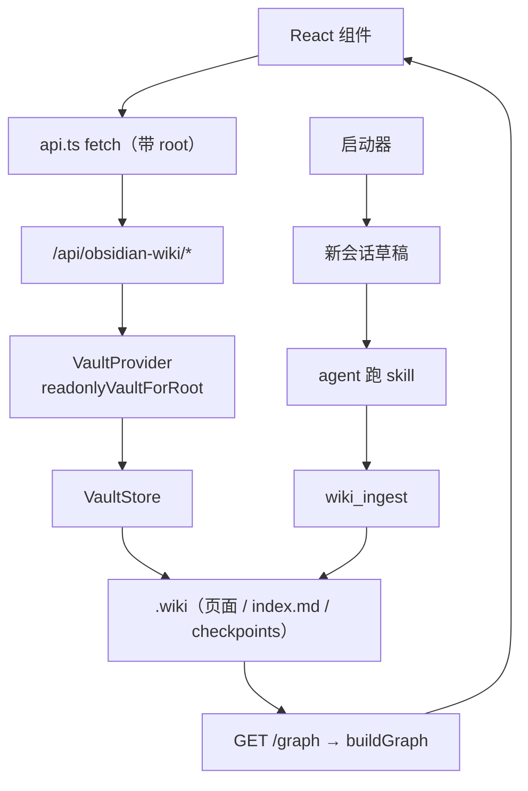

<details><summary>Relevant source files</summary>

- [src/client/index.ts](src/client/index.ts)
- [src/client/session-root.ts](src/client/session-root.ts)
- [src/client/api.ts](src/client/api.ts)
- [src/client/WikiSidebar.tsx](src/client/WikiSidebar.tsx)
- [src/client/VaultHeader.tsx](src/client/VaultHeader.tsx)
- [src/client/KnowledgeDistillLauncher.tsx](src/client/KnowledgeDistillLauncher.tsx)
- [src/client/GraphView.tsx](src/client/GraphView.tsx)
- [src/client/NoteWorkbench.tsx](src/client/NoteWorkbench.tsx)
- [src/routes.ts](src/routes.ts)
- [package.json](package.json)

行为证据（根目录测试，不计入 I1 路径前缀）：
[client-build.test.mjs](client-build.test.mjs)、
[client-session-follow.test.mjs](client-session-follow.test.mjs)、
[session-root.test.mjs](session-root.test.mjs)、
[wiki-root-scope.test.mjs](wiki-root-scope.test.mjs)、
[graph-view.test.mjs](graph-view.test.mjs)、
[client-api.test.mjs](client-api.test.mjs)、
[design-system.test.mjs](design-system.test.mjs)

</details>

> 挖掘批次：能力挖掘重扫（2026-10-24，commit `7d8fcb6` + `a471cf6` 之后）。本轮原地更新，纠正四处旧说法：
> ① 图谱**不是 cytoscape** 渲染——生产依赖只有 `dompurify`/`marked`，图谱是自研力导向 + SVG `innerHTML`（`src/client/GraphView.tsx:100-178`）；
> ② 「API 客户端是组件与宿主之间唯一合法通道」只对**数据面**成立，UI 装配面走宿主服务（slots / sidebarRightTabs / sidebarRight）；
> ③ GraphView 不再直连 `/graph`，改走 `fetchGraph(root)`（`src/client/api.ts:92-94`）；
> ④ 全部 `路径:行` 已按当前代码重核（旧页行号整体漂移：api.ts +15~+26、routes.ts +37~+61、Launcher -3、GraphView 未变）。
> 本轮新增：0.2 原生右侧栏页签、会话级库根、`?root=` 服务端语义、产物护栏。

## 1. 概念定义

### 1.1 核心概念

| 概念 | 定义 | 为什么重要 |
|---|---|---|
| **边栏 UI** | `dsh web` 右侧栏里的知识库面板族：知识库页签 + 笔记工作台页签 | 人唯一的交互面；也是写入的授权入口（点启动器 = 授权） |
| **页签类型（tab type）** | `sidebarRightTabs.register({id, kind, title, guide})` 注册的静态定义，`id` 同时是内容面板的 key | 0.2 把「类型定义」和「内容组件」拆成两段；只注册一段 = 什么都不显示且不报错 |
| **keyed seat** | `slots.inject('sidebar.right.pane.tab', () => slots.register({name, key}, Component))` | key 必须等于类型定义的 id，否则面板不渲染 |
| **会话级库根** | 由 seat 注入的 `sessionId` + `useSessions` 订阅的 cwd + 工作区行解析出的工作区根 | 面板按会话渲染；全局单值会被最后 activate 的面板劫持，表现为「切换工作区后仍是旧库」 |
| **root 作用域** | 每个 `/api/obsidian-wiki/*` 请求追加 `?root=<工作区根>` | 无 root = 旧全局当前库；带 root = 该工作区的库或 409，绝不回退 |
| **构建产物护栏** | 断言落在 `client/client.js` 上，禁止残留 `registerTab` / `betterSidebar` | 「源码已改、产物仍旧」的发布包只 grep 源码拦不住 |

### 1.2 领域概念

| 概念 | 说明 |
|---|---|
| **`WIKI_TAB` / `NOTE_TAB`** | 两个页签类型标识（`dsh-knj-obsidian:wiki` / `dsh-knj-obsidian:note`），id 与 kind 取同值便于排查（`src/client/index.ts:85-87`） |
| **`PaneTabProps`** | seat 交给面板的 props：`useTabInfo`（读 `navigation.params`）、`sessionId`、`useSessions`（订阅会话 cwd 的 store hook） |
| **`followedRoot` / `uninitialized`** | `/vaults?root=` 的回填：服务端实际解析到的根；该根没有 `.wiki` 时 `current:null` + `uninitialized:true` |
| **`WRITE_PATHS`** | 4 条真写端点白名单（page / rebuild-index / import / checkpoint/restore），只有它们走 `current()`（首次会 ensure 建脚手架） |
| **`CLIENT_BUILD`** | 客户端构建标记（`26.10.07`），显示在面板底部，用于人眼确认浏览器加载的是哪一次构建 |
| **`BATCH_DISCIPLINE`** | 还原点 → 查重 → 写前清单（信息性预览）→ 入库 → 质量报告；不做阻塞式二次确认 |
| **`projectFilter`** | 库根 → `--D-workspace-iobs_pro--` 形式的会话目录过滤串，由插件算好写进指令 |
| **`overrideRoot`** | VaultHeader 的**本面板**临时库覆盖（下拉切换），不写全局 currentVaultId；「跟随工作区」一键还原 |

## 2. 系统事实

### 2.1 系统事实

| 事实 | 值 | 来源 |
|---|---|---|
| 客户端硬依赖的宿主服务 | `['slots', 'sidebarRightTabs', 'sidebarRight']`，按服务名用 `export const inject` 声明 | `src/client/index.ts:150` |
| 包级 `dsh.client.inject` | 空数组（避免出现指向已卸载 betterSidebar 的悬空引用） | `package.json`（`dsh.client.inject: []`） |
| 0.2 宿主缺侧栏时 | `console.info` 后只卸载样式；服务端那半（工具/路由/skill）不受影响 | `src/client/index.ts:170-178` |
| 内容面板注册方式 | keyed seat `sidebar.right.pane.tab`，key = 类型定义 id | `src/client/index.ts:587-603` |
| 笔记页签标题 | 额外注册 `sidebar.right.pane.tab.title`，从 `params.title` 读回 | `src/client/index.ts:606-609` |
| 打开笔记页 | `sidebarRight.openTab(NOTE_TAB, { params: { path: '<id>\|<category>', title } })` | `src/client/index.ts:498` |
| 会话根解析顺序 | ① 认领该 session 的 workspace 行（`sessionIds` 含它）→ 该行 path；② cwd 的最深祖先 workspace；③ cwd 本身；都没有 → `undefined` | `src/client/session-root.ts:51-72` |
| 路径归一化 | 反斜杠→`/`、去尾斜杠、小写（Windows 大小写不敏感） | `src/client/session-root.ts:25-27` |
| root 为空时 | `withRoot` 原样返回路径（不带查询参数）→ 服务端走旧全局行为 | `src/client/api.ts:46-50` |
| 服务端带 root 解析不出库 | 409 + `code: 'vault-not-initialized'`，**绝不回退全局库** | `src/routes.ts:169-176` |
| `/vaults` 对未初始化工作区 | 200 + `current:null` + `followedRoot` + `uninitialized:true`，仍返回库列表 | `src/routes.ts:153-167` |
| 真写端点白名单 | `page` / `rebuild-index` / `import` / `checkpoint/restore` 四条 | `src/routes.ts:149` |
| 蒸馏范围类型 | `'enum' \| 'db' \| 'both' \| 'capability' \| 'sessions'`（5 值），UI 渲染 4 个单选（`both` 只作为 `buildCollectTrigger` 入参保留） | `src/client/KnowledgeDistillLauncher.tsx:10` |
| 会话列表渲染上限 | 50 条（其余靠搜索缩小） | `src/client/KnowledgeDistillLauncher.tsx:45` |
| capability 触发语内容 | 四步：入口枚举 `enumerate-entries.mjs` → 任务清单 `generate-task-list.mjs` → 串行挖掘 `process-task.mjs get_next` + `check-capability.mjs` → 断点续跑；附 `BATCH_DISCIPLINE` | `src/client/KnowledgeDistillLauncher.tsx:104-120` |
| 图谱渲染方式 | 自研力导向（`DEG`/`REP`/`TARGET` 三个常量）+ `svg.innerHTML` 逐帧重写；**无 cytoscape** | `src/client/GraphView.tsx:100-178` |
| 图谱节点命中 | 用 `pointerup` 而非 `click`（逐帧 innerHTML 重写会让 click 丢失，表现为要点两次） | `src/client/GraphView.tsx:182-193` |
| 图谱收敛后处理 | 力场停帧后 `spreadToFill` 铺满 → `placeLabels` 选边/截断 → 重绘 | `src/client/GraphView.tsx:151-153` |
| 构建产物护栏 | `client/client.js` 不得含 `registerTab` / `betterSidebar`；护栏自带「伪造产物必须判红」自检 | `client-build.test.mjs`（第 19-28、65-69、82-86 行） |
| 包声明 client 入口 | `exports['./client'].default = './client/client.js'`，`dsh.client.platform = 'web'` | `package.json` |

### 2.2 数据事实

| 数据 | 来源端点 / 位置 | 客户端函数 |
|---|---|---|
| 库列表（含初始化态） | `GET /vaults(?root=)` | `fetchVaults`（`src/client/api.ts:156-158`） |
| 页面清单 | `GET /pages(?root=)` | `fetchPages`（`src/client/api.ts:59-61`） |
| 单页 / 磁盘原文 / 全文保存 | `GET /page?id=&category=[&raw=1]` / `POST /page` | `fetchPage`（203）/ `fetchRawPage`（64）/ `saveRawPage`（72） |
| 搜索（纯词面） | `GET /search?q=&mode=` | `fetchSearch`（`src/client/api.ts:83-85`） |
| Lint 报告 | `GET /lint` | `fetchLint`（`src/client/api.ts:87-89`） |
| 图谱（节点/边/孤儿） | `GET /graph` | `fetchGraph`（`src/client/api.ts:92-94`） |
| 重建 index | `POST /rebuild-index` | `rebuildIndex`（`src/client/api.ts:97-106`） |
| 路径导入（保真搬到 `_raw/` 暂存） | `POST /import` | `importMd`（`src/client/api.ts:119-128`） |
| 语义索引状态 / 触发 | `GET /semantic-status` / `POST /semantic-update` | `fetchSemanticStatus`（237）/ `triggerSemanticUpdate`（242） |
| 还原点列表 / 回滚 | `GET /checkpoints` / `POST /checkpoint/restore` | `fetchCheckpoints`（183）/ `restoreCheckpoint`（191，默认 `merge`） |
| 库切换/挂接/移除 | `POST /vault/<activate\|switch\|attach\|remove>` | `postVault`（160）→ `activateVault`/`switchVault`/`attachVault`/`removeVault` |
| 跨组件刷新信号 | `window` CustomEvent `wiki:pages-changed` / `wiki:vault-changed` | WikiSidebar（63）/ Launcher（207-208） |

## 3. 功能树与入口映射

### 3.1 功能模块结构

```
边栏 UI
├─ 宿主装配层（index.ts）
│  ├─ 模块级：export const inject（slots / sidebarRightTabs / sidebarRight）
│  └─ apply(ctx)：样式注入 → 双通道取服务 → tab 类型注册 → keyed seat 注册 → disposers
├─ 会话作用域（session-root.ts + WikiSidebar / VaultHeader）
│  ├─ resolveSessionRoot：sessionIds 归属 → cwd 最深祖先 → cwd → undefined
│  ├─ WikiSidebar：root 下传所有子视图；undefined 时渲染「宿主没有提供会话上下文」
│  └─ VaultHeader：root 驱动库身份；overrideRoot 只作用于本面板
├─ 数据层（api.ts）：BASE + withRoot + 18 个导出的 client-call
├─ 面板组件
│  ├─ VaultHeader / VaultTree / SearchBox / LintPanel / SemanticIndexPanel
│  ├─ NoteWorkbench（笔记页签：栈式导航 + wikilink 原地跳转）
│  └─ KnowledgeDistillLauncher（范围/时间/会话复选/还原点 + 触发语生成）
├─ 图谱（GraphView.tsx + graph-layout.ts）
│  └─ 力导向 → spreadToFill → placeLabels → SVG innerHTML；全屏态自管页签
└─ 支撑：styles.ts（WIKI_CSS / injectWikiStyles）、markdown.ts、icons.tsx
```

### 3.2 入口映射表

| 入口 | 类型 | 必填 | 内核 | 文件:行 |
|---|---|---|---|---|
| `inject` | 模块导出 | — | 声明宿主服务依赖 | `src/client/index.ts:150` |
| `apply` | 宿主调用 | `ctx` | 装配页签与面板 | `src/client/index.ts:166` |
| `sidebarRightTabs.register` | 宿主服务 | `{id,kind,title}` | 页签静态定义 | `src/client/index.ts:529-553` |
| `slots.inject('sidebar.right.pane.tab')` | 宿主 seat | `key` | 页签内容面板 | `src/client/index.ts:587-603` |
| `sidebarRight.openTab` | 宿主服务 | `kind, {params}` | 打开笔记页 | `src/client/index.ts:492-502` |
| `resolveSessionRoot` | 内部纯函数 | `{sessionId,cwd,workspaces}` | 会话 → 工作区根 | `src/client/session-root.ts:51-72` |
| `withRoot` | 内部函数 | `path, root` | 拼 `?root=` | `src/client/api.ts:46-50` |
| `fetchGraph` | 客户端调用 | `root?` | 图谱数据 | `src/client/api.ts:92-94` |
| `fetchVaults` | 客户端调用 | `root?` | 库列表 / 初始化态 | `src/client/api.ts:156-158` |
| `buildCapabilityTrigger` | 内部函数 | `vaultRoot?` | 功能挖掘触发语 | `src/client/KnowledgeDistillLauncher.tsx:104-120` |
| `deliver` | 内部函数 | `copyOnly` | 触发语分发（新会话 / 剪贴板） | `src/client/KnowledgeDistillLauncher.tsx:337-361` |
| `startAgentSession` | 内部函数 | `text, cwd?` | 新建会话 + 预填 + 读回校验 | `src/client/index.ts:383-489` |
| `GraphView` | 组件 | `onOpenNote, root?` | 图谱渲染 | `src/client/GraphView.tsx:55` |

### 3.3 使用场景

| 场景 | 入口 | 理由 |
|---|---|---|
| 浏览/搜索当前工作区的库 | 知识库页签 → 浏览 / 搜索 | root 由会话解析，不会串到别的库 |
| 编辑某页 | 笔记页签 → 保存 | `POST /page` 同源 JSON，保存后自动重建 index |
| 看知识图谱 | 知识库页签 → 图谱 → 全屏 | 全屏态自管页签，点节点开页内页签 |
| 蒸馏近期会话 | 启动器「会话蒸馏」 | 唯一授权写入的 UI 通道；勾了会话只蒸所选 |
| 采集枚举/表结构 | 启动器「枚举/常量字典」「表结构」 | 走 wiki-collect skill |
| 代码 → 功能知识页 | 启动器「系统功能挖掘」 | 走 wiki-capability skill 的四步流程 |
| 回滚一次坏批次 | 启动器「还原点」 | 默认 `merge` 保留快照后新页；`exact` 需显式点 |

## 4. 调用链路总结

### 4.1 主链路图



### 4.2 分通道详细流程

```
① 页签注册（模块加载 → apply）
  export const inject = ['slots','sidebarRightTabs','sidebarRight']
  apply → injectWikiStyles()
       → 缺 slots/tabs ? 只留服务端能力（console.info 后返回）
       → hostService(ctx,'workspaces'|'sessions'|'conversation')（ctx.get 优先，旧版回退属性）
       → sidebarRightTabs.register({id:WIKI_TAB, kind:WIKI_TAB, priority:'extension', title, guide})
       → sidebarRightTabs.register({id:NOTE_TAB, kind:NOTE_TAB, multiple:true, title})
       → slots.inject('sidebar.right.pane.tab') × 2（key = WIKI_TAB / NOTE_TAB）
       → slots.inject('sidebar.right.pane.tab.title')（key = NOTE_TAB）
       → 返回 disposer：逐个 d() + removeWikiStyles()

② 会话 → 库根 → 数据
  seat.useSessions(s => s.byId[sessionId]?.cwd) → WikiSidebar
  → resolveSessionRoot({sessionId, cwd, workspaces})（index.ts 的 rootOfSeat 也是同款调用）
  → root === undefined → WikiSidebar 渲染「宿主没有提供会话上下文」空态
  → root 有值 → 每个 api 调用都 withRoot(path, root)
  → 服务端：rootParam ? resolveFollowedVault(provider, rootParam) : undefined
     · 命中 → 该 store（只读视图；只有真写端点才 current()）
     · 未命中 → /vaults 走 uninitialized 分支；其余端点 409

③ 蒸馏启动器 → agent 会话
  deliver(copyOnly)
    scope === 'sessions' → effectiveIds.length ? buildSelectedSessionsTrigger : buildDistillTrigger(range)
    scope === 'capability' → buildCapabilityTrigger(vaultRoot)
    其余（enum/db/both）→ buildCollectTrigger(scope)
    copyOnly → navigator.clipboard.writeText
    否则 → send() → 守卫（vaultRoot 已知 && initialized === true）→ startInstruction()
         → startAgentSession(text, targetRoot) → uiWorkspace.startSession(workspaceId,{prompt})
         → 轮询候选会话（新建的，或同 cwd 的 blank 复用）→ 读回草稿含前 12 字标记 → ok
  （「初始化知识库」走 initVault → startInstruction，刻意跳过未初始化守卫）

④ 图谱
  GraphView(root) → fetchGraph(root) + fetchPages(root)（id→category 索引）
  → 力场 tick 至 frameLimit → spreadToFill → placeLabels → paint()（SVG innerHTML）
  → pointerup 命中 g[data-id] → 嵌入态 onOpenNote / 全屏态开 page 页签
```

### 4.3 数据与存储关系



## 5. 附录

### 5.1 术语表

| 术语 | 含义 |
|---|---|
| 页签类型 / tab type | 静态面（id/kind/title/guide），注册进 `sidebarRightTabs` |
| keyed seat | 按 key 注册内容组件的 slot；key 必须等于类型 id |
| 跟随工作区 | 面板按会话解析 root；下拉「切换知识库」只是本面板覆盖 |
| 仅复制 | 不建会话、只把触发语写进剪贴板（适合手动粘到已有会话） |
| 同源校验 | 写端点要求 `isSameOrigin` + `content-type: application/json` |
| 产物护栏 | 断言落在 `client/client.js`，防「源码已改、产物仍旧」 |

### 5.2 参考资料

- [[会话级知识库绑定]] — 全局单值当前库为什么会答偏；本页的 `?root=` 是它在 UI 侧的落地
- [[dsh-插件宿主接口契约]] — 宿主服务与事件的实测契约；本页只列 UI 用到的三个服务
- [[知识库写入侧零推动]] — 为什么写入必须由人点启动器授权
- [[capability-知识写入]] — 启动器触发语最终落到 wiki_ingest 的哪条路径
- [[capability-知识检索]] — 搜索框背后的检索内核
- [[只改编译产物的修复会被下一次构建静默回滚]] — 产物护栏要防的那类故障

## 任务问法

（这页应该回答的问题——问答式与任务式都要收）

```queries
知识库面板怎么知道该读哪个工作区的知识库
为什么切换工作区后还是显示旧库
知识库页签是怎么注册到 DSH 0.2 右侧栏的
知识库里的图谱视图是怎么渲染的
蒸馏启动器的系统功能挖掘会生成什么指令
带 root 的请求解析不出库会怎样
加一个新的页签类型要动哪里
改图谱节点配色要动哪里
新增一个蒸馏范围要改哪几个地方
```

## Sources

- `src/client/index.ts:150`（`inject` 声明 `slots` / `sidebarRightTabs` / `sidebarRight`）
- `src/client/index.ts:166-178`（`apply` 与 `slots` 缺失时的降级）
- `src/client/index.ts:492-502`（`openNote` → `sidebarRight.openTab`）
- `src/client/index.ts:587-603`（`slots` 的 `inject` 注册 `sidebar.right.pane.tab` keyed seat）
- `src/client/session-root.ts:25-27`（`normalizeRoot`）
- `src/client/session-root.ts:51-72`（`resolveSessionRoot` 三级顺序）
- `src/client/api.ts:36`（`BASE` = `/api/obsidian-wiki`）
- `src/client/api.ts:46-50`（`withRoot` 追加 `root`）
- `src/client/api.ts:92-94`（`fetchGraph`）
- `src/client/api.ts:156-158`（`fetchVaults`）
- `src/client/api.ts:237-239`（`fetchSemanticStatus`）
- `src/client/WikiSidebar.tsx:53-57`（`resolveSessionRoot` 计算 `root`）
- `src/client/VaultHeader.tsx:73-75`（`overrideRoot ?? root` 面板级覆盖）
- `src/client/KnowledgeDistillLauncher.tsx:80-88`（`BATCH_DISCIPLINE`）
- `src/client/KnowledgeDistillLauncher.tsx:104-120`（`buildCapabilityTrigger`）
- `src/client/KnowledgeDistillLauncher.tsx:337-361`（`deliver`）
- `src/client/GraphView.tsx:151-153`（`spreadToFill` / `placeLabels`）
- `src/client/GraphView.tsx:182-193`（`handleNodePointerUp`）
- `src/routes.ts:102-126`（`resolveFollowedVault`）
- `src/routes.ts:149`（`WRITE_PATHS`）
- `src/routes.ts:169-176`（`vault-not-initialized` 409）

```sources
[
  {"path":"src/client/index.ts","hash":"sha256:876125ef8f366340","symbols":["inject","apply","WIKI_TAB","NOTE_TAB","openNote","openTab"]},
  {"path":"src/client/session-root.ts","hash":"sha256:54813e760ad0d1ac","symbols":["resolveSessionRoot","normalizeRoot"]},
  {"path":"src/client/api.ts","hash":"sha256:16b52435eccdc038","symbols":["BASE","withRoot","fetchGraph","fetchVaults","fetchSemanticStatus"]},
  {"path":"src/client/WikiSidebar.tsx","hash":"sha256:eb8798ff31fc85f3","symbols":["WikiSidebar","resolveSessionRoot"]},
  {"path":"src/client/VaultHeader.tsx","hash":"sha256:caf039f7403c9c03","symbols":["VaultHeader","overrideRoot"]},
  {"path":"src/client/KnowledgeDistillLauncher.tsx","hash":"sha256:3e8b6035679149d8","symbols":["SCOPE_LABELS","BATCH_DISCIPLINE","buildCapabilityTrigger","deliver"]},
  {"path":"src/client/GraphView.tsx","hash":"sha256:e3dcacfe6bede2f9","symbols":["GraphView","spreadToFill","placeLabels","handleNodePointerUp"]},
  {"path":"src/routes.ts","hash":"sha256:6912078691258cac","symbols":["resolveFollowedVault","WRITE_PATHS","vault-not-initialized"]}
]
```
