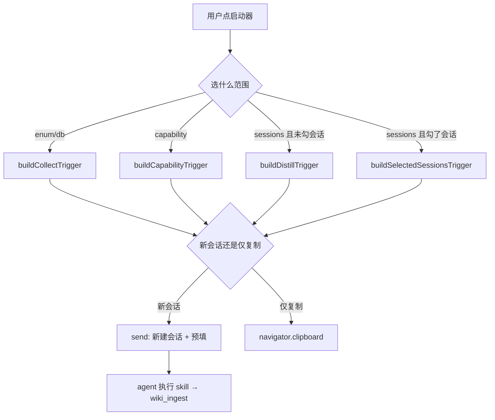

<details><summary>Relevant source files</summary>

- [src/client/api.ts](src/client/api.ts)
- [src/client/KnowledgeDistillLauncher.tsx](src/client/KnowledgeDistillLauncher.tsx)
- [src/client/GraphView.tsx](src/client/GraphView.tsx)
- [src/routes.ts](src/routes.ts)

</details>

> 挖掘批次：能力挖掘重扫（2026-10-20）。本轮纠正三处：①旧版引用的 `src/client/KnowledgePanel.tsx` **已不存在**（当前仓库无此文件），已改为实际存在的组件文件；②蒸馏范围已从 3 项变为 **4 项**（新增 `capability` 系统功能挖掘）；③`both` 不再是「预留位」，而是 enum+db 合并采集；`RESERVED_NOTICE` 的语义已改为「UI 版本过旧」。

## 1. 概念定义

### 1.1 核心概念

| 概念 | 定义 | 为什么重要 |
|---|---|---|
| **边栏 UI** | dsh web 里知识库面板（页面列表/编辑/搜索/图谱/蒸馏启动器） | 人唯一的交互面；也是写入的授权入口 |
| **API 客户端** | 浏览器侧对 `/api/obsidian-wiki/*` 的封装（`src/client/api.ts`） | 组件与宿主之间唯一的合法通道 |
| **蒸馏启动器** | 选范围 → 生成触发指令 → 投进新会话或剪贴板 | 用户点按钮 = 写入授权 |
| **四个范围** | enum / db / capability / sessions | 四种入库通道共用同一段「批次纪律」文本 |
| **会话注入能力不可达** | 浏览器端拿不到宿主进程的 skill 注册表 | 决定了 UI 不能「动态探测 skill 是否安装」 |

### 1.2 领域概念

| 概念 | 说明 |
|---|---|
| **DistillScope** | `enum \| db \| capability \| sessions`（`both` 仅作为 `buildCollectTrigger` 的入参保留） |
| **RESERVED_NOTICE** | 现只在「UI 版本过旧」时提示重启 dsh web（不再是预留位文案） |
| **BATCH_DISCIPLINE** | 还原点 → 查重 → 写前清单 → 入库 → 质量报告（五步，不做阻塞式二次确认） |
| **projectFilter** | 库根路径 → `--D-workspace-iobs_pro--` 形式的会话目录过滤串 |

## 2. 系统事实

### 2.1 系统事实

| 事实 | 值 | 来源 |
|---|---|---|
| 组件与宿主的通信方式 | 仅 HTTP（`fetch` 到 `/api/obsidian-wiki/*`） | `src/client/api.ts:36` |
| 写入端点是否同源校验 | 是（写路径白名单 + `isSameOrigin`） | `src/routes.ts:112` |
| 浏览器能否探测 skill | **不能**（skill registry 在宿主进程） | 无暴露路由 |
| 范围选项数量 | 4 个（enum / db / capability / sessions） | `src/client/KnowledgeDistillLauncher.tsx:47-60` |
| 会话列表渲染上限 | 50 条（其余靠搜索缩小） | `src/client/KnowledgeDistillLauncher.tsx:45` |
| capability 范围生成的指令 | 引用内置 wiki-capability skill，四步流程 + 批次纪律 | `src/client/KnowledgeDistillLauncher.tsx:107-123` |
| sessions 范围生成的指令 | 项目过滤串由插件算好，`session:<id>` 作 source，contentHash 用单会话摘要哈希 | `src/client/KnowledgeDistillLauncher.tsx:126-139` |
| 回滚默认模式 | `merge`（非破坏） | `src/client/api.ts:165` |

### 2.2 数据事实

| 数据 | 来源端点 | 客户端函数 |
|---|---|---|
| 库列表 | `GET /vaults` | `fetchVaults`（`src/client/api.ts:130`） |
| 库切换/挂载/移除 | `POST /vault/<action>` | `activateVault` / `switchVault` / `attachVault` / `removeVault` |
| 页面清单 | `GET /pages` | `fetchPages`（`src/client/api.ts:44`） |
| 单页原文 / 保存 | `GET /page` / `POST /page` | `fetchRawPage` / `saveRawPage`（`src/client/api.ts:57`） |
| 搜索 | `GET /search` | `fetchSearch`（`src/client/api.ts:68`） |
| 图谱 | `GET /graph` | GraphView 直接 `fetch` |
| 语义索引状态 / 更新 | `GET /semantic-status` / `POST /semantic-update` | `fetchSemanticStatus` / `triggerSemanticUpdate` |
| 还原点 | `GET /checkpoints` / `POST /checkpoint/restore` | `fetchCheckpoints` / `restoreCheckpoint` |

## 3. 功能树与入口映射

### 3.1 功能模块结构

```
边栏 UI
├─ API 客户端（api.ts）
│   ├─ 读：fetchVaults / fetchPages / fetchPage / fetchRawPage / fetchSearch / fetchLint / fetchCheckpoints
│   └─ 写：saveRawPage / importMd / rebuildIndex / triggerSemanticUpdate / restoreCheckpoint
├─ 面板组件（WikiSidebar / VaultTree / NoteWorkbench / SearchBox / LintPanel / SemanticIndexPanel）
├─ 蒸馏启动器（KnowledgeDistillLauncher.tsx）
│   ├─ 范围：enum / db / capability / sessions
│   ├─ 时间范围 + 会话复选（勾了就只蒸所选）
│   └─ 触发指令生成 + 新会话投递 / 剪贴板
└─ 图谱视图（GraphView.tsx）
    └─ cytoscape 渲染 + 点击开页
```

### 3.2 入口映射表

| 入口 | 类型 | 说明 | 实现位置 |
|---|---|---|---|
| `fetchPages` | 客户端调用 | 页面清单 | `src/client/api.ts:44` |
| `saveRawPage` | 客户端调用 | 整页保存 | `src/client/api.ts:57` |
| `fetchSearch` | 客户端调用 | 搜索（纯词面） | `src/client/api.ts:68` |
| `fetchVaults` | 客户端调用 | 库列表 | `src/client/api.ts:130` |
| `fetchSemanticStatus` | 客户端调用 | 语义索引状态 | `src/client/api.ts:211` |
| `triggerSemanticUpdate` | 客户端调用 | 触发语义索引刷新 | `src/client/api.ts:216` |
| `projectFilterOf` | 内部函数 | 库根 → 项目过滤串 | `src/client/KnowledgeDistillLauncher.tsx:73` |
| `buildCollectTrigger` | 内部函数 | enum/db 指令生成 | `src/client/KnowledgeDistillLauncher.tsx:94` |
| `buildCapabilityTrigger` | 内部函数 | 功能挖掘指令 | `src/client/KnowledgeDistillLauncher.tsx:107` |
| `buildDistillTrigger` | 内部函数 | 会话蒸馏指令 | `src/client/KnowledgeDistillLauncher.tsx:126` |
| `deliver` | 内部函数 | 分发到新会话 / 剪贴板 | `src/client/KnowledgeDistillLauncher.tsx:319` |
| `GraphView` | 组件 | 图谱渲染 | `src/client/GraphView.tsx:55` |

### 3.3 使用场景

| 场景 | 入口 | 理由 |
|---|---|---|
| 浏览/搜索库 | 知识面板 + `GO` | 人最快的方式 |
| 编辑某页 | `POST /page` | 整页保存 |
| 蒸馏近期会话 | 启动器 sessions | 唯一授权写入的 UI 通道 |
| 采集枚举/表结构 | 启动器 enum/db | 走 wiki-collect skill |
| 代码 → 功能知识页 | 启动器 capability | 走 wiki-capability skill |
| 看知识图谱 | GraphView | 关系可视化 |

## 4. 调用链路总结

### 4.1 主链路图



### 4.2 分通道详细流程

**搜索**（`src/client/api.ts:68` → `src/routes.ts:210`）：

```
fetchSearch(q, mode) → GET /search?q=&mode=
→ retrieve(store, q, { mode })   ← 纯词面，不掺语义
→ 返回 candidates
```

**蒸馏投递**（`src/client/KnowledgeDistillLauncher.tsx:319`）：

```
deliver(copyOnly)：
  scope === 'sessions' → 勾了会话：buildSelectedSessionsTrigger；否则：buildDistillTrigger(range)
  scope === 'capability' → buildCapabilityTrigger(vaultRoot)
  其余（enum/db/both） → buildCollectTrigger(scope)
  copyOnly → clipboard.writeText + 提示粘贴
  否则 → send()：新建会话并预填指令（文案随 scope 变化）
```

### 4.3 数据与存储关系

```mermaid
graph TD
  A[React 组件] --> B[api.ts fetch]
  B --> C[/api/obsidian-wiki/*]
  C --> D[VaultStore]
  D --> E[.wiki]
  F[启动器] --> G[新会话预填指令]
  G --> H[agent 跑 skill]
  H --> I[wiki_ingest]
  I --> E
```

## 5. 附录

### 5.1 术语表

| 术语 | 含义 |
|---|---|
| 范围（scope） | 启动器顶部的四个选项，决定生成的指令走哪个 skill |
| 仅复制 | 不建会话、只把指令写进剪贴板（适合手动粘贴到已有会话） |
| 同源校验 | 写端点要求 Origin/Referer 与 Host 一致 |
| projectFilter | 库根路径 → `--D-workspace-x--` 形式的会话目录过滤串 |

### 5.2 参考资料

- [[知识库写入侧零推动]] — 启动器是唯一授权写入的 UI 通道
- [[dsh-插件宿主接口契约]] — 宿主会话与工作区服务的最小结构面
- [[capability-知识写入]] — 启动器生成的指令最终落到哪个工具
- [[capability-知识检索]] — 搜索框背后的检索内核

## 任务问法

（这页应该回答的问题——问答式与任务式都要收）

```queries
边栏的蒸馏启动器怎么用
蒸馏范围有哪些
预留位是什么
知识面板怎么搜索
系统功能挖掘从哪启动
给启动器加一个新的蒸馏范围
改边栏的搜索行为
```

## Sources

- `src/client/api.ts:36`（BASE = /api/obsidian-wiki）
- `src/client/api.ts:44`（fetchPages）
- `src/client/api.ts:57`（saveRawPage）
- `src/client/api.ts:68-69`（fetchSearch）
- `src/client/api.ts:130`（fetchVaults）
- `src/client/api.ts:165`（restoreCheckpoint 默认 merge）
- `src/client/api.ts:211-217`（fetchSemanticStatus / triggerSemanticUpdate）
- `src/client/KnowledgeDistillLauncher.tsx:45`（MAX_RENDERED_SESSIONS = 50）
- `src/client/KnowledgeDistillLauncher.tsx:47-63`（SCOPE_LABELS 四范围与 RESERVED_NOTICE）
- `src/client/KnowledgeDistillLauncher.tsx:73`（projectFilterOf）
- `src/client/KnowledgeDistillLauncher.tsx:83-91`（BATCH_DISCIPLINE 五步）
- `src/client/KnowledgeDistillLauncher.tsx:94`（buildCollectTrigger）
- `src/client/KnowledgeDistillLauncher.tsx:107-123`（buildCapabilityTrigger）
- `src/client/KnowledgeDistillLauncher.tsx:126-139`（buildDistillTrigger）
- `src/client/KnowledgeDistillLauncher.tsx:319-343`（deliver 分发）
- `src/client/GraphView.tsx:55`（GraphView 组件）
- `src/client/GraphView.tsx:70`（fetch /api/obsidian-wiki/graph）
- `src/routes.ts:28`（路由 BASE）
- `src/routes.ts:112`（写路径白名单）
- `src/routes.ts:115`（GET /vaults）
- `src/routes.ts:150-155`（语义状态/更新）
- `src/routes.ts:170`（GET /pages）
- `src/routes.ts:210-216`（GET /search、GET /graph）
- `src/routes.ts:257-261`（还原点列表/恢复）

```sources
[
  {"path":"src/client/api.ts","hash":"sha256:f74609ede649c6cb","symbols":["fetchPages","saveRawPage","fetchSearch","fetchVaults","restoreCheckpoint","triggerSemanticUpdate"]},
  {"path":"src/client/KnowledgeDistillLauncher.tsx","hash":"sha256:179c3b5b131a0f9a","symbols":["SCOPE_LABELS","projectFilterOf","buildCollectTrigger","buildCapabilityTrigger","buildDistillTrigger","deliver"]},
  {"path":"src/client/GraphView.tsx","hash":"sha256:65b3cfbb7cceaa45","symbols":["GraphView"]},
  {"path":"src/routes.ts","hash":"sha256:6cc47ff45e56c5bb","symbols":["WRITE_PATHS"]}
]
```

