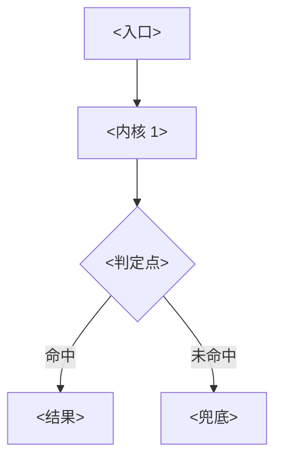
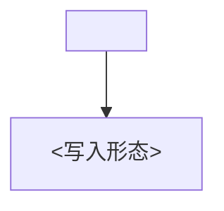

# 业务认知理解模板（能力页骨架）

> 用法：复制本文件到 `.wiki/projects/capability-<功能名>.md` 后逐节替换 `<占位>`。
> **不是拿来通读的模板**——每一节的判据见文末「写作纪律」，不合格不入库。
> 结构来源：SDD 的「业务认知理解」五节结构；本插件在其上追加了 `任务问法` 与 `sources` 两个
> 检索/新鲜度所需的块。

---

## 页面骨架（从下面 `---` 开始复制）

```markdown
---
id: capability-<功能名>
title: <功能名>
category: projects
tags: [concept]
tier: core
confidence: inferred
source: capability-mining:<功能名>    # ⚠️ 每个功能页用独立 source！共用一个会导致 manifest 的
                                     # pages_produced 被每次覆盖（实测只剩最后 1 页，增量对账失效）
summary: <一句话，≤120 字，说清「这是什么 + 凭什么重要」>
created: <ISO>
updated: <ISO>
---

<details><summary>Relevant source files</summary>

- [src/<文件>.ts](src/<文件>.ts)

（≥5 个文件；后续 `Sources` 的引用只能落在这些文件里）

</details>

> 挖掘批次：<日期与批次名>。本轮纠正：<若与旧版有事实冲突，写清旧说法错在哪、新结论的依据是什么>。

## 1. 概念定义

### 1.1 核心概念

| 概念 | 定义 | 为什么重要 |
|---|---|---|
| **<概念>** | <一句话定义，含关键常量/函数名> | <不搞懂它会犯什么错；有实测数字就写数字> |

### 1.2 领域概念

| 概念 | 说明 |
|---|---|
| **<术语>** | <它在本功能里的确切含义，含取值来源（常量名/配置键）> |

## 2. 系统事实

### 2.1 系统事实

| 事实 | 值 | 来源 |
|---|---|---|
| <事实描述> | `<常量/阈值/默认值>` | `<路径>:<行>` |

### 2.2 数据事实

| 数据 | 位置 / 形态 |
|---|---|
| <数据名> | `<路径>` / <JSON、YAML、JSONL 等形态> |

## 3. 功能树与入口映射

### 3.1 功能模块结构

```
<功能名>
├─ <子模块>            ← <一句话职责>
│  └─ <更细模块>
└─ <子模块>
```

### 3.2 入口映射表

| 入口 | 类型 | 必填 | 内核 | 文件:行 |
|---|---|---|---|---|
| `<入口名>` | tool / route / hook / ui | `<参数>` 或 — | `<内核函数>` | `src/<文件>.ts:<行>` |

### 3.3 使用场景

| 场景 | 入口 | 理由 |
|---|---|---|
| <用户/agent 想干什么> | `<入口>` | <为什么该走这个入口而不是别的> |

## 4. 调用链路总结

### 4.1 主链路图



### 4.2 分通道详细流程

```
<通道名>
  1. <步骤，带函数名与行为>
  2. …
```

### 4.3 数据与存储关系



## 5. 附录

### 5.1 术语表

| 术语 | 含义 |
|---|---|
| <术语> | <含义> |

### 5.2 参考资料

- [[<既有页标题>]] — <它补了本页没覆盖的哪一块>
- [[<既有页标题>]] — <同上>

（**≥2 条**，且必须指向**库内已存在的页**；写成孤岛会让本页检索不到）

## 任务问法

（这页应该回答的问题——问答式与任务式都要收。**这一段是必填项**：检索前置层会解析
`queries` 块并按「问法命中」给分，缺了它，改写过措辞的提问只能靠语义层兜底。）

```queries
<问答式：别人会怎么问这个功能是怎么实现的>
<问答式：某个可疑现象背后的原因>
<对比式：A 和 B 什么区别>
<任务式：改这块要动哪里 / 加一个新 X 怎么做>
```

## Sources

- `<路径>:<起>-<止>`（<这段是什么>）
- `<路径>:<行>`（<这个常量/符号是什么>）

（**≥5 条**，覆盖 **≥3 个文件**；行号必须由 `scripts/check-anchors.mjs` 核对，不许凭记忆写）

```sources
[{"path":"src/<文件>.ts","hash":"sha256:<16位>","symbols":["<符号>"]}]
```

（hash 用 `node scripts/check-anchors.mjs --project <根> --page projects/capability-<功能名>.md --hashes` 生成）
```

---

## 写作纪律（不合格不入库）

| # | 纪律 | 判据 |
|---|---|---|
| 1 | **行号由工具核对** | `check-anchors.mjs` 逐条打印引用行，人工比对符号；不通过就改，不手写 |
| 2 | **只引用实际读过的文件** | `Relevant source files` 与 `Sources` 只能出现打开过的路径 |
| 3 | **一功能一页、一页一 source** | `source: capability-mining:<功能名>`，不共用批次号 |
| 4 | **`任务问法` 必填** | 至少 4 条，问答式 ≥2 条；I3 判据是「问答式 queries ≥80% 进 Top5」 |
| 5 | **`[[wikilink]]` ≥2 条且指向既有页** | 否则这页是子图孤岛，只能被标题命中 |
| 6 | **保留测试文件作为行为证据** | 断言比注释硬；引用测试文件时写清哪条断言证明了什么 |
| 7 | **不写没验证过的因果** | 每条「因为…所以…」后面要么有行号，要么有实测数字 |

四条不变量（I1–I4）与处置口径见 `SKILL.md` §3.5。
